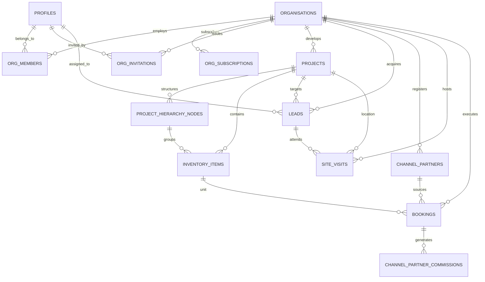

# BUSINESS RELATIONSHIP MAP
## PRODUCTION X — REAL ESTATE GROWTH OS

**Document ID:** `UX-RELMAP-001`  
**Phase:** Phase 1: Complete Application Audit (Investigation & Architecture Only)  
**Date:** 2026-11-15  
**Auditor:** Antigravity Agent  
**Scope:** Structural mapping of organisations, channel partners, employees, projects, and leads based on the actual database schema and application code.

---

## 1. High-Level Entity Relationship Architecture



---

## 2. Core Business Relationships

### 2.1 Developers vs Channel Partners

The database and application currently feature two disconnected concepts of "Channel Partner":

#### Model A: Organisation-Level Type (`organisations.type`)
- Defined in `supabase/migrations/20260001_enums.sql` as `CREATE TYPE org_type AS ENUM ('developer', 'channel_partner')`.
- When an agency registers at `/register` and selects "Channel Partner", an organisation row is created with `type = 'channel_partner'`.
- **Current Behavior:** This organisation operates in complete isolation. It has its own empty projects, empty inventory, and empty leads.
- **Architectural Disconnect:** There is currently **no foreign key, subscription, or cross-tenant sharing mechanism** connecting a Channel Partner organisation to a Developer organisation.

#### Model B: Developer-Owned Channel Partner Directory (`channel_partners`)
- Defined in `supabase/migrations/20260023_sales_and_channel_partners.sql`.
- Table `channel_partners` has `org_id UUID REFERENCES organisations(id)`.
- **Current Behavior:** A developer registers external brokers as flat contact rows within their workspace (Firm Name, RERA Number, Contact Person, Phone, Tier, Default Commission Rate).
- When a booking is recorded (`bookings`), it links to `channel_partner_id`.
- **Architectural Disconnect:** The broker registered in `channel_partners` has **no user account, no login credentials, and no portal access**. They cannot view real-time inventory availability or submit leads directly.

### 2.2 Employee & Management Hierarchy

The application structures internal personnel through `org_members`:
```
auth.users (Supabase Auth)
    └── profiles (Global user identity: full_name, avatar, phone)
            └── org_members (Workspace membership: org_id, role, joined_at)
```

#### Roles in Practice:
- **`owner`:** The original workspace creator. Complete administrative control.
- **`admin`:** Executive / Director level. Full CRUD across all entities and settings.
- **`manager`:** Sales Manager / Team Lead. Can create/update projects, manage inventory, reassign leads, and schedule visits. Cannot delete projects or alter org settings.
- **`sales_exec`:** Sales Representative / Closing Agent. Intended to manage their own assigned leads, log activities, and update pipeline stages.
- **`readonly`:** Financial auditor / external observer. View-only access across all records.

#### Manager-to-Executive Relationship:
- Currently, **all managers manage all sales executives** across the entire organization.
- There is no sub-team entity (e.g. "North Tower Sales Team" or "Luxury Villa Team").
- There is no reporting hierarchy where specific executives report to specific managers.

### 2.3 Project Access & Scoping Relationships

- **Current Implementation:** All projects (`projects`) belong directly to an organization (`org_id`).
- **Access Rule:** Every active member of the organization (`org_members`) has full read access to **every project** in that organization.
- **Current Limitation:** There is **no project-level assignment table** (e.g. `project_members`). A developer cannot restrict a junior sales executive to only Project A while hiding Project B.

### 2.4 Lead Ownership & Assignment Relationships

- A lead (`leads`) belongs to an organization (`org_id`) and optionally references a target project (`project_id`).
- A lead can have an assigned owner: `assigned_to REFERENCES profiles(id)`.
- **Automatic Assignment Engine (`supabase/migrations/20260008_auto_assign.sql`):**
  - Trigger `trigger_auto_assign_lead` fires on `BEFORE INSERT ON leads`.
  - If `NEW.assigned_to IS NULL`, it finds the `sales_exec` in that `org_id` with the fewest open leads (`status NOT IN ('booked', 'lost', 'junk')`).
  - **Limitation:** The trigger allocates leads across the entire company pool without evaluating the lead's `project_id`. An executive specializing in commercial plots will receive leads for high-end luxury penthouses.
- **Manual Assignment (`app/api/leads/assign/route.ts`):**
  - Restricted to `['owner', 'admin', 'manager']`.
  - Reassignment writes an audit activity to `lead_activities`.

### 2.5 Subscription & Seat Entitlement Architecture

In accordance with the approved commercial SaaS model:
- **Organisation-Controlled Scope:** Subscriptions are attached to organizations (`organisations`), not individual users. Both Developer Organisations and Channel Partner Organisations maintain independent subscriptions and seat allocations.
- **Seat Accounting Model:**
  - `Included Seats`: Defined by plan tier (configurable; not hardcoded).
  - `Additional Purchased Seats`: Add-on seats acquired by the organization.
  - `Total Seat Allowance` = `Included Seats` + `Additional Purchased Seats`.
  - `Occupied Seats` = Count of active members (`org_members.status = 'active'`).
  - `Reserved Seats` = Count of valid pending invitations (`org_invitations.status = 'pending' AND expires_at > now()`).
  - `Available Seats` = `Total Seat Allowance` - (`Occupied Seats` + `Reserved Seats`).
- **Internal Member Enforcement:** All internal organization roles (`owner`, `admin`, `manager`, `sales_exec`, `readonly`) consume 1 seat.
- **Multiple Organisation Independence:** If a user belongs to multiple organizations, each organization accounts for that user's seat independently against its own subscription pool.
- **Seat Limit Enforcement:** When `Available Seats <= 0`, new invitations are strictly blocked at both the API and UI layers, routing administrators to plan upgrades or additional seat purchases.

---

## 3. Structural Capability Assessment

| Business Requirement | Supported Today? | Architectural Mechanism | Identified Limitation |
| :--- | :---: | :--- | :--- |
| **Subscription-controlled organization provisioning** | **Staged** | Platform Administrator onboarding and customer provisioning. | Replaces arbitrary public registration (`/register`). |
| **Employee invitations & seat reservations** | **Staged** | `org_invitations` table with cryptographically secure tokens. | Joining links to existing org; pending invites reserve seats. |
| **Strict subscription seat limits** | **Staged** | Server DAL seat calculator (`active + pending <= total`). | Enforced at API layer; blocks over-allocation. |
| **Safe employee deactivation & lead retention** | **Staged** | `org_members.status = 'deactivated'` + explicit lead reassignment. | Preserves historical activities and prevents orphaned leads. |
| **One developer working with multiple channel partners** | **Partial** | Developer registers multiple rows in `public.channel_partners`. | Purely a static directory. Brokers have no login access or live inventory portal. |
| **One channel partner working with multiple developers** | **No** | None. | CP organisations cannot subscribe to or link with external developer workspaces. |
| **Multiple projects under each developer** | **Yes** | `projects.org_id REFERENCES organisations(id)`. | Fully supported across all 5 property categories. |
| **Multiple managers and sales executives** | **Yes** | `org_members` many-to-many relationship with role enum. | Fully supported; dynamic role verification. |
| **Project-level access restrictions** | **No** | None. All members see all projects. | No project-to-user scoping table exists. |
| **Users belonging to multiple organisations** | **Yes** | `org_members` supports multiple rows per `profile_id`. | Verified server-side; interactive workspace switcher active. |
| **Employee removal & responsibility reassignment** | **Staged** | Formal deactivation modal with batch lead reassignment. | Preserves historical data with full audit trail. |

---

## 4. Key Architectural Recommendations for Future Phases

1. **Subscription & User Provisioning Engine:**
   - Deploy `org_subscriptions` and `org_invitations` to enforce seat limits and invite-only employee onboarding.
   - Restrict public `/register` so arbitrary users cannot spawn uncontrolled organisations.
2. **Unify Channel Partner Model:**
   - Allow a developer to "invite" an external Channel Partner by generating an authenticated partner link.
   - When a broker logs into their CP Workspace, establish a secure syndication link allowing them to browse authorized projects/collateral and register buyer referrals without direct access to developer internal CRM records.
3. **Project Scoping Layer:**
   - Introduce an optional `project_assignments` mapping (`project_id`, `profile_id`, `role`) so enterprise developers can restrict visibility by development site.
4. **Project-Aware Lead Distribution:**
   - Upgrade the auto-assignment trigger to filter sales executives assigned to the specific `project_id` associated with the incoming lead.
