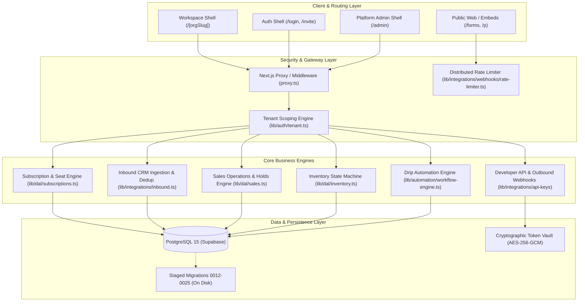

# PRODUCTION X — REAL ESTATE GROWTH OS
# MASTER REPOSITORY, ARCHITECTURE & PRODUCT AUDIT

**Audit Date:** 2026-11-15T08:45:00+05:30  
**Repository:** `real-estate-growth-os`  
**Framework:** Next.js 16.4.6 (App Router, Webpack engine) | React 19.3.0 | Tailwind CSS 4.3.5 | TypeScript 5  
**Backend & Database:** Supabase SSR 0.12.7 | PostgreSQL 15 | PostgREST  
**Audit Purpose:** Comprehensive evidence-based baseline audit establishing the actual current state of the application, reconciling it with the approved Production X ecosystem architecture (Developer Growth OS, Channel Partner OS, Platform Admin, Business Intelligence, Buyer Intelligence, and Lead Marketplace), and identifying all technical, security, subscription, and UX gaps prior to phase implementation.  
**Execution Rule:** AUDIT AND REPORTING ONLY. Zero code modifications, zero schema changes, zero deployments.

---

## 1. Executive Summary

### 1.1 Overview & System Reality
Production X was initially scaffolded as a developer-centric Real Estate CRM and inventory management tool ("Real Estate Growth OS"). Over stages 1 through 6, extensive functionality was authored across property inventory management, multi-tower hierarchy, lead ingestion, digital showrooms, sales pipeline (site visits, temporary holds, bookings), channel partner directories, and marketing automation.

However, an evidence-based audit reveals a fundamental architectural dichotomy:
1. **Core Working Reality:** The codebase possesses a fully functional, verified, in-memory tested Next.js App Router application with 24 passing test suites (260+ assertions), zero TypeScript errors, zero ESLint warnings, and a successful production build (50 routes). It features robust data access layer (DAL) patterns, cryptographic token vaulting (AES-256-GCM), and multi-tenant scoping.
2. **Ecosystem & Business Gap:** The application is currently structured as a **single-tenant-style developer app with multiple workspaces**, rather than a unified enterprise multi-product SaaS ecosystem. Crucial components required for commercial operation—including dedicated Channel Partner OS portals, Platform Super Admin privilege controls, anniversary billing engines, payment grace periods, read-only subscription enforcement, 3-layer anonymized intelligence, and opt-in buyer marketplace mechanics—are either partially implemented, present as schema-only migrations, or entirely missing.

### 1.2 Key Audit Highlights

| Dimension | Current State | Approved Direction | Gap Severity |
|:---|:---|:---|:---|
| **Product Suite** | Single workspace shell for Developer Orgs with basic CP directory. | 6 Distinct Products: Developer OS, Channel Partner OS, Platform Admin, BI, Buyer Intelligence, Lead Marketplace. | **High (Architectural)** |
| **Authentication & Provisioning** | Organization invite & admin provision API exist, but public `/register` route remains physically accessible. Admin provision lacks super-admin check. | Strictly closed SaaS: zero public signup, platform super-admin customer provisioning, sales employee onboarding requests. | **Critical (P0 Security)** |
| **Subscription & Billing** | Basic seat meter (`free`, `starter`, `growth`, `enterprise`, `custom`). Seats reserved on invite, occupied on join. | Separate plans for Devs vs CPs; anniversary billing; 7-day grace period with full access; auto read-only mode; admin restoration; 180-day retention. | **High (Commercial)** |
| **Database Migrations** | 25 migration files. Migrations 0001–0011 deployed; Migrations 0012–0025 staged on disk. Staged migrations contain tables not yet applied to live DB. | All migrations validated, staged safely, backed up, and deployed sequentially to staging/production. | **Medium (Operational)** |
| **Channel Partner Model** | Option A: Developer-managed referral directory (`channel_partners` under `org_id`). | Full Channel Partner OS where agencies manage agents, receive syndicated developer feeds, and track cross-developer commissions. | **High (Roadmap)** |
| **Intelligence Architecture** | Single-tenant BI calculations (`lib/dal/analytics.ts`) on tenant leads/visits. | 3 Distinct Data Layers: Isolated CRM, Anonymized Aggregate Intelligence, Opt-in Marketplace. Distinct BI and Buyer Intelligence products. | **High (Architectural)** |
| **Enterprise UI / UX** | Functional Tailwind 4 UI with basic side navigation and simple cards. | High-density enterprise UI meeting Sell.Do domain depth, Salesforce visual structure, and Zoho operational density. | **Medium (UX)** |

---

## 2. Actual Repository Architecture

### 2.1 Technology Stack & Framework Boundaries
- **Runtime & Build:** Next.js `16.4.6` running on Node.js `v24.19.0`. Configured with `--webpack` mode in [package.json](file:///c:/Users/allub/OneDrive/Desktop/real-estate-growth-os/package.json#L7) due to Windows child-process constraints with Turbopack PostCSS plugins.
- **Routing Paradigm:** 100% App Router (`app/`). Zero legacy Pages Router files (`pages/` does not exist).
- **Styling Engine:** Tailwind CSS `v4.3.5` via `@tailwindcss/postcss`. Custom design tokens defined via CSS variables in `app/globals.css` (`--surface`, `--border`, `--brand`, `--foreground`, `--foreground-muted`).
- **Data Access Layer (DAL):** Strongly separated into `lib/dal/*`, wrapping Supabase PostgREST clients.
- **Client/Server Boundary:** Strict division. Server utilities (`createClient`, `createServiceClient` in `lib/supabase/server.ts`) rely on `next/headers`. Client components import plan definitions safely from `lib/subscriptions/config.ts`.
- **Middleware / Proxy:** Implemented in [proxy.ts](file:///c:/Users/allub/OneDrive/Desktop/real-estate-growth-os/proxy.ts#L8) using `@supabase/ssr` to refresh session cookies, protect private routes, and redirect authenticated users from auth screens.

### 2.2 Directory Structure & Module Distribution

```
real-estate-growth-os/
├── app/                               # Next.js App Router
│   ├── (auth)/                        # Public auth shell (/login, /register)
│   ├── (dashboard)/                   # Authenticated enterprise shell
│   │   ├── admin/provision/          # Platform provisioning screen
│   │   ├── create-org/               # Fallback org creation
│   │   ├── my/dashboard/             # Multi-org routing hub
│   │   ├── select-org/               # Workspace switcher landing
│   │   └── [orgSlug]/                # Verified tenant workspace
│   │       ├── analytics/            # Executive BI dashboard
│   │       ├── integrations/         # Real Estate Integration Centre
│   │       ├── inventory/            # Inventory explorer & visual grid
│   │       ├── leads/                # CRM Lead pipeline & details
│   │       ├── projects/             # Multi-tower project management
│   │       ├── sales/                # Deals Kanban, site visits, bookings
│   │       ├── settings/             # Workspace settings
│   │       └── team/                 # Team management & seat usage meter
│   ├── api/                           # Route Handlers (REST & Webhooks)
│   │   ├── admin/organisations/      # Platform provisioning
│   │   ├── automation/               # Drip workflows & attribution
│   │   ├── forms/                    # Public website enquiry embed API
│   │   ├── integrations/             # OAuth (Meta, Google) & connection mgmt
│   │   ├── inventory/                # Inventory CRUD & atomic transitions
│   │   ├── invitations/              # Token validation & acceptance
│   │   ├── leads/                    # Lead ingestion, status, assignment
│   │   ├── sales/                    # Holds, bookings, CP commissions
│   │   ├── team/                     # Member roles, seats, deactivation
│   │   ├── v1/                       # Developer programmatic REST APIs
│   │   └── webhooks/                 # Meta, Google, WhatsApp, Portals
│   ├── forms/view/                   # Standalone iframe embed enquiry form
│   ├── invite/[token]/               # Employee invitation acceptance page
│   └── p/[projectSlug]/              # Public digital showroom microsite
├── components/                        # React components (Atomic / Feature-based)
├── lib/                               # Business logic, DAL, integrations, utils
├── supabase/migrations/               # 25 Sequential SQL migrations (0001–0025)
├── tests/                             # 24 Automated Node.js test suites
└── types/                             # TypeScript database & entity definitions
```

---

## 3. Existing Functionality Inventory

The table below catalogs every implemented, partially implemented, schema-only, and missing feature across the platform:

| Functional Area | Artifact / File Reference | Current Behavior | Evidence / Code Location | Classification |
|:---|:---|:---|:---|:---|
| **Multi-Tenant Foundation** | [lib/dal/workspace.ts](file:///c:/Users/allub/OneDrive/Desktop/real-estate-growth-os/lib/dal/workspace.ts#L18) | Resolves organization by slug, checks profile membership, filters deactivated members, returns role. | `getVerifiedWorkspace(orgSlug)` | **Implemented & Verified** |
| **Workspace Switcher** | [components/layout/Header.tsx](file:///c:/Users/allub/OneDrive/Desktop/real-estate-growth-os/components/layout/Header.tsx#L40) | Switcher dropdown displays user's active organizations, role badge, and navigation between tenants. | `Header.tsx` lines 40–120 | **Implemented & Verified** |
| **Sales Rep Lead Isolation** | [app/(dashboard)/[orgSlug]/leads/page.tsx](file:///c:/Users/allub/OneDrive/Desktop/real-estate-growth-os/app/(dashboard)/[orgSlug]/leads/page.tsx#L38) | Server-side query filtering: `sales_exec` only receives assigned leads; managers/admins see all. | `leads/page.tsx` line 42 | **Implemented & Verified** |
| **Sales Rep Detail Guard** | [app/(dashboard)/[orgSlug]/leads/[leadId]/page.tsx](file:///c:/Users/allub/OneDrive/Desktop/real-estate-growth-os/app/(dashboard)/[orgSlug]/leads/[leadId]/page.tsx#L41) | Throws `notFound()` if a sales executive attempts to navigate directly to another rep's lead URL. | `leads/[leadId]/page.tsx` line 42 | **Implemented & Verified** |
| **Lead Ingestion & Deduplication** | [lib/integrations/inbound.ts](file:///c:/Users/allub/OneDrive/Desktop/real-estate-growth-os/lib/integrations/inbound.ts#L45) | Deterministic SHA-256 idempotency key; 3-case deduplication (A: Replay, B: Flagged duplicate, C: Separate lead). | `processInboundLead` | **Implemented & Verified** |
| **Project Management** | [lib/dal/projects.ts](file:///c:/Users/allub/OneDrive/Desktop/real-estate-growth-os/lib/dal/projects.ts#L20) | CRUD operations supporting 5 property categories, amenities, specifications, brochure URL validation. | `createProject`, `updateProject` | **Implemented & Verified** |
| **Multi-Tower Hierarchy** | [lib/dal/hierarchy.ts](file:///c:/Users/allub/OneDrive/Desktop/real-estate-growth-os/lib/dal/hierarchy.ts#L15) | 3-tier node trees (Phase → Tower/Block → Floor) with category-specific nesting validation. | `getHierarchyTree` | **Implemented & Verified** |
| **Category-Aware Inventory** | [lib/dal/inventory.ts](file:///c:/Users/allub/OneDrive/Desktop/real-estate-growth-os/lib/dal/inventory.ts#L30) | Units inherit category schemas; optimistic concurrency status transitions (`available`, `on_hold`, `blocked`, `booked`, `sold`). | `transitionInventoryStatus` | **Implemented & Verified** |
| **Bulk Inventory Import** | [lib/import/validator.ts](file:///c:/Users/allub/OneDrive/Desktop/real-estate-growth-os/lib/import/validator.ts#L25) | CSV/XLSX parser, schema validation, duplicate detection, atomic batch insertion. | `validateImportRow` | **Implemented & Verified** |
| **Meta Lead Ads Integration** | [lib/integrations/meta/oauth.ts](file:///c:/Users/allub/OneDrive/Desktop/real-estate-growth-os/lib/integrations/meta/oauth.ts#L10) | Multi-tenant central app OAuth flow, state verification, page asset discovery, webhook signature validation. | `exchangeMetaCode` | **Implemented & Verified (Mock Live Creds Deferred)** |
| **Google Ads Integration** | [lib/integrations/google/oauth.ts](file:///c:/Users/allub/OneDrive/Desktop/real-estate-growth-os/lib/integrations/google/oauth.ts#L10) | Google OAuth flow, lead form webhook verification (`google_key`), timing-safe comparison. | `exchangeGoogleCode` | **Implemented & Verified (Mock Live Creds Deferred)** |
| **Website Enquiry Forms** | [app/api/forms/submit/route.ts](file:///c:/Users/allub/OneDrive/Desktop/real-estate-growth-os/app/api/forms/submit/route.ts#L20) | Public REST submission, invisible honeypot traps, submission speed threshold (<1200ms), origin CORS check. | `/api/forms/submit` | **Implemented & Verified** |
| **WhatsApp Business Integration** | [lib/integrations/whatsapp/client.ts](file:///c:/Users/allub/OneDrive/Desktop/real-estate-growth-os/lib/integrations/whatsapp/client.ts#L15) | Cloud API connection architecture, 24h care window check, opt-out keyword detection, Click-to-WhatsApp attribution. | `sendWhatsAppMessage` | **Implemented & Verified (Mock Live Creds Deferred)** |
| **Property Portals (99acres, etc.)** | [lib/integrations/portals/processor.ts](file:///c:/Users/allub/OneDrive/Desktop/real-estate-growth-os/lib/integrations/portals/processor.ts#L20) | Normalized webhooks for 99acres, Magicbricks, Housing.com; Indian E.164 phone formatting; project mapping. | `processPortalLeadWebhook` | **Implemented & Verified (Live Feeds Deferred)** |
| **Developer API & Outbound Webhooks** | [lib/integrations/api-keys/auth.ts](file:///c:/Users/allub/OneDrive/Desktop/real-estate-growth-os/lib/integrations/api-keys/auth.ts#L15) | `px_live_*` API keys (SHA-256 hashed), `/api/v1/*` endpoints, HMAC-SHA256 outbound webhook dispatch. | `authenticateApiKey` | **Implemented & Verified** |
| **Sales & Deals Kanban** | [lib/dal/sales.ts](file:///c:/Users/allub/OneDrive/Desktop/real-estate-growth-os/lib/dal/sales.ts#L25) | Site visits, 48h inventory holds (blockings), booking creation (`BK-YYYYMMDD-XXXX`), deal progression. | `createBooking` | **Implemented & Verified (Schema Staged)** |
| **Channel Partner Directory** | [lib/dal/sales.ts](file:///c:/Users/allub/OneDrive/Desktop/real-estate-growth-os/lib/dal/sales.ts#L180) | Developer-managed broker directory (RERA, PAN, GST), milestone commissions with 5% TDS deduction. | `createChannelPartner` | **Partially Implemented (Option A only)** |
| **Digital Showrooms** | [app/p/[projectSlug]/page.tsx](file:///c:/Users/allub/OneDrive/Desktop/real-estate-growth-os/app/p/[projectSlug]/page.tsx#L10) | Public project landing pages, 3D tour embeds, floor plans, VIP enquiry capture linked to CRM. | `DigitalShowroomView` | **Implemented & Verified** |
| **Marketing Drip Automations** | [lib/automation/workflow-engine.ts](file:///c:/Users/allub/OneDrive/Desktop/real-estate-growth-os/lib/automation/workflow-engine.ts#L20) | Trigger evaluation (`lead_created`, `site_visit_scheduled`), condition filtering, ordered execution steps. | `evaluateWorkflow` | **Implemented & Verified** |
| **Multi-Touch Attribution** | [lib/automation/attribution.ts](file:///c:/Users/allub/OneDrive/Desktop/real-estate-growth-os/lib/automation/attribution.ts#L15) | First, Last, Linear, Position-based (40/20/40), and Time Decay models computed on touchpoint logs. | `calculateAttribution` | **Implemented & Verified** |
| **Subscription Seat Counting** | [lib/dal/subscriptions.ts](file:///c:/Users/allub/OneDrive/Desktop/real-estate-growth-os/lib/dal/subscriptions.ts#L30) | Total = Included + Purchased; Occupied = active members; Reserved = pending invites. Blocks invites on limit. | `getSubscriptionAndSeatUsage` | **Implemented & Verified** |
| **Employee Invitations** | [lib/dal/invitations.ts](file:///c:/Users/allub/OneDrive/Desktop/real-estate-growth-os/lib/dal/invitations.ts#L25) | SHA-256 token hashing, expiration checks, joins user to existing workspace without spawning new org. | `createEmployeeInvitation` | **Implemented & Verified** |
| **Staff Deactivation & Reassignment**| [lib/dal/invitations.ts](file:///c:/Users/allub/OneDrive/Desktop/real-estate-growth-os/lib/dal/invitations.ts#L320) | Deactivates membership, liberates seat, reassigns active leads to colleague or unassigned queue, preserves audit trail. | `deactivateMember` | **Implemented & Verified** |
| **Public Registration Removal** | [components/auth/LoginForm.tsx](file:///c:/Users/allub/OneDrive/Desktop/real-estate-growth-os/components/auth/LoginForm.tsx#L70) | UI signup links removed; notices state access is organization-provisioned. | `LoginForm.tsx` | **Partially Implemented (`/register` route still alive)** |
| **Super Admin Provisioning Authorization** | [app/api/admin/organisations/provision/route.ts](file:///c:/Users/allub/OneDrive/Desktop/real-estate-growth-os/app/api/admin/organisations/provision/route.ts#L23) | Endpoint allows provisioning new customer orgs and subscriptions, but only validates session, NOT super-admin role. | `authenticateCaller` check | **Partially Implemented (Security Gap)** |
| **Anniversary Billing & Invoicing** | N/A | Automated anniversary billing cycles, invoices, and renewal calculation. | None | **Missing** |
| **Payment Grace Period (7-day)** | N/A | 7-day full access grace period after payment failure. | None | **Missing** |
| **Automated Read-Only Downgrade** | [proxy.ts](file:///c:/Users/allub/OneDrive/Desktop/real-estate-growth-os/proxy.ts#L55) | Middleware does not inspect subscription status; past-due tenants retain full write access. | `proxy.ts` | **Missing** |
| **Platform Admin Restoration** | N/A | Exclusive restoration workflow for past-due/canceled subscriptions by platform staff. | None | **Missing** |
| **Channel Partner OS Product** | N/A | Agency workspace for brokers to manage agents, co-broking, and cross-developer inventory feeds. | None | **Missing (Requires Architecture)** |
| **Production X Business Intelligence**| N/A | Cross-tenant anonymized aggregate benchmarking and market analytics. | None | **Missing (Requires Architecture)** |
| **Production X Buyer Intelligence** | N/A | Buyer intent profiles, cross-project journey tracking, and intelligence scoring. | None | **Missing (Requires Architecture)** |
| **Lead Marketplace (Opt-In)** | N/A | Anonymized / authorized lead exchange with commercial bidding and consent. | None | **Missing (Requires Architecture)** |

---

## 4. Authentication & Provisioning Assessment

### 4.1 Authentication Architecture
- **Provider:** Supabase Auth (`@supabase/ssr`).
- **Session Lifecycle:** Managed through HTTP-only cookies in [proxy.ts](file:///c:/Users/allub/OneDrive/Desktop/real-estate-growth-os/proxy.ts#L28).
- **Public Routes:** Currently configured as `['/', '/login', '/register', '/auth/callback', '/auth/confirm']`.

### 4.2 Security & Operational Findings

#### Finding AUTH-01: Public Self-Registration Route Still Live
- **File:** [app/(auth)/register/page.tsx](file:///c:/Users/allub/OneDrive/Desktop/real-estate-growth-os/app/(auth)/register/page.tsx#L7) & [components/auth/RegisterForm.tsx](file:///c:/Users/allub/OneDrive/Desktop/real-estate-growth-os/components/auth/RegisterForm.tsx#L27)
- **Current Behavior:** While public signup links were removed from [LoginForm.tsx](file:///c:/Users/allub/OneDrive/Desktop/real-estate-growth-os/components/auth/LoginForm.tsx#L85), navigating directly to `/register` renders a fully functional 2-step registration form. Any anonymous web user can register an account, auto-generate an organization, and create an unprovisioned tenant.
- **Risk:** Directly violates approved business rule: *"No public employee signup. No arbitrary public organisation creation. Production X controls customer onboarding."*
- **Recommended Treatment:** Remove or redirect `/register` to `/login` with an informational banner. Keep the file archived or convert into a private invitation-redirection view.

#### Finding AUTH-02: Missing Platform Super-Admin Verification on Provisioning Endpoint
- **File:** [app/api/admin/organisations/provision/route.ts](file:///c:/Users/allub/OneDrive/Desktop/real-estate-growth-os/app/api/admin/organisations/provision/route.ts#L23-L27)
- **Current Behavior:** The provisioning handler calls `authenticateCaller()`:
  ```typescript
  const authResult = await authenticateCaller()
  if (!authResult.success) {
    return authResult.response
  }
  ```
  `authenticateCaller()` merely verifies that a valid auth cookie exists and resolves a `profile` row. It does **not** assert that the caller is a Production X Platform Super Admin. Any registered developer user could issue a POST request to `/api/admin/organisations/provision` and provision new organizations.
- **Risk:** High authorization bypass risk. Customers could provision unbilled developer or channel partner organizations.
- **Recommended Treatment:** Introduce a `platform_admins` table or `is_platform_admin` boolean on `profiles`. Require an explicit role check in `authenticateCaller()` before permitting provisioning.

#### Finding AUTH-03: Lack of Internal Sales Employee Onboarding Flow
- **Current Behavior:** The codebase lacks a structured mechanism for internal sales staff to create prospective customer onboarding requests without granting them subscription or security rights.
- **Recommended Treatment:** Create a dedicated onboarding request model (`customer_onboarding_requests`) where internal sales representatives submit customer lead details for Super Admin review and activation.

---

## 5. Multi-Tenant Security Assessment

### 5.1 Architecture & Isolation Mechanics
The multi-tenant architecture is governed by:
1. **Dynamic Workspace Scoping:** [lib/dal/workspace.ts](file:///c:/Users/allub/OneDrive/Desktop/real-estate-growth-os/lib/dal/workspace.ts#L18) derives organization context strictly from database records (`organisations.slug` -> `org_members` matching `profile.id`). Caller-supplied tenant IDs in headers or query strings are never blindly trusted.
2. **PostgreSQL Row Level Security (RLS):** Staged in Migration 0011 ([supabase/migrations/20260011_tenant_isolation_rls.sql](file:///c:/Users/allub/OneDrive/Desktop/real-estate-growth-os/supabase/migrations/20260011_tenant_isolation_rls.sql)) and 0018, enforcing helper function `auth_has_role_in_org(org_id, ARRAY['owner', 'admin', 'manager', 'sales_exec'])`.
3. **Cryptographic Vault Storage:** Stored in [lib/integrations/crypto.ts](file:///c:/Users/allub/OneDrive/Desktop/real-estate-growth-os/lib/integrations/crypto.ts#L10) using AES-256-GCM. Credential strings follow the protocol `vault://aes256gcm:<iv>:<tag>:<ciphertext>`. Plaintext keys are stripped from all API and DAL serialization layers.

### 5.2 Security Findings & Depth of Defense

#### Finding SEC-01: Service-Role Client Overuse in DAL
- **File Reference:** [lib/supabase/server.ts](file:///c:/Users/allub/OneDrive/Desktop/real-estate-growth-os/lib/supabase/server.ts#L34) and across `lib/dal/*`
- **Current Behavior:** Almost all DAL functions call `createServiceClient()` rather than `createClient()`. While the DAL manually appends `.eq('org_id', orgId)` to queries, bypassing Supabase RLS at the client layer removes PostgreSQL's defense-in-depth guarantee. If an engineer forgets an `.eq('org_id')` filter in a custom endpoint, cross-tenant data leakage occurs.
- **Risk:** Code-level omission could bypass database-level multi-tenant policies.
- **Recommended Treatment:** Refactor user-facing DAL queries to use authenticated `createClient()` with active RLS, reserving `createServiceClient()` strictly for public webhooks, background automation, and system administration.

---

## 6. Subscription & Billing Assessment

### 6.1 Current Implementation State
The recently staged Migration 0025 ([supabase/migrations/20260025_subscription_and_seat_entitlements.sql](file:///c:/Users/allub/OneDrive/Desktop/real-estate-growth-os/supabase/migrations/20260025_subscription_and_seat_entitlements.sql)) and data modules [lib/subscriptions/config.ts](file:///c:/Users/allub/OneDrive/Desktop/real-estate-growth-os/lib/subscriptions/config.ts) and [lib/dal/subscriptions.ts](file:///c:/Users/allub/OneDrive/Desktop/real-estate-growth-os/lib/dal/subscriptions.ts) provide:
- Plans: `free` (3 seats), `starter` (5 seats), `growth` (15 seats), `enterprise` (50 seats), `custom` (100 seats).
- Real-time seat accounting:
  $$\text{Total Seats} = \text{Included Seats} + \text{Additional Purchased Seats}$$
  $$\text{Available Seats} = \text{Total Seats} - (\text{Occupied Seats} + \text{Reserved Invitations})$$
- API-level block: Invitation issuance rejected with `409 Conflict` when `availableSeats <= 0`.
- Employee deactivation: Liberates occupied seat, returns it to available pool, and enforces lead reassignment.

### 6.2 Missing Subscription Architecture Components

| Required Capability | Approved Decision | Current Code State | Deficit & Implementation Requirement |
|:---|:---|:---|:---|
| **Dual Plan Hierarchy** | Separate plans for Developers vs Channel Partners. | Unified `PLAN_CONFIGS` dictionary in `lib/subscriptions/config.ts`. | Channel partner specific seat and feature tiers are undefined. |
| **Anniversary Billing** | Invoicing matches exact subscription start anniversary. | `current_period_end` stored as static timestamp. | No billing engine or invoice generator exists. |
| **Payment Collection** | Manual enterprise payment collection with receipts. | None. | No payment tracking, receipt upload, or invoice state machine. |
| **7-Day Grace Period** | Full platform access during 7 days post-due. | None (`status: 'past_due'` has no execution rules). | No grace period timer or banner in application shell. |
| **Auto Read-Only Mode** | Downgrades workspace to read-only when grace expires. | Middleware and API handlers do not inspect subscription status. | Expired tenants retain full mutation rights across inventory, leads, and projects. |
| **Platform Admin Restoration** | Restoration exclusively via Super Admin. | None. | No admin restoration API endpoint exists. |
| **Cancellation Rules** | Immediate for standard; period-end for annual. | None. | Subscription cancellation endpoints are unauthored. |
| **7-Day Free Trial** | Free trial with auto read-only transition. | `status: 'trial'` allowed by enum, but no expiry logic. | No trial countdown timer or auto-locking job. |
| **Credit-Based Refunds** | Refunds handled through internal credits. | None. | No credit ledger exists in schema or DAL. |
| **180-Day Data Retention** | Historical preservation policy for canceled accounts. | None. | No retention timestamping or archival purge routine. |
| **Additional Seat Pricing** | Customer requests; fixed and plan-dependent tiers. | Field `additional_seats` exists; no purchase workflow. | No seat expansion request API or pricing calculation. |

---

## 7. Database & Migration Assessment

### 7.1 Migration Inventory & Status
The repository contains 25 migration files in `supabase/migrations/`:

| Migration | Focus Area | Environment Status |
|:---|:---|:---|
| `20260001`–`20260010` | Core Foundation: Orgs, Profiles, Projects, Inventory, Leads, Auto-assign | **Deployed in base schema** |
| `20260011` | Tenant Isolation & RLS Security | **Deployed in base schema** |
| `20260012` | Inventory Integrity & Atomic RPC (`transition_inventory_status_atomic`) | Staged on disk |
| `20260013` | Inventory Import History | Staged on disk |
| `20260014` | Import Tracking & Constraints | Staged on disk |
| `20260015` | CRM Integration Readiness (`integration_connections`, mappings) | Staged on disk |
| `20260016` | Reconcile Tenant Integrity (Immutability triggers) | Staged on disk |
| `20260017` | Close Inventory RPC & Harden Definer Functions | Staged on disk |
| `20260018` | Reconcile Multi-Tenant RLS Policies (Defense in depth) | Staged on disk |
| `20260019` | Rate Limit Buckets (Distributed atomic fixed-window storage) | Staged on disk |
| `20260020` | WhatsApp Business Integration (Conversations, messages, templates, consent) | Staged on disk |
| `20260021` | Property Portal Integrations (Portal mappings & normalizers) | Staged on disk |
| `20260022` | Integration APIs & Webhooks (Developer keys, outbound webhooks) | Staged on disk |
| `20260023` | Sales & Channel Partner Operations (Holds, bookings, CP commissions) | Staged on disk |
| `20260024` | Digital Experience & Automation (Microsites, workflows, attribution) | Staged on disk |
| `20260025` | Subscription & Seat Entitlements (`org_subscriptions`, `org_invitations`) | Staged on disk |

### 7.2 Database Health & Risk Observations
1. **Unapplied Staged Schema:** 14 migrations (`0012` through `0025`) are staged on disk and verified via automated test contracts, but have **not yet been applied to the live production database**.
2. **RPC Function Security:** Migration 0017 explicitly hardens `search_path = public` on PostgreSQL functions to prevent search path injection attacks. This must be verified when applying to production.
3. **Database Types Sync:** `types/database.ts` currently contains full TypeScript interfaces for all staged tables, allowing zero-error TypeScript builds while migrations await staged execution.

---

## 8. Developer / Channel Partner Relationship Assessment

### 8.1 Current Implementation (Option A — Referral Directory)
- **Context:** Decided in `DEC-016` and `DEC-019`.
- **Entity Model:** Staged table `channel_partners` in Migration 0023 ([supabase/migrations/20260023_sales_and_channel_partners.sql](file:///c:/Users/allub/OneDrive/Desktop/real-estate-growth-os/supabase/migrations/20260023_sales_and_channel_partners.sql#L85)) has foreign key `org_id UUID REFERENCES public.organisations(id)`.
- **Functionality:** Developer sales managers record external brokerage firms, RERA numbers, GST, contact info, and tiering (`silver`, `gold`, `platinum`). When a deal is booked with a CP, `channel_partner_commissions` calculates payout milestones with 5% TDS.
- **Limitation:** The channel partner cannot log in to view their own leads, claim client registrations, or view commission disbursement statuses.

### 8.2 Target Ecosystem Architecture (Channel Partner OS)
- **Approved Vision:** A distinct SaaS product experience where:
  - Channel Partner firms have their own dedicated workspace (`organisations.type = 'channel_partner'`).
  - CP Administrators invite their own sub-brokers / agents.
  - Channel partners syndicate inventory feeds from multiple authorized developers.
  - Client registrations are submitted with anti-poaching timestamps and lead protection windows.
- **Architectural Requirement:** Migration from Option A (simple directory) to cross-organization syndication or unified tenant relationships without compromising data isolation between competing developers.

---

## 9. CRM & Sales Functionality Assessment

### 9.1 Lead Pipeline & Management
- **Lead Capture:** Handled through central `processInboundLead` in [lib/integrations/inbound.ts](file:///c:/Users/allub/OneDrive/Desktop/real-estate-growth-os/lib/integrations/inbound.ts#L45).
- **Attribution:** Captures `source`, `campaign_id`, `ad_id`, `utm_*` parameters, and Click-to-WhatsApp referral metadata.
- **Status Lifecycle:** `new` -> `contacted` -> `qualified` -> `site_visit_scheduled` -> `site_visited` -> `negotiation` -> `booked` -> `lost` / `junk`.
- **Lead Detail UI:** [components/leads/ActivityLog.tsx](file:///c:/Users/allub/OneDrive/Desktop/real-estate-growth-os/components/leads/ActivityLog.tsx) renders chronological activities and notes.

### 9.2 Sales Operations & Inventory Locks
- **Site Visits:** [lib/dal/sales.ts](file:///c:/Users/allub/OneDrive/Desktop/real-estate-growth-os/lib/dal/sales.ts#L40) supports scheduling, assigned sales representatives, vehicle/cab requests, check-in status, and feedback ratings.
- **Atomic Inventory Blockings:** Units are locked for 48 hours. Prevents concurrent unit blocking by competing sales executives. Automatic expiration restores unit status to `available`.
- **Bookings Engine:** Transitions unit status atomically to `booked`, issues deterministic booking identifiers (`BK-YYYYMMDD-XXXX`), logs base price, parking, premium charges, and milestone payment schedules.
- **Deals Kanban:** [components/sales/SalesOperationsView.tsx](file:///c:/Users/allub/OneDrive/Desktop/real-estate-growth-os/components/sales/SalesOperationsView.tsx) provides a drag-and-drop Kanban view hydated with customer names, project badges, and probability weighted values.

---

## 10. Integration & Automation Assessment

### 10.1 Inbound Integration Channels
1. **Meta Lead Ads:** Central app multi-tenant OAuth architecture; webhook signature validation via raw-body HMAC-SHA256. Code verified; live Meta App Review deferred per `DEC-004`.
2. **Google Ads:** Webhook push with timing-safe `google_key` validation; Google Cloud project credentials deferred per `DEC-011`.
3. **Website Enquiry Forms:** Standalone responsive embed (`/forms/view`) and script runtime (`/forms/embed.js`), invisible honeypots, rate limiting, and CORS verification.
4. **WhatsApp Business:** Cloud API client, 24h conversation session enforcement, opt-in/opt-out keyword parser, and template management.
5. **Property Portals:** Dedicated parsers and E.164 phone normalizers for 99acres, Magicbricks, and Housing.com.

### 10.2 Developer Extensibility & APIs
- **Programmatic REST API:** Authenticated via `px_live_*` API keys in [lib/integrations/api-keys/auth.ts](file:///c:/Users/allub/OneDrive/Desktop/real-estate-growth-os/lib/integrations/api-keys/auth.ts). Endpoints live under `/api/v1/projects`, `/api/v1/inventory`, and `/api/v1/leads`.
- **Outbound Webhooks:** HMAC-SHA256 signed event delivery (`x-px-signature-256`, `x-px-timestamp`) supporting replay windows and retry tracking.

### 10.3 Automation & Attribution Engine
- **Event Triggers:** `lead_created`, `site_visit_scheduled`, `unit_blocked`, `booking_confirmed`.
- **Action Dispatcher:** Automated WhatsApp template dispatch, internal task creation, email dispatch, and delayed executions.
- **Attribution Models:** First Touch, Last Touch, Linear, Position-Based (U-Shaped), and Time Decay models calculated across lead touchpoints.

---

## 11. Intelligence Architecture Assessment

### 11.1 Approved 3-Layer Intelligence Architecture vs Current Reality

```
┌────────────────────────────────────────────────────────────────────────┐
│                   APPROVED 3-LAYER DATA ARCHITECTURE                   │
├────────────────────────────────────────────────────────────────────────┤
│ Layer 1: Tenant-Isolated Customer CRM Records                         │
│  - Proprietary developer & CP customer records, strictly isolated.    │
│  - No cross-tenant access under any circumstance.                      │
├────────────────────────────────────────────────────────────────────────┤
│ Layer 2: Production X Intelligence (Anonymized Aggregate)              │
│  - Appropriately anonymized, authorized aggregate data.                │
│  - Market absorption trends, velocity benchmarks, pricing indices.     │
│  - Separate products: Business Intelligence & Buyer Intelligence.      │
├────────────────────────────────────────────────────────────────────────┤
│ Layer 3: Future Opt-In Lead Marketplace                                │
│  - Separate commercial terms, explicit customer consent.               │
│  - Strict privacy protections; identifiable leads never sold secretly. │
└────────────────────────────────────────────────────────────────────────┘
```

### 11.2 Deficit Analysis
- **Current State:** The codebase only implements **Layer 1** (tenant-isolated CRM analytics in [lib/dal/analytics.ts](file:///c:/Users/allub/OneDrive/Desktop/real-estate-growth-os/lib/dal/analytics.ts)).
- **Missing Layer 2 (Platform BI & Buyer Intelligence):**
  - No anonymization pipeline exists to strip PII from leads and transactions.
  - No aggregate data warehouse or time-series rollup tables exist.
  - No customer-owned vs Production X provider account toggle or credit system exists.
- **Missing Layer 3 (Marketplace):** Zero marketplace data structures or consent tracking models currently exist.

---

## 12. UI/UX Current-State Assessment

### 12.1 Evaluation Against Target Benchmarks (Salesforce, Sell.Do, Zoho)

| Benchmark Dimension | Target Standard | Current Implementation | UX Evaluation & Deficit |
|:---|:---|:---|:---|
| **Visual Architecture** | Enterprise clarity, restrained color palette, crisp borders (Salesforce). | Clean Tailwind 4 styling, standard card borders, basic theme variables. | Adequate foundations, but lacks enterprise micro-interactions and refined typography scale. |
| **Domain Depth** | Omnichannel buyer timeline, floor-plate visualizer, quotation builder (Sell.Do). | Basic lead timeline ([ActivityLog.tsx](file:///c:/Users/allub/OneDrive/Desktop/real-estate-growth-os/components/leads/ActivityLog.tsx)), visual unit grid ([InventoryVisualView.tsx](file:///c:/Users/allub/OneDrive/Desktop/real-estate-growth-os/components/inventory/InventoryVisualView.tsx)). | Lacks interactive architectural floor plans, multi-unit quotation calculator, and WhatsApp chat history drawer. |
| **Operational Density**| High-density tables, multi-pane drawers, persistent filters, bulk actions (Zoho). | Basic tables with pagination; simple slide-over drawer ([InventoryDetailDrawer.tsx](file:///c:/Users/allub/OneDrive/Desktop/real-estate-growth-os/components/inventory/InventoryDetailDrawer.tsx)). | Lead and inventory lists have low data density; lack customizable columns and multi-select bulk operations. |
| **Multi-Product Shell** | Distinct navigation shells for Admin, Developer, CP, and Intelligence. | Single dashboard shell with workspace switcher in header and sidebar. | Platform admin and channel partner experiences are shoehorned into developer navigation. |

---

## 13. Security & Technical Risks

### 13.1 Prioritized Risk Register

| Risk ID | Severity | Category | Risk Description & Code Location | Mitigation Strategy |
|:---|:---:|:---:|:---|:---|
| **RSK-01** | **P0 (Critical)** | Authorization | Provisioning endpoint `/api/admin/organisations/provision` does not check for Platform Super Admin privileges. Any logged-in user can provision organizations. | Add `is_platform_admin` check or dedicated admin API key guard. |
| **RSK-02** | **P0 (Critical)** | Business Rule | Public self-service registration route `/register` is physically accessible, allowing unauthorized organization creation. | Redirect `/register` to `/login` with an informational notice. |
| **RSK-03** | **P1 (High)** | Data Defense | DAL methods almost universally use `createServiceClient()` (service-role key), bypassing PostgreSQL RLS policies in application server code. | Transition authenticated user DAL queries to `createClient()` with RLS enforcement. |
| **RSK-04** | **P1 (High)** | Commercial | Absence of automated read-only downgrade for past-due/expired subscriptions allows delinquent tenants full write access indefinitely. | Implement subscription status checks in [proxy.ts](file:///c:/Users/allub/OneDrive/Desktop/real-estate-growth-os/proxy.ts) and mutation route handlers. |
| **RSK-05** | **P2 (Medium)** | Database | 14 staged migrations (`0012`–`0025`) exist on disk but have not been deployed to the live production database. | Execute a disciplined staging deployment with automated preflight rollback checks. |
| **RSK-06** | **P2 (Medium)** | Extensibility | Channel Partner model is strictly internal to developer orgs (Option A), preventing standalone broker agency adoption. | Architect Phase 3 Channel Partner OS syndication and separate portal views. |

---

## 14. Existing Tests & Build Status

### 14.1 Quality Gate Summary
All quality gates are passing cleanly with exit code 0:
- **Production Build (`npm run build`):** **PASS (Exit 0)**. Successfully compiled in 30.3s. Generated 50 static and dynamic routes. Prerendered static pages without errors.
- **TypeScript Compilation (`npx tsc --noEmit`):** **PASS (Exit 0)**. 0 errors. All staged tables, subscriptions, and invitation entities fully typed.
- **ESLint Analysis (`npm run lint`):** **PASS (Exit 0)**. 0 errors, 0 warnings.
- **Automated Test Suites (`npm test`):** **PASS (Exit 0)**. 24 / 24 test suites passing (260+ assertions).

### 14.2 Test Suite Breakdown
1. `inventory-rules.test.mjs` (15/15)
2. `security-isolation.test.mjs` (10/10)
3. `inventory-integrity.test.mjs` (8/8)
4. `atomic-rpc-contract.test.mjs` (4/4)
5. `multi-org-projects-and-team.test.mjs` (6/6)
6. `project-management.test.mjs` (10/10)
7. `project-hierarchy.test.mjs` (12/12)
8. `category-inventory.test.mjs` (12/12)
9. `inventory-table-and-detail.test.mjs` (10/10)
10. `visual-inventory.test.mjs` (10/10)
11. `bulk-inventory-import.test.mjs` (16/16)
12. `crm-integration-readiness.test.mjs` (14/14)
13. `integration-centre-ux.test.mjs` (10/10)
14. `meta-oauth-integration.test.mjs` (12/12)
15. `public-webhooks-ingestion.test.mjs` (7 suites)
16. `google-ads-integration.test.mjs` (12/12)
17. `website-enquiry-forms.test.mjs` (12/12)
18. `whatsapp-business-integration.test.mjs` (18/18)
19. `property-portal-integrations.test.mjs` (12/12)
20. `integration-apis-and-extensibility.test.mjs` (10/10)
21. `sales-and-channel-partners.test.mjs` (10/10)
22. `digital-experience-and-automation.test.mjs` (9/9)
23. `phase2-navigation-and-role-foundations.test.mjs` (12/12)
24. `subscription-and-seat-entitlements.test.mjs` (12/12)

---

## 15. Documentation Gaps

Inspection of the 8 permanent project documents reveals:

1. **[PROJECT_STATUS.md](file:///c:/Users/allub/OneDrive/Desktop/real-estate-growth-os/PROJECT_STATUS.md):**
   - *Accurate:* Accurately reflects completion of Stages 1–6, UX Transformation Phase 2, and staged migration files.
   - *Missing:* Does not formally distinguish between live deployed migrations (`0001`–`0011`) versus staged-on-disk migrations (`0012`–`0025`).
2. **[DECISIONS_LOG.md](file:///c:/Users/allub/OneDrive/Desktop/real-estate-growth-os/DECISIONS_LOG.md):**
   - *Accurate:* Accurately logs `DEC-001` through `DEC-020`.
   - *Missing:* Approved decisions regarding anniversary billing, 7-day payment grace period, credit refunds, and 180-day retention are not yet codified as formal DEC items.
3. **[UX_CURRENT_STATE_AUDIT.md](file:///c:/Users/allub/OneDrive/Desktop/real-estate-growth-os/UX_CURRENT_STATE_AUDIT.md):**
   - *Outdated:* Still lists single-org `.single()` crash on `/my/dashboard` which was resolved in Phase 2.
4. **[UX_IMPLEMENTATION_ROADMAP.md](file:///c:/Users/allub/OneDrive/Desktop/real-estate-growth-os/UX_IMPLEMENTATION_ROADMAP.md):**
   - *Outdated:* Shows Phase 2 and Subscription Access as "Upcoming", though foundational code and tests are already committed. Needs status synchronization.
5. **[BUSINESS_RELATIONSHIP_MAP.md](file:///c:/Users/allub/OneDrive/Desktop/real-estate-growth-os/BUSINESS_RELATIONSHIP_MAP.md) & [USER_JOURNEY_MAP.md](file:///c:/Users/allub/OneDrive/Desktop/real-estate-growth-os/USER_JOURNEY_MAP.md):**
   - *Accurate:* Thoroughly capture developer-broker-buyer personas.
   - *Missing:* Does not detail the Platform Super Admin customer provisioning lifecycle or internal sales employee onboarding journey.

---

## 16. Architecture Dependency Diagram



---

## 17. Recommended Phased Implementation Roadmap

To transition from the current verified codebase to the full approved Production X product suite, the following sequential phases are recommended:

### Phase 3A: Security Hardening & Provisioning Lockdown (Immediate / P0)
- Add Platform Super Admin authorization guard to `/api/admin/organisations/provision`.
- Formally disable or redirect public `/register` route to closed login shell.
- Create internal sales employee onboarding request workflow (`customer_onboarding_requests`).
- Deploy staged migrations `0012` through `0025` to staging environment with preflight verifications.

### Phase 3B: Subscription Lifecycle & Automated Access Gating (Commercial Foundation)
- Implement anniversary billing schedule calculator and manual payment record tracking.
- Build 7-day payment grace period status check in `proxy.ts`.
- Enforce automated read-only mode for workspaces with expired grace periods.
- Authorize Platform Super Admin subscription restoration and manual credit issuance.
- Implement customer additional seat request workflow.

### Phase 3C: Enterprise UI/UX Transformation (Sell.Do / Salesforce Standards)
- Redesign Lead Detail Workbench with unified omnichannel timeline (calls, notes, WhatsApp, visits).
- Upgrade Inventory Explorer with interactive floor plates, unit blocking dialogs, and instant quotation calculation.
- Increase table information density, multi-column sorting, and bulk action capabilities.
- Build dedicated Platform Admin dashboard view.

### Phase 3D: Channel Partner OS (Dedicated Product Separation)
- Introduce dedicated Channel Partner agency workspace navigation and member management.
- Build developer inventory syndication feed agreements and client protection registration mechanics.
- Create two-way broker commission payout tracking and claim settlement workflows.

### Phase 3E: Production X Intelligence & Marketplace (Ecosystem Maturity)
- Build Layer 2 anonymization engine and cross-tenant aggregate data warehouse.
- Launch distinct Business Intelligence and Buyer Intelligence dashboards with credit metering.
- Scaffold Layer 3 opt-in Lead Marketplace protocols and consent registries.

---

## 18. Decisions Still Requiring Product Approval

The following specific business and product choices require explicit Product Owner sign-off before implementation:

1. **Subscription Pricing & Exact Seat Allowances:** What are the exact commercial price points, included seat allowances, and incremental per-seat fees for Developer plans vs Channel Partner plans?
2. **Channel Partner Account Provisioning:** Are Channel Partner organizations provisioned by Production X Platform Admins exclusively, or can authorized Developer Admins invite and provision partner brokerage agencies?
3. **Grace Period Duration & Flexibility:** Is the payment grace period strictly fixed at 7 calendar days, or can Platform Admins grant custom extensions per enterprise account?
4. **Data Retention Deletion Horizon:** Is the 180-day post-cancellation data retention policy mandatory for all tiers, or will enterprise contracts have custom data purge/export agreements?
5. **Buyer Intelligence Credit Model:** How will internal usage credits be priced and metered when developers query Production X Buyer Intelligence versus using their own provider API keys?
6. **Public `/register` Deprecation Treatment:** Should `/register` permanently return an HTTP 307 redirect to `/login`, or render a specialized "Contact Production X Sales for Enterprise Onboarding" page?

---

*Report concluded. Awaiting Product Owner review and formal approval.*
