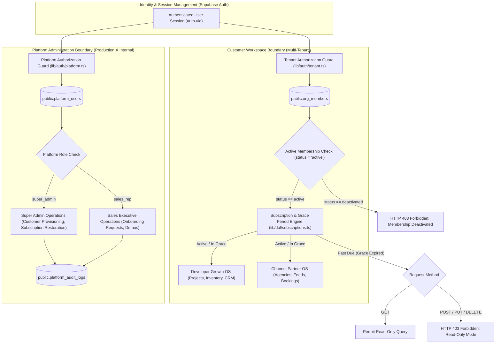
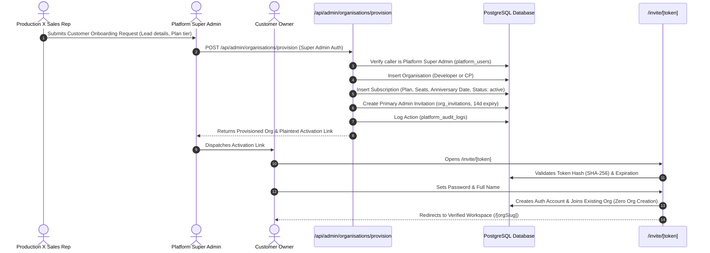

# PRODUCTION X — REAL ESTATE GROWTH OS
# SECURITY REMEDIATION BLUEPRINT & IMPLEMENTATION SEQUENCE

**Blueprint Date:** 2026-11-15T12:05:00+05:30  
**Target Codebase:** Production X Real Estate Growth OS (`real-estate-growth-os`)  
**Context:** Remediates Critical (P0) and High (P1) vulnerabilities identified in `PRODUCTION_X_SECURITY_VERIFICATION_REPORT.md` and fulfills the ecosystem architecture outlined in `PRODUCTION_X_MASTER_ARCHITECTURE_AUDIT.md`.  
**Execution Constraint:** READ-ONLY PLANNING ONLY. Zero code modifications, zero schema changes, zero database mutations, zero deployments.

---

## 1. Architecture Diagrams

### 1.1 Target Security & Privilege Architecture


### 1.2 Customer Provisioning & Invitation Sequence


---

## 2. Proposed Database Schema

To establish independent platform-level authorization, closed-SaaS onboarding, robust deactivation enforcement, and commercial subscription controls, four discrete schemas are specified. None of these modify historical migrations (`0001`–`0025`).

### 2.1 Platform Administration & Auditing Schema (Migration 0026)

```sql
-- 1. Platform Roles Enum
CREATE TYPE public.platform_role AS ENUM (
  'super_admin',
  'sales_rep',
  'finance_admin',
  'support_agent'
);

-- 2. Platform Staff Table (Strictly isolated from customer org_members)
CREATE TABLE public.platform_users (
  id UUID PRIMARY KEY DEFAULT gen_random_uuid(),
  user_id UUID NOT NULL UNIQUE REFERENCES auth.users(id) ON DELETE CASCADE,
  role public.platform_role NOT NULL,
  is_active BOOLEAN NOT NULL DEFAULT true,
  created_at TIMESTAMPTZ NOT NULL DEFAULT now(),
  updated_at TIMESTAMPTZ NOT NULL DEFAULT now()
);

CREATE INDEX idx_platform_users_user ON public.platform_users(user_id);
CREATE INDEX idx_platform_users_role ON public.platform_users(role, is_active);

-- 3. Platform Administration Audit Log
CREATE TABLE public.platform_audit_logs (
  id UUID PRIMARY KEY DEFAULT gen_random_uuid(),
  actor_user_id UUID NOT NULL REFERENCES auth.users(id) ON DELETE RESTRICT,
  actor_role public.platform_role NOT NULL,
  action TEXT NOT NULL,
  target_entity_type TEXT NOT NULL, -- 'organisation', 'subscription', 'platform_user'
  target_entity_id UUID NOT NULL,
  metadata JSONB NOT NULL DEFAULT '{}'::jsonb,
  ip_address TEXT,
  user_agent TEXT,
  created_at TIMESTAMPTZ NOT NULL DEFAULT now()
);

CREATE INDEX idx_platform_audit_logs_actor ON public.platform_audit_logs(actor_user_id);
CREATE INDEX idx_platform_audit_logs_entity ON public.platform_audit_logs(target_entity_type, target_entity_id);

-- 4. Enable RLS on Platform Tables
ALTER TABLE public.platform_users ENABLE ROW LEVEL SECURITY;
ALTER TABLE public.platform_audit_logs ENABLE ROW LEVEL SECURITY;

-- Security helper: Check platform role via security definer
CREATE OR REPLACE FUNCTION public.auth_is_platform_role(allowed_roles public.platform_role[])
RETURNS BOOLEAN AS $$
BEGIN
  RETURN EXISTS (
    SELECT 1 FROM public.platform_users
    WHERE user_id = auth.uid()
      AND is_active = true
      AND role = ANY(allowed_roles)
  );
END;
$$ LANGUAGE plpgsql SECURITY DEFINER STABLE;

-- RLS: Platform users can read platform_users; only super_admin can modify
CREATE POLICY "platform_users_read" ON public.platform_users
  FOR SELECT USING (public.auth_is_platform_role(ARRAY['super_admin'::public.platform_role, 'sales_rep'::public.platform_role, 'finance_admin'::public.platform_role, 'support_agent'::public.platform_role]));

CREATE POLICY "super_admin_manage_platform_users" ON public.platform_users
  FOR ALL USING (public.auth_is_platform_role(ARRAY['super_admin'::public.platform_role]));

CREATE POLICY "super_admin_read_audit_logs" ON public.platform_audit_logs
  FOR SELECT USING (public.auth_is_platform_role(ARRAY['super_admin'::public.platform_role, 'finance_admin'::public.platform_role]));
```

### 2.2 Customer Onboarding Requests Schema (Migration 0027)

```sql
-- Internal Sales Request Model for Customer Onboarding
CREATE TYPE public.onboarding_request_status AS ENUM (
  'pending_review',
  'approved',
  'provisioned',
  'rejected'
);

CREATE TABLE public.customer_onboarding_requests (
  id UUID PRIMARY KEY DEFAULT gen_random_uuid(),
  requested_by UUID NOT NULL REFERENCES auth.users(id) ON DELETE RESTRICT,
  company_name TEXT NOT NULL,
  company_type public.org_type NOT NULL,
  plan_tier TEXT NOT NULL DEFAULT 'growth',
  included_seats INTEGER NOT NULL DEFAULT 5,
  admin_email TEXT NOT NULL,
  admin_name TEXT NOT NULL,
  billing_cycle TEXT NOT NULL DEFAULT 'annual',
  status public.onboarding_request_status NOT NULL DEFAULT 'pending_review',
  approved_by UUID REFERENCES auth.users(id) ON DELETE SET NULL,
  provisioned_org_id UUID REFERENCES public.organisations(id) ON DELETE SET NULL,
  rejection_reason TEXT,
  notes TEXT,
  created_at TIMESTAMPTZ NOT NULL DEFAULT now(),
  updated_at TIMESTAMPTZ NOT NULL DEFAULT now()
);

CREATE INDEX idx_onboarding_requests_status ON public.customer_onboarding_requests(status);
ALTER TABLE public.customer_onboarding_requests ENABLE ROW LEVEL SECURITY;

-- Sales reps can create and read their own requests; Super Admin can manage all
CREATE POLICY "sales_reps_own_onboarding_requests" ON public.customer_onboarding_requests
  FOR ALL USING (
    requested_by = auth.uid() OR 
    public.auth_is_platform_role(ARRAY['super_admin'::public.platform_role])
  );
```

### 2.3 RLS Tenant Isolation Hardening (Migration 0028)

```sql
-- Update auth_has_role_in_org to explicitly reject deactivated members
CREATE OR REPLACE FUNCTION public.auth_has_role_in_org(
  target_org_id UUID,
  allowed_roles TEXT[]
)
RETURNS BOOLEAN AS $$
BEGIN
  RETURN EXISTS (
    SELECT 1 FROM public.org_members om
    JOIN public.profiles p ON p.id = om.profile_id
    WHERE om.org_id = target_org_id
      AND p.auth_user_id = auth.uid()
      AND om.role::text = ANY(allowed_roles)
      AND (om.status IS NULL OR om.status = 'active') -- CRITICAL DEACTIVATION FILTER
  );
END;
$$ LANGUAGE plpgsql SECURITY DEFINER STABLE;
```

### 2.4 Commercial Billing, Grace Periods & Credit Ledgers (Migration 0029)

```sql
-- 1. Subscription Commercial State Extension
ALTER TABLE public.org_subscriptions
  ADD COLUMN IF NOT EXISTS grace_period_ends_at TIMESTAMPTZ,
  ADD COLUMN IF NOT EXISTS is_read_only BOOLEAN NOT NULL DEFAULT false,
  ADD COLUMN IF NOT EXISTS canceled_at TIMESTAMPTZ,
  ADD COLUMN IF NOT EXISTS cancel_at_period_end BOOLEAN NOT NULL DEFAULT false,
  ADD COLUMN IF NOT EXISTS restored_at TIMESTAMPTZ,
  ADD COLUMN IF NOT EXISTS restored_by UUID REFERENCES auth.users(id) ON DELETE SET NULL;

CREATE INDEX IF NOT EXISTS idx_org_subscriptions_readonly ON public.org_subscriptions(is_read_only);

-- 2. Customer Credit Ledger (Refunds & Service Credits)
CREATE TABLE public.org_credit_ledger (
  id UUID PRIMARY KEY DEFAULT gen_random_uuid(),
  org_id UUID NOT NULL REFERENCES public.organisations(id) ON DELETE CASCADE,
  amount_cents BIGINT NOT NULL, -- In currency subunit (e.g. INR paise or USD cents)
  currency TEXT NOT NULL DEFAULT 'INR',
  reason TEXT NOT NULL,
  issued_by UUID NOT NULL REFERENCES auth.users(id) ON DELETE RESTRICT,
  expires_at TIMESTAMPTZ,
  created_at TIMESTAMPTZ NOT NULL DEFAULT now()
);

CREATE INDEX idx_credit_ledger_org ON public.org_credit_ledger(org_id);
ALTER TABLE public.org_credit_ledger ENABLE ROW LEVEL SECURITY;

CREATE POLICY "admins_read_credit_ledger" ON public.org_credit_ledger
  FOR SELECT USING (public.auth_has_role_in_org(org_id, ARRAY['owner', 'admin']));

-- 3. Additional Seat Expansion Requests
CREATE TYPE public.seat_request_status AS ENUM ('pending', 'approved', 'rejected', 'fulfilled');

CREATE TABLE public.seat_expansion_requests (
  id UUID PRIMARY KEY DEFAULT gen_random_uuid(),
  org_id UUID NOT NULL REFERENCES public.organisations(id) ON DELETE CASCADE,
  requested_by UUID NOT NULL REFERENCES public.profiles(id) ON DELETE RESTRICT,
  additional_seats_requested INTEGER NOT NULL CHECK (additional_seats_requested > 0),
  reason TEXT,
  status public.seat_request_status NOT NULL DEFAULT 'pending',
  reviewed_by UUID REFERENCES auth.users(id) ON DELETE SET NULL,
  created_at TIMESTAMPTZ NOT NULL DEFAULT now(),
  updated_at TIMESTAMPTZ NOT NULL DEFAULT now()
);

CREATE INDEX idx_seat_requests_org ON public.seat_expansion_requests(org_id, status);
ALTER TABLE public.seat_expansion_requests ENABLE ROW LEVEL SECURITY;

CREATE POLICY "org_admins_manage_seat_requests" ON public.seat_expansion_requests
  FOR ALL USING (public.auth_has_role_in_org(org_id, ARRAY['owner', 'admin']));
```

---

## 3. Authorisation Design & Code Contracts

### 3.1 Platform Authorization Module: `lib/auth/platform.ts`

```typescript
// lib/auth/platform.ts
import { NextResponse } from 'next/server'
import { createClient, createServiceClient } from '@/lib/supabase/server'

export type PlatformRole = 'super_admin' | 'sales_rep' | 'finance_admin' | 'support_agent'

export interface PlatformAuthContext {
  userId: string
  email: string
  role: PlatformRole
}

/**
 * Authenticates that the caller holds a valid session and is an active platform staff member.
 */
export async function authenticatePlatformAdmin(
  allowedRoles: PlatformRole[] = ['super_admin']
): Promise<
  | { success: true; context: PlatformAuthContext }
  | { success: false; response: NextResponse }
> {
  const supabase = await createClient()
  const { data: { user }, error } = await supabase.auth.getUser()

  if (error || !user) {
    return {
      success: false,
      response: NextResponse.json({ error: 'Unauthorised. Authentication required.' }, { status: 401 }),
    }
  }

  const service = createServiceClient()
  const { data: platformUser } = await service
    .from('platform_users')
    .select('role, is_active')
    .eq('user_id', user.id)
    .eq('is_active', true)
    .maybeSingle()

  if (!platformUser || !allowedRoles.includes(platformUser.role as PlatformRole)) {
    return {
      success: false,
      response: NextResponse.json(
        { error: 'Forbidden. Platform administrator privileges required.' },
        { status: 403 }
      ),
    }
  }

  return {
    success: true,
    context: {
      userId: user.id,
      email: user.email || '',
      role: platformUser.role as PlatformRole,
    },
  }
}

/**
 * Log auditable platform administrator actions.
 */
export async function logPlatformAction(params: {
  actorUserId: string
  actorRole: PlatformRole
  action: string
  targetEntityType: 'organisation' | 'subscription' | 'platform_user'
  targetEntityId: string
  metadata?: Record<string, unknown>
  req?: Request
}): Promise<void> {
  const service = createServiceClient()
  await service.from('platform_audit_logs').insert({
    actor_user_id: params.actorUserId,
    actor_role: params.actorRole,
    action: params.action,
    target_entity_type: params.targetEntityType,
    target_entity_id: params.targetEntityId,
    metadata: params.metadata || {},
    ip_address: params.req?.headers.get('x-forwarded-for') || null,
    user_agent: params.req?.headers.get('user-agent') || null,
  })
}
```

### 3.2 Secure Super Admin Initial Bootstrap
To prevent open registration or public privilege escalation:
1. **No Public Signup for Platform Users:** `platform_users` cannot be populated via any public API.
2. **Environment Variable Seed:** At initial system deployment, the environment configuration defines:
   ```
   INITIAL_SUPER_ADMIN_EMAIL=security-lead@productionx.com
   PLATFORM_BOOTSTRAP_SECRET=<64-char-cryptographic-secret>
   ```
3. **One-Time Bootstrap CLI / Script:** A standalone seed script (`scripts/bootstrap-super-admin.mjs`) connects directly using `SUPABASE_SERVICE_ROLE_KEY`, resolves the user's `auth.users` ID, inserts `role: 'super_admin'` into `platform_users`, and terminates. Once the initial Super Admin exists, all subsequent platform users are provisioned exclusively through the Super Admin UI, requiring two-factor authorization.

---

## 4. Closed-SaaS Provisioning Design

### 4.1 Decommissioning Strategy for Public Registration
1. **Proxy Gating (`proxy.ts`):**
   - Remove `/register` from `PUBLIC_ROUTES`.
   - Update middleware:
     ```typescript
     if (pathname === '/register') {
       const url = request.nextUrl.clone()
       url.pathname = '/login'
       url.searchParams.set('notice', 'closed_saas')
       return NextResponse.redirect(url)
     }
     ```
2. **Component & Page Deprecation:**
   - [app/(auth)/register/page.tsx](file:///c:/Users/allub/OneDrive/Desktop/real-estate-growth-os/app/(auth)/register/page.tsx): Replace content with an informational server component redirecting to `/login` with explanation.
   - [components/auth/RegisterForm.tsx](file:///c:/Users/allub/OneDrive/Desktop/real-estate-growth-os/components/auth/RegisterForm.tsx): Archive component; remove from client bundle.
3. **API Lockdown:**
   - [app/api/orgs/route.ts](file:///c:/Users/allub/OneDrive/Desktop/real-estate-growth-os/app/api/orgs/route.ts): Decommission `POST /api/orgs` for general users. Reject with `HTTP 403 Forbidden` (`{ error: 'Organisation creation is restricted to Production X onboarding.' }`).
   - Remove [app/(dashboard)/create-org/page.tsx](file:///c:/Users/allub/OneDrive/Desktop/real-estate-growth-os/app/(dashboard)/create-org/page.tsx) and navigation links in `Header.tsx`, `Sidebar.tsx`, and `select-org/page.tsx`.

### 4.2 Preserved User & Invitation Workflows
- **Existing User Sign-In:** [LoginForm.tsx](file:///c:/Users/allub/OneDrive/Desktop/real-estate-growth-os/components/auth/LoginForm.tsx) handles password authentication and session refresh with zero dependency on registration code.
- **Invited Employee Joining:** Handled exclusively via [app/invite/[token]/page.tsx](file:///c:/Users/allub/OneDrive/Desktop/real-estate-growth-os/app/invite/[token]/page.tsx) and [AcceptInviteForm.tsx](file:///c:/Users/allub/OneDrive/Desktop/real-estate-growth-os/components/auth/AcceptInviteForm.tsx). It binds the user directly to the inviting organization, consumes a reserved seat, and never creates a new organization.

---

## 5. Membership Deactivation Security Design

### 5.1 Enforcing Deactivation Across Server-Side Helpers

In [lib/auth/tenant.ts](file:///c:/Users/allub/OneDrive/Desktop/real-estate-growth-os/lib/auth/tenant.ts), update all 4 authorization functions:

```typescript
// Proposed update in lib/auth/tenant.ts: authorizeOrgAccess
const { data: membership } = await service
  .from('org_members')
  .select('role, status') // Include status column
  .eq('org_id', orgId)
  .eq('profile_id', auth.profile.id)
  .maybeSingle()

if (!membership) {
  return {
    success: false,
    response: NextResponse.json({ error: 'Forbidden. You do not belong to this organisation.' }, { status: 403 }),
  }
}

// CRITICAL REMEDIATION: Explicitly block deactivated memberships
if (membership.status === 'deactivated' || membership.status === 'suspended') {
  return {
    success: false,
    response: NextResponse.json(
      { error: 'Forbidden. Your membership in this organisation has been deactivated.' },
      { status: 403 }
    ),
  }
}
```

Apply the identical check in `authorizeProjectAccess`, `authorizeInventoryAccess`, and `authorizeLeadAccess`.

### 5.2 Multi-Organisation Independence & Session Handling
- **Multi-Tenant State:** When a user belongs to Org A (where they were deactivated) and Org B (where they remain active):
  - Their global Supabase auth session remains intact.
  - Queries for Org A return `403 Forbidden`.
  - Queries for Org B succeed normally.
  - In [lib/dal/workspace.ts](file:///c:/Users/allub/OneDrive/Desktop/real-estate-growth-os/lib/dal/workspace.ts#L43), `availableOrgs` only includes active memberships. If their currently selected workspace is deactivated, the application shell seamlessly redirects them to `/select-org` to access Org B.

### 5.3 Historical Record Preservation & Reassignment
- All past actions (`lead_activities`, `inventory_status_history`, notes) retain `actor_id` pointing to the deactivated member's `profile_id`.
- Reassignment of active leads occurs atomically inside `lib/dal/invitations.ts:deactivateMember`:
  - Active leads transferred to designated team member OR moved to unassigned queue.
  - Immutable audit note added: `"Lead reassigned due to team member deactivation."`

---

## 6. Tenant Isolation & Service-Role Usage Taxonomy

The table below provides a strict architectural classification of every database operation across the repository:

| Operation / Path | Current Client | Classification | Target Architectural Treatment |
|:---|:---|:---|:---|
| **Public Lead Webhooks** (`lib/integrations/inbound.ts`) | `createServiceClient()` | **Public Integration** | **Retain Service Client.** Webhooks arrive without user sessions. Tenant context derived strictly from verified connection ID. |
| **Website Form Embed API** (`/api/forms/submit`) | `createServiceClient()` | **Public Integration** | **Retain Service Client.** Anonymous visitors submit enquiries. Rate-limited and validated via connection mapping. |
| **Drip Automation Engine** (`lib/automation/workflow-engine.ts`) | `createServiceClient()` | **Background / System** | **Retain Service Client.** Executes asynchronous marketing jobs. Strictly scopes queries via `workflow.org_id`. |
| **Token Verification** (`lib/dal/invitations.ts:validateInvitationToken`) | `createServiceClient()` | **Public Integration** | **Retain Service Client.** Validates token hash before user has logged in. |
| **Platform Provisioning** (`/api/admin/organisations/provision`) | `createServiceClient()` | **Platform Operation** | **Retain Service Client with Super Admin Guard.** Requires `authenticatePlatformAdmin(['super_admin'])`. |
| **User Projects Query** (`lib/dal/projects.ts:getProjectsByOrg`) | `createServiceClient()` | **User-Scoped Access** | **Migrate to Authenticated Client.** User session exists; should query via `createClient()` with active RLS. |
| **User Inventory Query** (`lib/dal/inventory.ts:getInventoryItems`) | `createServiceClient()` | **User-Scoped Access** | **Migrate to Authenticated Client.** User session exists; query via `createClient()` with active RLS. |
| **User Lead Detail & Notes** (`/api/leads/[leadId]/notes`) | `createClient()` | **User-Scoped Access** | **Already Compliant.** Queries via user client with RLS active. |
| **Deals Pipeline Query** (`lib/dal/sales.ts:getDeals`) | `createServiceClient()` | **User-Scoped Access** | **Migrate to Authenticated Client.** Should execute under caller's Supabase client. |

---

## 7. Subscription Enforcement Architecture

### 7.1 Commercial Rules & States
- **Plans:**
  - Developer Plans: `developer_starter` (5 seats), `developer_growth` (15 seats), `developer_enterprise` (50 seats).
  - Channel Partner Plans: `cp_starter` (3 seats), `cp_pro` (10 seats), `cp_enterprise` (30 seats).
- **Billing Calendar:** Anniversary billing calculated from `current_period_start`.
- **Payment Collection:** Manual corporate wire/cheque collection; receipts recorded by Platform Super Admin.
- **7-Day Grace Period:** When renewal payment is pending (`status = 'past_due'`), tenant retains full read/write access for exactly 7 days from `current_period_end`.
- **Automatic Read-Only Mode:** At $T > \text{current\_period\_end} + 7\text{ days}$, `is_read_only` is set to `true`.
  - All `POST`, `PUT`, `PATCH`, and `DELETE` requests are rejected with `HTTP 403 Forbidden` (`{ error: 'Workspace is in read-only mode due to expired subscription.' }`).
  - All `GET` requests succeed normally.
- **Platform-Admin-Only Restoration:** Only Super Admin can restore account by logging receipt and calling `/api/admin/subscriptions/restore`.

### 7.2 Multi-Layer Server-Side Enforcement Matrix

| Enforcement Point | Component / File | Behavior When Past Grace Expiry |
|:---|:---|:---|
| **Middleware / Proxy** | [proxy.ts](file:///c:/Users/allub/OneDrive/Desktop/real-estate-growth-os/proxy.ts) | Inspects cached subscription state. For mutation methods on `/[orgSlug]/*`, immediately aborts with 403 before invoking route handlers. |
| **Tenant Authorization** | [lib/auth/tenant.ts](file:///c:/Users/allub/OneDrive/Desktop/real-estate-growth-os/lib/auth/tenant.ts) | In `authorizeOrgAccess`, non-GET requests assert `!subscription.is_read_only`. |
| **API Mutation Handlers** | `/api/leads/*`, `/api/inventory/*`, `/api/projects/*` | Mutation handlers assert workspace is write-permitted. |
| **Public Lead Ingestion** | [lib/integrations/inbound.ts](file:///c:/Users/allub/OneDrive/Desktop/real-estate-growth-os/lib/integrations/inbound.ts) | Continues ingesting during 7-day grace period; queues or rejects with 429 once grace expires to protect developer SLA. |
| **Marketing Automations** | [lib/automation/workflow-engine.ts](file:///c:/Users/allub/OneDrive/Desktop/real-estate-growth-os/lib/automation/workflow-engine.ts) | Background execution pauses step dispatch when `is_read_only === true`. |
| **Frontend UI Shell** | [components/layout/Header.tsx](file:///c:/Users/allub/OneDrive/Desktop/real-estate-growth-os/components/layout/Header.tsx) | Amber countdown banner during grace period; persistent red banner and disabled action buttons in read-only mode. |

---

## 8. Database Migration Sequence & Staging Plan

### 8.1 Proposed Migration Plan (Never Modifying Historical Migrations)

| Migration Sequence | Target Environment | Focus & Changes | Dependencies | Destructive? |
|:---|:---:|:---|:---|:---:|
| `20260026_platform_admin_roles_and_audit.sql` | Staging -> Prod | Creates `platform_role`, `platform_users`, `platform_audit_logs`, and `auth_is_platform_role` function. | 0001 | No |
| `20260027_closed_saas_onboarding_requests.sql` | Staging -> Prod | Creates `customer_onboarding_requests` and RLS policies for internal sales staff. | 0026 | No |
| `20260028_tenant_isolation_and_rls_hardening.sql` | Staging -> Prod | Replaces `auth_has_role_in_org` function to check `om.status = 'active'`. | 0011, 0025 | No |
| `20260029_commercial_billing_and_credit_ledgers.sql`| Staging -> Prod | Extends `org_subscriptions` (grace, read_only), creates `org_credit_ledger` and `seat_expansion_requests`. | 0025 | No |

### 8.2 Staging Verification & Preflight Assertions
1. **Pre-Deployment Backup:** Execute a full physical snapshot and PostgreSQL dump (`pg_dump -Fc`) prior to applying any new migrations.
2. **Preflight Assertions Script (`scripts/preflight-migrations.mjs`):**
   - Assert PostgreSQL connectivity.
   - Verify that tables `organisations`, `profiles`, `org_members` exist.
   - Verify that column `status` exists on `org_members`.
   - Assert that no active transaction is holding locks on `org_members`.
3. **Rollback Plan:**
   - Every migration file will be paired with an exact reverse migration file (e.g. `20260026_revert.sql`).
   - If any migration fails, the runner triggers an automatic transaction rollback (`ROLLBACK;`).

---

## 9. Automated Security Test Matrix

| Test ID | Objective | Request / Action | Expected Result |
|:---|:---|:---|:---|
| **SEC-01** | Platform Provisioning Authorization | Customer `sales_exec` or `admin` sends `POST /api/admin/organisations/provision`. | `403 Forbidden` (`{ error: 'Forbidden. Platform administrator privileges required.' }`). Zero org created. |
| **SEC-02** | Super Admin Provisioning Success | Authenticated `super_admin` sends `POST /api/admin/organisations/provision`. | `201 Created`. Org, subscription, and owner invite created. Logged in `platform_audit_logs`. |
| **SEC-03** | Public Registration Blocking | Anonymous request to `GET /register`. | HTTP 307 Redirect to `/login?notice=closed_saas`. |
| **SEC-04** | Anonymous Org Creation Blocking | Anonymous or standard user sends `POST /api/orgs`. | `403 Forbidden` (`{ error: 'Organisation creation is restricted to Production X onboarding.' }`). |
| **SEC-05** | Deactivated Member API Blocking | Member with `status = 'deactivated'` sends `GET /api/leads?orgId=<orgId>`. | `403 Forbidden` (`{ error: 'Forbidden. Your membership in this organisation has been deactivated.' }`). |
| **SEC-06** | Deactivated Member Mutation Blocking | Deactivated member sends `POST /api/inventory/<id>/status` or `POST /api/sales/blockings`. | `403 Forbidden`. Status unchanged. |
| **SEC-07** | Multi-Org Member Independence | User deactivated in Org A sends request for active membership in Org B. | Org A returns `403 Forbidden`. Org B returns `200 OK`. |
| **SEC-08** | Subscription Grace Period Warning | Tenant in grace period (`status: 'past_due'`, day 3) queries API and web pages. | `200 OK`. Response includes grace period warning headers and UI banner. Mutations permitted. |
| **SEC-09** | Read-Only Mode Mutation Block | Tenant past grace period (`is_read_only = true`) sends `POST /api/leads` or `PUT /api/projects/[id]`. | `403 Forbidden` (`{ error: 'Workspace is in read-only mode due to expired subscription.' }`). |
| **SEC-10** | Read-Only Mode Query Allowance | Tenant past grace period sends `GET /api/leads` or `GET /api/inventory`. | `200 OK`. Historical data readable. |
| **SEC-11** | Super Admin Subscription Restoration | Super Admin calls `/api/admin/subscriptions/restore` with payment receipt ID. | `200 OK`. `is_read_only` toggled to `false`, `status` set to `active`. Audit logged. |
| **SEC-12** | Database RLS Deactivation Filter | Deactivated member issues direct PostgREST select against `leads` table. | PostgREST returns 0 rows (PostgreSQL RLS blocks query). |

---

## 10. Prioritised Implementation Sequence

### Phase 1: Platform Authorization & Provisioning Lockdown (P0 — Immediate)
1. **Migration 0026 & 0027 Execution:** Deploy `platform_users`, `platform_audit_logs`, and `customer_onboarding_requests`.
2. **Author `lib/auth/platform.ts`:** Implement `authenticatePlatformAdmin` and `logPlatformAction`.
3. **Lock Down Provisioning Endpoints:** Update [app/api/admin/organisations/provision/route.ts](file:///c:/Users/allub/OneDrive/Desktop/real-estate-growth-os/app/api/admin/organisations/provision/route.ts) and [app/(dashboard)/admin/provision/page.tsx](file:///c:/Users/allub/OneDrive/Desktop/real-estate-growth-os/app/(dashboard)/admin/provision/page.tsx) with Super Admin checks.
4. **Decommission Public Registration:** Redirect `/register` to `/login`, restrict `POST /api/orgs`, and remove `/create-org` navigation links.
5. **Initial Super Admin Bootstrap:** Run bootstrap script for primary operator.

### Phase 2: Membership Deactivation & Tenant Isolation Hardening (P0 — Immediate)
6. **Migration 0028 Execution:** Update PostgreSQL function `auth_has_role_in_org` to check `om.status = 'active'`.
7. **Harden `lib/auth/tenant.ts`:** Update `authorizeOrgAccess`, `authorizeProjectAccess`, `authorizeInventoryAccess`, and `authorizeLeadAccess` to enforce `membership.status !== 'deactivated'`.
8. **Automated Verification:** Run Security Test Suite (`SEC-05`, `SEC-06`, `SEC-07`, `SEC-12`).

### Phase 3: Commercial Subscriptions & Automated Read-Only Gating (P1 — Next Step)
9. **Migration 0029 Execution:** Deploy `grace_period_ends_at`, `is_read_only`, `org_credit_ledger`, and `seat_expansion_requests`.
10. **Implement Read-Only Gating:** Update `proxy.ts` and `lib/auth/tenant.ts` to block mutations for expired tenants.
11. **Super Admin Subscription Restoration Endpoint:** Create `/api/admin/subscriptions/restore`.
12. **Frontend Grace Period & Read-Only Banners:** Render notifications in `Header.tsx`.

---

## 11. Risks & Unresolved Decisions Requiring Product Approval

1. **Exact Super Admin Bootstrap Identity:** Which specific corporate email address should be hardcoded as the initial bootstrap Super Admin in the staging/production seed script?
2. **Channel Partner Plan Definitions:** What are the exact seat counts and commercial fees for Channel Partner plans (`cp_starter`, `cp_pro`, `cp_enterprise`)?
3. **Webhooks During Read-Only Mode:** Should marketing webhooks (Meta/Google/Portals) be dropped with `429 Too Many Requests` or queued in a dead-letter table when a developer workspace is locked in read-only mode?
4. **Grace Period Extension Discretion:** Does the Platform Super Admin have authority to manually grant a grace period extension (e.g. +14 days) directly from the admin panel?

---

*Remediation Blueprint concluded. Awaiting Product Owner formal sign-off before proceeding with implementation.*
