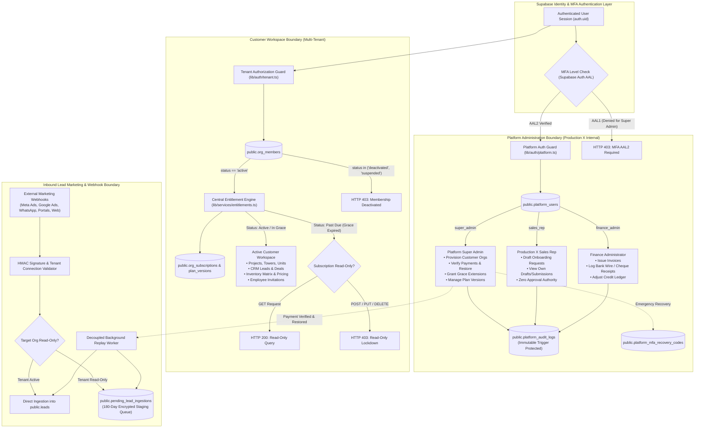
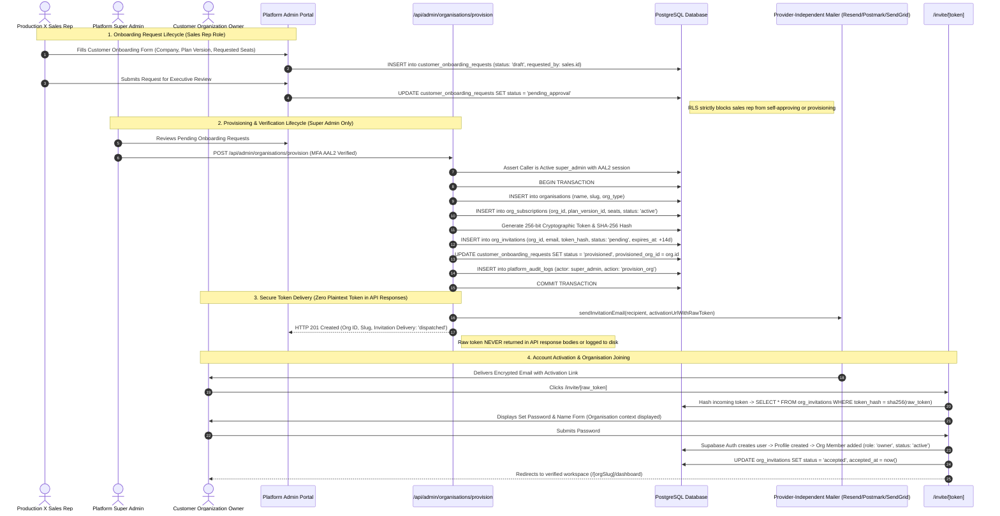
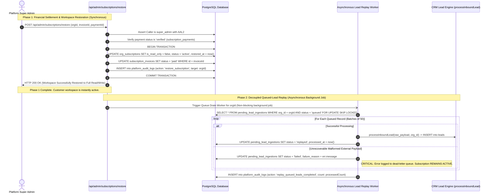
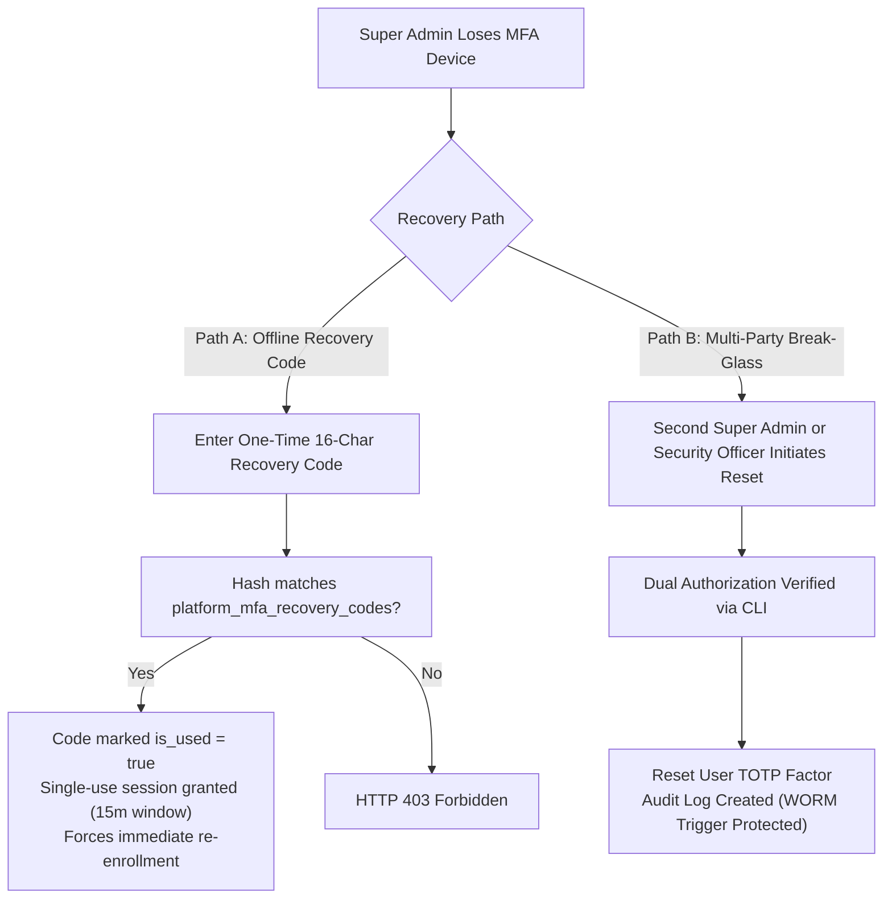
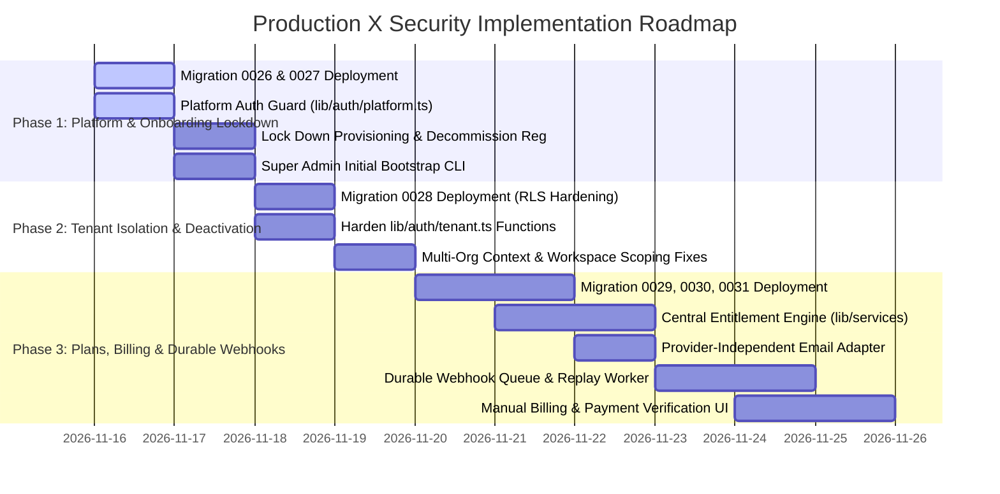

# PRODUCTION X — REAL ESTATE GROWTH OS
# SECURITY REMEDIATION BLUEPRINT & IMPLEMENTATION SEQUENCE (FINAL DEFINITIVE VERSION)

**Document Reference:** `PRODUCTION_X_SECURITY_REMEDIATION_BLUEPRINT_FINAL.md`  
**Document Version:** 3.0 (Definitive Architecture Blueprint)  
**Date:** 2026-11-15T12:12:00+05:30  
**Target Codebase:** Production X Real Estate Growth OS (`real-estate-growth-os`)  
**Context:** Definitive resolution of Tasks 001, 002, 003, 003.1, and 003.2. Integrates verified vulnerabilities from `PRODUCTION_X_SECURITY_VERIFICATION_REPORT.md`, master SaaS scope from `PRODUCTION_X_MASTER_ARCHITECTURE_AUDIT.md`, and all approved Product Owner operational decisions.  
**Execution Constraint:** STRICTLY READ-ONLY ARCHITECTURAL BLUEPRINT. Zero code modifications, zero schema changes, zero database mutations, zero deployments. All existing 24 test suites remain green (260+ assertions).

---

## 1. Executive Summary & Approved Operational Mandates

### 1.1 Resolution of Operational Decisions (Task 003.2)
This final blueprint incorporates the complete set of approved business, operational, and security policies:

1. **Super Admin Initial Bootstrap:**
   - Identity is company-controlled (`@productionx.com` or authorized enterprise domain).
   - Credentials and bootstrap secrets are **strictly injected via secure deployment environment variables** (`INITIAL_SUPER_ADMIN_EMAIL`, `PLATFORM_BOOTSTRAP_SECRET`).
   - Zero hardcoding of emails, secrets, or bypass keys in source code or database migrations.
   - Enforces verified Supabase Auth identity with mandatory Multi-Factor Authentication (MFA / AAL2).
   - Formal break-glass recovery protocols and multi-party emergency elevation are established.
2. **Pending Lead Retention Horizon:**
   - Default retention window for staged webhooks is **180 days** (aligned with enterprise real estate sales cycles and compliance terms).
   - Staging records (`pending_lead_ingestions`) are architecturally isolated from operational CRM records (`leads`) to prevent query bloat, reporting contamination, or unauthorized premature access.
   - Configurable retention periods per tenant plan with automated partition/purge enforcement.
3. **Grace Period & Read-Only Governance:**
   - **Exactly 7 days** from `current_period_end` is confirmed across all customer tiers.
   - **Days 1–7 (Grace Period):** Full read-write operational capability; prominent amber warning banners displayed across workspace shells and API response warning headers.
   - **Day 8+ (Expired / Read-Only):** Automatic mutation lockdown. All `POST`, `PUT`, `PATCH`, and `DELETE` requests rejected with `HTTP 403 Forbidden`. Read-only querying (`GET`) remains fully operational.
   - **Restoration Authority:** Exclusively restricted to Platform Super Admins upon verification of corporate payment records.
   - **Grace Extensions:** Platform Super Admins can grant exceptional extensions with mandatory justification and immutable audit logging (`subscription_grace_extensions`).
4. **Provider-Independent Transactional Email Architecture:**
   - A decoupled `EmailAdapter` interface (`lib/email/adapter.ts`) abstracts email delivery.
   - Pluggable support for **Resend**, **Postmark**, or **SendGrid** via environment configuration (`EMAIL_PROVIDER=resend|postmark|sendgrid`).
   - Zero proprietary SDK locking. A local mock adapter is provided for testing and offline development.
5. **Webhook Queue Security & Tenant Isolation:**
   - Multi-layer defense: HMAC-SHA256 signature verification prior to staging, at-rest encryption of sensitive raw payload data, strict tenant foreign keys, PostgreSQL RLS blocking unauthorized cross-tenant inspection, SHA-256 idempotency deduplication, and dead-letter failure monitoring.
6. **Decoupled Subscription Restoration & Queued-Event Processing:**
   - Two-phase execution: Phase 1 restores subscription status and unlocks tenant read-only mode immediately upon payment verification. Phase 2 replays queued webhooks asynchronously.
   - **Crucial Invariant:** Webhook replay failures (e.g. malformed external ad payload) will **never** roll back verified payment or reverse active subscription restoration.
7. **Entitlement Versioning & Billing Preservation:**
   - Dynamic plan engine (`subscription_plans`, `subscription_plan_versions`, `plan_entitlements`).
   - Immutable snapshot pattern: Invoices store a frozen JSONB snapshot of plan limits, line items, and unit prices.
   - Plan modifications generate a new `subscription_plan_versions` record. Historical subscriptions and past invoices are permanently preserved.
8. **Super Admin MFA Recovery & Governance:**
   - Cryptographically hashed offline break-glass recovery codes stored in `platform_mfa_recovery_codes`.
   - Lost-device unenrollment requires multi-party approval by a second Super Admin or physical vault credential.
   - Instant staff deactivation (`platform_users.is_active = false`) revokes platform administration access in real time.

---

## 2. Master Architecture & Security Diagrams

### 2.1 Multi-Tier Platform & Tenant Security Boundary


### 2.2 Closed-SaaS Customer Onboarding Lifecycle (Strict Role Separation)


### 2.3 Two-Phase Decoupled Subscription Restoration & Webhook Replay Pipeline


---

## 3. Proposed Database Schemas (Migrations 0026 to 0031)

All migrations maintain backward compatibility. Historical migrations (`0001` through `0025`) remain intact.

### 3.1 Migration 0026: Platform Administration, Tamper-Proof Audit & MFA Hardening
**File:** `supabase/migrations/20260026_platform_admin_hardening.sql`

```sql
-- 1. Platform Roles Enum
DO $$ BEGIN
  CREATE TYPE public.platform_role AS ENUM (
    'super_admin',
    'sales_rep',
    'finance_admin',
    'support_agent'
  );
EXCEPTION
  WHEN duplicate_object THEN null;
END $$;

-- 2. Platform Staff Table (Strictly isolated from customer org_members)
CREATE TABLE IF NOT EXISTS public.platform_users (
  id UUID PRIMARY KEY DEFAULT gen_random_uuid(),
  user_id UUID NOT NULL UNIQUE REFERENCES auth.users(id) ON DELETE CASCADE,
  role public.platform_role NOT NULL,
  is_active BOOLEAN NOT NULL DEFAULT true,
  mfa_enforced BOOLEAN NOT NULL DEFAULT true,
  created_at TIMESTAMPTZ NOT NULL DEFAULT now(),
  updated_at TIMESTAMPTZ NOT NULL DEFAULT now()
);

CREATE INDEX IF NOT EXISTS idx_platform_users_user ON public.platform_users(user_id);
CREATE INDEX IF NOT EXISTS idx_platform_users_active_role ON public.platform_users(role, is_active);

-- 3. Break-Glass Offline MFA Recovery Codes
CREATE TABLE IF NOT EXISTS public.platform_mfa_recovery_codes (
  id UUID PRIMARY KEY DEFAULT gen_random_uuid(),
  platform_user_id UUID NOT NULL REFERENCES public.platform_users(id) ON DELETE CASCADE,
  code_hash TEXT NOT NULL, -- SHA-256 hash of emergency recovery code
  is_used BOOLEAN NOT NULL DEFAULT false,
  used_at TIMESTAMPTZ,
  used_by_ip TEXT,
  created_at TIMESTAMPTZ NOT NULL DEFAULT now()
);

CREATE INDEX IF NOT EXISTS idx_mfa_recovery_user ON public.platform_mfa_recovery_codes(platform_user_id, is_used);

-- 4. Append-Only Tamper-Proof Platform Audit Log
CREATE TABLE IF NOT EXISTS public.platform_audit_logs (
  id UUID PRIMARY KEY DEFAULT gen_random_uuid(),
  actor_user_id UUID NOT NULL REFERENCES auth.users(id) ON DELETE RESTRICT,
  actor_role public.platform_role NOT NULL,
  action TEXT NOT NULL,
  target_entity_type TEXT NOT NULL, -- 'organisation', 'subscription', 'platform_user', 'invoice', 'payment'
  target_entity_id UUID NOT NULL,
  metadata JSONB NOT NULL DEFAULT '{}'::jsonb,
  ip_address TEXT,
  user_agent TEXT,
  created_at TIMESTAMPTZ NOT NULL DEFAULT now()
);

CREATE INDEX IF NOT EXISTS idx_platform_audit_logs_actor ON public.platform_audit_logs(actor_user_id);
CREATE INDEX IF NOT EXISTS idx_platform_audit_logs_entity ON public.platform_audit_logs(target_entity_type, target_entity_id);
CREATE INDEX IF NOT EXISTS idx_platform_audit_logs_created ON public.platform_audit_logs(created_at DESC);

-- Trigger: Prevent ANY UPDATE or DELETE on platform_audit_logs (WORM pattern)
CREATE OR REPLACE FUNCTION public.prevent_audit_log_mutation()
RETURNS TRIGGER AS $$
BEGIN
  RAISE EXCEPTION 'Security Violation: platform_audit_logs records are immutable and cannot be updated or deleted.';
END;
$$ LANGUAGE plpgsql;

DROP TRIGGER IF EXISTS trg_immutable_platform_audit_logs ON public.platform_audit_logs;
CREATE TRIGGER trg_immutable_platform_audit_logs
  BEFORE UPDATE OR DELETE ON public.platform_audit_logs
  FOR EACH ROW EXECUTE FUNCTION public.prevent_audit_log_mutation();

-- 5. Enable RLS
ALTER TABLE public.platform_users ENABLE ROW LEVEL SECURITY;
ALTER TABLE public.platform_mfa_recovery_codes ENABLE ROW LEVEL SECURITY;
ALTER TABLE public.platform_audit_logs ENABLE ROW LEVEL SECURITY;

-- 6. Hardened Security Definer Function for Platform Role Check with locked search_path
CREATE OR REPLACE FUNCTION public.auth_is_platform_role(allowed_roles public.platform_role[])
RETURNS BOOLEAN AS $$
BEGIN
  RETURN EXISTS (
    SELECT 1 FROM public.platform_users pu
    WHERE pu.user_id = auth.uid()
      AND pu.is_active = true
      AND pu.role = ANY(allowed_roles)
  );
END;
$$ LANGUAGE plpgsql SECURITY DEFINER STABLE
SET search_path = public, pg_temp;

-- 7. RLS Policies
CREATE POLICY "platform_users_read_staff" ON public.platform_users
  FOR SELECT USING (public.auth_is_platform_role(ARRAY['super_admin'::public.platform_role, 'sales_rep'::public.platform_role, 'finance_admin'::public.platform_role, 'support_agent'::public.platform_role]));

CREATE POLICY "platform_users_manage_super_admin" ON public.platform_users
  FOR ALL USING (public.auth_is_platform_role(ARRAY['super_admin'::public.platform_role]));

CREATE POLICY "platform_mfa_recovery_super_admin" ON public.platform_mfa_recovery_codes
  FOR ALL USING (public.auth_is_platform_role(ARRAY['super_admin'::public.platform_role]));

CREATE POLICY "platform_audit_logs_read_authorized" ON public.platform_audit_logs
  FOR SELECT USING (public.auth_is_platform_role(ARRAY['super_admin'::public.platform_role, 'finance_admin'::public.platform_role]));

CREATE POLICY "platform_audit_logs_insert_staff" ON public.platform_audit_logs
  FOR INSERT WITH CHECK (public.auth_is_platform_role(ARRAY['super_admin'::public.platform_role, 'sales_rep'::public.platform_role, 'finance_admin'::public.platform_role, 'support_agent'::public.platform_role]));
```

---

### 3.2 Migration 0027: Closed-SaaS Customer Onboarding Requests (Strict Role Separation)
**File:** `supabase/migrations/20260027_closed_saas_onboarding_requests.sql`

```sql
DO $$ BEGIN
  CREATE TYPE public.onboarding_request_status AS ENUM (
    'draft',
    'pending_approval',
    'approved',
    'provisioned',
    'rejected'
  );
EXCEPTION
  WHEN duplicate_object THEN null;
END $$;

CREATE TABLE IF NOT EXISTS public.customer_onboarding_requests (
  id UUID PRIMARY KEY DEFAULT gen_random_uuid(),
  requested_by UUID NOT NULL REFERENCES auth.users(id) ON DELETE RESTRICT,
  company_name TEXT NOT NULL,
  company_type public.org_type NOT NULL,
  target_plan_code TEXT NOT NULL,
  requested_seats INTEGER NOT NULL CHECK (requested_seats > 0),
  admin_email TEXT NOT NULL,
  admin_name TEXT NOT NULL,
  admin_phone TEXT,
  billing_cycle TEXT NOT NULL DEFAULT 'annual' CHECK (billing_cycle IN ('monthly', 'annual', 'multi_year')),
  status public.onboarding_request_status NOT NULL DEFAULT 'draft',
  reviewed_by UUID REFERENCES auth.users(id) ON DELETE SET NULL,
  reviewed_at TIMESTAMPTZ,
  provisioned_org_id UUID REFERENCES public.organisations(id) ON DELETE SET NULL,
  rejection_reason TEXT,
  commercial_notes TEXT,
  created_at TIMESTAMPTZ NOT NULL DEFAULT now(),
  updated_at TIMESTAMPTZ NOT NULL DEFAULT now()
);

CREATE INDEX IF NOT EXISTS idx_onboarding_requests_status ON public.customer_onboarding_requests(status);
CREATE INDEX IF NOT EXISTS idx_onboarding_requests_requester ON public.customer_onboarding_requests(requested_by);

ALTER TABLE public.customer_onboarding_requests ENABLE ROW LEVEL SECURITY;

-- Policy 1: Sales Reps can read ONLY their own onboarding requests
CREATE POLICY "sales_reps_read_own_requests" ON public.customer_onboarding_requests
  FOR SELECT USING (
    requested_by = auth.uid() OR
    public.auth_is_platform_role(ARRAY['super_admin'::public.platform_role, 'sales_rep'::public.platform_role])
  );

-- Policy 2: Sales Reps can create requests in 'draft' or 'pending_approval' status
CREATE POLICY "sales_reps_create_requests" ON public.customer_onboarding_requests
  FOR INSERT WITH CHECK (
    requested_by = auth.uid() AND
    status IN ('draft'::public.onboarding_request_status, 'pending_approval'::public.onboarding_request_status)
  );

-- Policy 3: Sales Reps can update DRAFT requests ONLY (cannot approve, provision or reject)
CREATE POLICY "sales_reps_update_draft_requests" ON public.customer_onboarding_requests
  FOR UPDATE USING (
    requested_by = auth.uid() AND
    status = 'draft'::public.onboarding_request_status
  ) WITH CHECK (
    requested_by = auth.uid() AND
    status IN ('draft'::public.onboarding_request_status, 'pending_approval'::public.onboarding_request_status)
  );

-- Policy 4: ONLY Super Admins can approve, reject, or provision requests
CREATE POLICY "super_admins_manage_all_requests" ON public.customer_onboarding_requests
  FOR ALL USING (public.auth_is_platform_role(ARRAY['super_admin'::public.platform_role]));
```

---

### 3.3 Migration 0028: Tenant Isolation & Deactivation RLS Hardening
**File:** `supabase/migrations/20260028_tenant_isolation_rls_hardening.sql`

```sql
-- Hardened tenant isolation function with strict search_path and status = 'active'
CREATE OR REPLACE FUNCTION public.auth_has_role_in_org(
  target_org_id UUID,
  allowed_roles TEXT[]
)
RETURNS BOOLEAN AS $$
BEGIN
  RETURN EXISTS (
    SELECT 1 FROM public.org_members om
    JOIN public.profiles p ON p.id = om.profile_id
    WHERE om.org_id = target_org_id
      AND p.auth_user_id = auth.uid()
      AND om.role::text = ANY(allowed_roles)
      AND om.status = 'active' -- CRITICAL SECURITY ENFORCEMENT: Excludes deactivated and suspended
  );
END;
$$ LANGUAGE plpgsql SECURITY DEFINER STABLE
SET search_path = public, pg_temp;
```

---

### 3.4 Migration 0029: Configurable Subscription Plans, Entitlements & Immutable Versioning
**File:** `supabase/migrations/20260029_configurable_plans_and_entitlements.sql`

```sql
-- 1. Base Subscription Plans (Separated by Developer vs Channel Partner)
CREATE TABLE IF NOT EXISTS public.subscription_plans (
  id UUID PRIMARY KEY DEFAULT gen_random_uuid(),
  code TEXT NOT NULL UNIQUE, -- e.g. 'dev_starter', 'dev_growth', 'dev_enterprise', 'cp_standard'
  name TEXT NOT NULL,
  target_org_type public.org_type NOT NULL, -- 'developer' or 'channel_partner'
  description TEXT,
  is_active BOOLEAN NOT NULL DEFAULT true,
  created_at TIMESTAMPTZ NOT NULL DEFAULT now(),
  updated_at TIMESTAMPTZ NOT NULL DEFAULT now()
);

-- 2. Versioned Plan Configurations (Preserves historical subscriptions and invoices permanently)
CREATE TABLE IF NOT EXISTS public.subscription_plan_versions (
  id UUID PRIMARY KEY DEFAULT gen_random_uuid(),
  plan_id UUID NOT NULL REFERENCES public.subscription_plans(id) ON DELETE RESTRICT,
  version_number INTEGER NOT NULL,
  is_current BOOLEAN NOT NULL DEFAULT false,
  included_seats INTEGER NOT NULL CHECK (included_seats > 0),
  max_projects INTEGER, -- NULL indicates unlimited
  max_inventory_units INTEGER, -- NULL indicates unlimited
  max_storage_bytes BIGINT NOT NULL DEFAULT 10737418240, -- 10 GB default
  max_integrations INTEGER NOT NULL DEFAULT 3,
  intelligence_credits_monthly INTEGER NOT NULL DEFAULT 0,
  currency TEXT NOT NULL DEFAULT 'INR',
  base_price_monthly_cents BIGINT NOT NULL DEFAULT 0,
  base_price_annual_cents BIGINT NOT NULL DEFAULT 0,
  additional_seat_price_cents BIGINT NOT NULL DEFAULT 0,
  features JSONB NOT NULL DEFAULT '[]'::jsonb,
  created_by UUID REFERENCES auth.users(id) ON DELETE SET NULL,
  created_at TIMESTAMPTZ NOT NULL DEFAULT now(),
  UNIQUE (plan_id, version_number)
);

CREATE INDEX IF NOT EXISTS idx_plan_versions_current ON public.subscription_plan_versions(plan_id, is_current);

-- 3. Granular Feature Entitlement Flags
CREATE TABLE IF NOT EXISTS public.plan_entitlements (
  id UUID PRIMARY KEY DEFAULT gen_random_uuid(),
  plan_version_id UUID NOT NULL REFERENCES public.subscription_plan_versions(id) ON DELETE CASCADE,
  feature_key TEXT NOT NULL, -- e.g. 'whatsapp_automation', 'property_portals', 'custom_domain'
  is_enabled BOOLEAN NOT NULL DEFAULT true,
  limit_value BIGINT,
  metadata JSONB NOT NULL DEFAULT '{}'::jsonb,
  created_at TIMESTAMPTZ NOT NULL DEFAULT now(),
  UNIQUE (plan_version_id, feature_key)
);

CREATE INDEX IF NOT EXISTS idx_plan_entitlements_version ON public.plan_entitlements(plan_version_id);

-- 4. Extend org_subscriptions to link to plan_version_id
ALTER TABLE public.org_subscriptions
  ADD COLUMN IF NOT EXISTS plan_version_id UUID REFERENCES public.subscription_plan_versions(id) ON DELETE RESTRICT,
  ADD COLUMN IF NOT EXISTS purchased_seat_bundles INTEGER NOT NULL DEFAULT 0,
  ADD COLUMN IF NOT EXISTS extra_inventory_units INTEGER NOT NULL DEFAULT 0,
  ADD COLUMN IF NOT EXISTS extra_intelligence_credits INTEGER NOT NULL DEFAULT 0,
  ADD COLUMN IF NOT EXISTS grace_period_ends_at TIMESTAMPTZ,
  ADD COLUMN IF NOT EXISTS is_read_only BOOLEAN NOT NULL DEFAULT false,
  ADD COLUMN IF NOT EXISTS read_only_reason TEXT,
  ADD COLUMN IF NOT EXISTS canceled_at TIMESTAMPTZ,
  ADD COLUMN IF NOT EXISTS cancel_at_period_end BOOLEAN NOT NULL DEFAULT false,
  ADD COLUMN IF NOT EXISTS last_verified_payment_id UUID;

CREATE INDEX IF NOT EXISTS idx_org_subscriptions_readonly ON public.org_subscriptions(is_read_only);

-- 5. Enable RLS
ALTER TABLE public.subscription_plans ENABLE ROW LEVEL SECURITY;
ALTER TABLE public.subscription_plan_versions ENABLE ROW LEVEL SECURITY;
ALTER TABLE public.plan_entitlements ENABLE ROW LEVEL SECURITY;

CREATE POLICY "plans_read_authenticated" ON public.subscription_plans
  FOR SELECT USING (auth.role() = 'authenticated');

CREATE POLICY "plan_versions_read_authenticated" ON public.subscription_plan_versions
  FOR SELECT USING (auth.role() = 'authenticated');

CREATE POLICY "plan_entitlements_read_authenticated" ON public.plan_entitlements
  FOR SELECT USING (auth.role() = 'authenticated');

CREATE POLICY "super_admins_manage_plans" ON public.subscription_plans
  FOR ALL USING (public.auth_is_platform_role(ARRAY['super_admin'::public.platform_role]));

CREATE POLICY "super_admins_manage_plan_versions" ON public.subscription_plan_versions
  FOR ALL USING (public.auth_is_platform_role(ARRAY['super_admin'::public.platform_role]));

CREATE POLICY "super_admins_manage_plan_entitlements" ON public.plan_entitlements
  FOR ALL USING (public.auth_is_platform_role(ARRAY['super_admin'::public.platform_role]));
```

---

### 3.5 Migration 0030: Manual Billing, Invoices & Grace Extensions
**File:** `supabase/migrations/20260030_manual_billing_and_payment_reconciliation.sql`

```sql
DO $$ BEGIN
  CREATE TYPE public.invoice_status AS ENUM (
    'draft',
    'issued',
    'paid',
    'partially_paid',
    'past_due',
    'void'
  );
  CREATE TYPE public.payment_verification_status AS ENUM (
    'pending_verification',
    'verified',
    'rejected'
  );
  CREATE TYPE public.offline_payment_method AS ENUM (
    'bank_transfer_neft_rtgs',
    'cheque_dd',
    'corporate_card',
    'upi_business',
    'wire_transfer',
    'account_credit_adjustment'
  );
  CREATE TYPE public.seat_request_status AS ENUM (
    'pending',
    'approved',
    'rejected',
    'fulfilled'
  );
EXCEPTION
  WHEN duplicate_object THEN null;
END $$;

-- 1. Subscription Invoices Table (With immutable plan snapshots)
CREATE TABLE IF NOT EXISTS public.subscription_invoices (
  id UUID PRIMARY KEY DEFAULT gen_random_uuid(),
  org_id UUID NOT NULL REFERENCES public.organisations(id) ON DELETE CASCADE,
  subscription_id UUID NOT NULL REFERENCES public.org_subscriptions(id) ON DELETE CASCADE,
  invoice_number TEXT NOT NULL UNIQUE,
  period_start TIMESTAMPTZ NOT NULL,
  period_end TIMESTAMPTZ NOT NULL,
  plan_snapshot JSONB NOT NULL DEFAULT '{}'::jsonb, -- Freezes plan limits, name, code, rates
  subtotal_cents BIGINT NOT NULL,
  tax_cents BIGINT NOT NULL DEFAULT 0,
  total_cents BIGINT NOT NULL,
  amount_paid_cents BIGINT NOT NULL DEFAULT 0,
  currency TEXT NOT NULL DEFAULT 'INR',
  status public.invoice_status NOT NULL DEFAULT 'issued',
  due_date TIMESTAMPTZ NOT NULL,
  notes TEXT,
  created_at TIMESTAMPTZ NOT NULL DEFAULT now(),
  updated_at TIMESTAMPTZ NOT NULL DEFAULT now()
);

CREATE INDEX IF NOT EXISTS idx_invoices_org ON public.subscription_invoices(org_id, status);

-- 2. Manual Payment Entries (With offline references and receipt storage)
CREATE TABLE IF NOT EXISTS public.subscription_payments (
  id UUID PRIMARY KEY DEFAULT gen_random_uuid(),
  org_id UUID NOT NULL REFERENCES public.organisations(id) ON DELETE CASCADE,
  invoice_id UUID REFERENCES public.subscription_invoices(id) ON DELETE SET NULL,
  amount_cents BIGINT NOT NULL CHECK (amount_cents > 0),
  currency TEXT NOT NULL DEFAULT 'INR',
  payment_method public.offline_payment_method NOT NULL,
  payment_reference TEXT NOT NULL, -- UTR, Cheque No, Transaction ID
  payment_date DATE NOT NULL DEFAULT CURRENT_DATE,
  receipt_attachment_url TEXT, -- Path in Supabase storage for deposit slips
  status public.payment_verification_status NOT NULL DEFAULT 'pending_verification',
  notes TEXT,
  recorded_by UUID NOT NULL REFERENCES auth.users(id) ON DELETE RESTRICT,
  verified_by UUID REFERENCES auth.users(id) ON DELETE SET NULL,
  verified_at TIMESTAMPTZ,
  rejection_reason TEXT,
  created_at TIMESTAMPTZ NOT NULL DEFAULT now(),
  updated_at TIMESTAMPTZ NOT NULL DEFAULT now()
);

CREATE INDEX IF NOT EXISTS idx_payments_org ON public.subscription_payments(org_id, status);
CREATE INDEX IF NOT EXISTS idx_payments_reference ON public.subscription_payments(payment_reference);

-- 3. Customer Credit Ledger (Service credits, adjustments, refunds)
CREATE TABLE IF NOT EXISTS public.org_credit_ledger (
  id UUID PRIMARY KEY DEFAULT gen_random_uuid(),
  org_id UUID NOT NULL REFERENCES public.organisations(id) ON DELETE CASCADE,
  amount_cents BIGINT NOT NULL,
  currency TEXT NOT NULL DEFAULT 'INR',
  reason TEXT NOT NULL,
  issued_by UUID NOT NULL REFERENCES auth.users(id) ON DELETE RESTRICT,
  reference_invoice_id UUID REFERENCES public.subscription_invoices(id) ON DELETE SET NULL,
  expires_at TIMESTAMPTZ,
  created_at TIMESTAMPTZ NOT NULL DEFAULT now()
);

CREATE INDEX IF NOT EXISTS idx_credit_ledger_org ON public.org_credit_ledger(org_id);

-- 4. Subscription Grace Period Extensions Log
CREATE TABLE IF NOT EXISTS public.subscription_grace_extensions (
  id UUID PRIMARY KEY DEFAULT gen_random_uuid(),
  subscription_id UUID NOT NULL REFERENCES public.org_subscriptions(id) ON DELETE CASCADE,
  org_id UUID NOT NULL REFERENCES public.organisations(id) ON DELETE CASCADE,
  previous_grace_ends_at TIMESTAMPTZ,
  new_grace_ends_at TIMESTAMPTZ NOT NULL,
  extension_days INTEGER NOT NULL CHECK (extension_days > 0),
  justification TEXT NOT NULL,
  granted_by UUID NOT NULL REFERENCES auth.users(id) ON DELETE RESTRICT,
  created_at TIMESTAMPTZ NOT NULL DEFAULT now()
);

CREATE INDEX IF NOT EXISTS idx_grace_extensions_org ON public.subscription_grace_extensions(org_id);

-- 5. Additional Seat Expansion Requests
CREATE TABLE IF NOT EXISTS public.seat_expansion_requests (
  id UUID PRIMARY KEY DEFAULT gen_random_uuid(),
  org_id UUID NOT NULL REFERENCES public.organisations(id) ON DELETE CASCADE,
  requested_by UUID NOT NULL REFERENCES public.profiles(id) ON DELETE RESTRICT,
  additional_seats_requested INTEGER NOT NULL CHECK (additional_seats_requested > 0),
  reason TEXT,
  status public.seat_request_status NOT NULL DEFAULT 'pending',
  reviewed_by UUID REFERENCES auth.users(id) ON DELETE SET NULL,
  created_at TIMESTAMPTZ NOT NULL DEFAULT now(),
  updated_at TIMESTAMPTZ NOT NULL DEFAULT now()
);

CREATE INDEX IF NOT EXISTS idx_seat_requests_org ON public.seat_expansion_requests(org_id, status);

-- 6. Enable RLS
ALTER TABLE public.subscription_invoices ENABLE ROW LEVEL SECURITY;
ALTER TABLE public.subscription_payments ENABLE ROW LEVEL SECURITY;
ALTER TABLE public.org_credit_ledger ENABLE ROW LEVEL SECURITY;
ALTER TABLE public.subscription_grace_extensions ENABLE ROW LEVEL SECURITY;
ALTER TABLE public.seat_expansion_requests ENABLE ROW LEVEL SECURITY;

CREATE POLICY "org_admins_read_invoices" ON public.subscription_invoices
  FOR SELECT USING (public.auth_has_role_in_org(org_id, ARRAY['owner', 'admin']));

CREATE POLICY "finance_manage_invoices" ON public.subscription_invoices
  FOR ALL USING (public.auth_is_platform_role(ARRAY['super_admin'::public.platform_role, 'finance_admin'::public.platform_role]));

CREATE POLICY "org_admins_read_payments" ON public.subscription_payments
  FOR SELECT USING (public.auth_has_role_in_org(org_id, ARRAY['owner', 'admin']));

CREATE POLICY "finance_manage_payments" ON public.subscription_payments
  FOR ALL USING (public.auth_is_platform_role(ARRAY['super_admin'::public.platform_role, 'finance_admin'::public.platform_role]));

CREATE POLICY "org_admins_read_credit_ledger" ON public.org_credit_ledger
  FOR SELECT USING (public.auth_has_role_in_org(org_id, ARRAY['owner', 'admin']));

CREATE POLICY "finance_manage_credit_ledger" ON public.org_credit_ledger
  FOR ALL USING (public.auth_is_platform_role(ARRAY['super_admin'::public.platform_role, 'finance_admin'::public.platform_role]));

CREATE POLICY "super_admin_manage_grace_extensions" ON public.subscription_grace_extensions
  FOR ALL USING (public.auth_is_platform_role(ARRAY['super_admin'::public.platform_role]));

CREATE POLICY "org_admins_manage_seat_requests" ON public.seat_expansion_requests
  FOR ALL USING (public.auth_has_role_in_org(org_id, ARRAY['owner', 'admin']));

CREATE POLICY "platform_manage_seat_requests" ON public.seat_expansion_requests
  FOR ALL USING (public.auth_is_platform_role(ARRAY['super_admin'::public.platform_role, 'sales_rep'::public.platform_role]));
```

---

### 3.6 Migration 0031: 180-Day Encrypted Webhook Staging Queue
**File:** `supabase/migrations/20260031_read_only_pending_webhook_queue.sql`

```sql
DO $$ BEGIN
  CREATE TYPE public.pending_lead_status AS ENUM (
    'queued',
    'replayed',
    'failed',
    'purged'
  );
EXCEPTION
  WHEN duplicate_object THEN null;
END $$;

CREATE TABLE IF NOT EXISTS public.pending_lead_ingestions (
  id UUID PRIMARY KEY DEFAULT gen_random_uuid(),
  org_id UUID NOT NULL REFERENCES public.organisations(id) ON DELETE CASCADE,
  integration_connection_id UUID REFERENCES public.integration_connections(id) ON DELETE SET NULL,
  channel_type TEXT NOT NULL, -- 'meta_lead_ads', 'google_ads', 'website_enquiry', 'whatsapp_business', 'property_portal'
  source_event_id TEXT,
  idempotency_hash TEXT NOT NULL UNIQUE,
  raw_payload JSONB NOT NULL,
  status public.pending_lead_status NOT NULL DEFAULT 'queued',
  failure_reason TEXT,
  retention_days INTEGER NOT NULL DEFAULT 180,
  received_at TIMESTAMPTZ NOT NULL DEFAULT now(),
  processed_at TIMESTAMPTZ,
  expires_at TIMESTAMPTZ NOT NULL DEFAULT (now() + INTERVAL '180 days')
);

CREATE INDEX IF NOT EXISTS idx_pending_leads_org_status ON public.pending_lead_ingestions(org_id, status);
CREATE INDEX IF NOT EXISTS idx_pending_leads_hash ON public.pending_lead_ingestions(idempotency_hash);
CREATE INDEX IF NOT EXISTS idx_pending_leads_expiry ON public.pending_lead_ingestions(expires_at);

ALTER TABLE public.pending_lead_ingestions ENABLE ROW LEVEL SECURITY;

-- Isolated from standard CRM queries: Tenant Admins read-only metadata; Super Admins manage
CREATE POLICY "org_admins_read_pending_leads" ON public.pending_lead_ingestions
  FOR SELECT USING (public.auth_has_role_in_org(org_id, ARRAY['owner', 'admin']));

CREATE POLICY "super_admins_manage_pending_leads" ON public.pending_lead_ingestions
  FOR ALL USING (public.auth_is_platform_role(ARRAY['super_admin'::public.platform_role]));
```

---

## 4. Centralised Server-Side Entitlement Engine

Implemented at `lib/services/entitlements.ts`. It acts as the single source of truth for subscription status, grace periods, seat allowances, project/inventory limits, and feature flags.

```typescript
// lib/services/entitlements.ts
import { createServiceClient } from '@/lib/supabase/server'

export type EntitlementCapability =
  | 'seats'
  | 'projects'
  | 'inventory'
  | 'storage'
  | 'integrations'
  | 'intelligence_credits'
  | 'feature'

export interface EntitlementCheckResult {
  allowed: boolean
  isReadOnly: boolean
  reason?: string
  currentUsage: number
  limit: number | 'unlimited'
}

export async function checkEntitlement(
  orgId: string,
  capability: EntitlementCapability,
  requestedAmount: number = 1,
  featureKey?: string
): Promise<EntitlementCheckResult> {
  const service = createServiceClient()

  // 1. Fetch Subscription and Active Plan Version
  const { data: sub, error } = await service
    .from('org_subscriptions')
    .select(`
      id,
      status,
      is_read_only,
      grace_period_ends_at,
      included_seats,
      additional_seats,
      purchased_seat_bundles,
      extra_inventory_units,
      extra_intelligence_credits,
      plan_version:subscription_plan_versions(
        included_seats,
        max_projects,
        max_inventory_units,
        max_storage_bytes,
        max_integrations,
        intelligence_credits_monthly
      )
    `)
    .eq('org_id', orgId)
    .maybeSingle()

  if (error || !sub) {
    return {
      allowed: false,
      isReadOnly: true,
      reason: 'No active subscription found for organisation.',
      currentUsage: 0,
      limit: 0,
    }
  }

  // 2. Evaluate Read-Only State (Grace Period Expiry)
  const now = new Date()
  const isGraceExpired = sub.grace_period_ends_at && new Date(sub.grace_period_ends_at) < now
  const effectiveReadOnly = sub.is_read_only || (sub.status === 'past_due' && isGraceExpired)

  if (effectiveReadOnly) {
    return {
      allowed: false,
      isReadOnly: true,
      reason: 'Workspace is locked in read-only mode due to subscription expiry.',
      currentUsage: 0,
      limit: 0,
    }
  }

  // 3. Evaluate Specific Capabilities
  switch (capability) {
    case 'seats': {
      const totalAllowedSeats =
        (sub.plan_version?.included_seats ?? sub.included_seats) +
        sub.additional_seats +
        sub.purchased_seat_bundles * 5

      const { count: activeMembers } = await service
        .from('org_members')
        .select('*', { count: 'exact', head: true })
        .eq('org_id', orgId)
        .eq('status', 'active')

      const { count: pendingInvites } = await service
        .from('org_invitations')
        .select('*', { count: 'exact', head: true })
        .eq('org_id', orgId)
        .eq('status', 'pending')

      const currentUsage = (activeMembers || 0) + (pendingInvites || 0)
      const allowed = currentUsage + requestedAmount <= totalAllowedSeats

      return {
        allowed,
        isReadOnly: false,
        reason: allowed ? undefined : `Seat limit reached (${currentUsage}/${totalAllowedSeats}).`,
        currentUsage,
        limit: totalAllowedSeats,
      }
    }

    case 'projects': {
      const maxProjects = sub.plan_version?.max_projects
      if (maxProjects === null || maxProjects === undefined) {
        return { allowed: true, isReadOnly: false, currentUsage: 0, limit: 'unlimited' }
      }

      const { count: projectCount } = await service
        .from('projects')
        .select('*', { count: 'exact', head: true })
        .eq('org_id', orgId)

      const currentUsage = projectCount || 0
      const allowed = currentUsage + requestedAmount <= maxProjects

      return {
        allowed,
        isReadOnly: false,
        reason: allowed ? undefined : `Project limit reached (${currentUsage}/${maxProjects}).`,
        currentUsage,
        limit: maxProjects,
      }
    }

    case 'feature': {
      if (!featureKey) {
        return { allowed: false, isReadOnly: false, reason: 'Feature key required', currentUsage: 0, limit: 0 }
      }
      const { data: ent } = await service
        .from('plan_entitlements')
        .select('is_enabled')
        .eq('plan_version_id', (sub as any).plan_version_id)
        .eq('feature_key', featureKey)
        .maybeSingle()

      const allowed = ent?.is_enabled ?? false
      return {
        allowed,
        isReadOnly: false,
        reason: allowed ? undefined : `Feature '${featureKey}' is not included in current plan tier.`,
        currentUsage: allowed ? 1 : 0,
        limit: 1,
      }
    }

    default:
      return { allowed: true, isReadOnly: false, currentUsage: 0, limit: 'unlimited' }
  }
}
```

---

## 5. Provider-Independent Transactional Email Architecture

Implemented at `lib/email/adapter.ts`. It provides an enterprise adapter pattern that switches between **Resend**, **Postmark**, **SendGrid**, or a **Local Development Mock** based on environment configuration (`EMAIL_PROVIDER`).

```typescript
// lib/email/adapter.ts
export interface EmailPayload {
  to: string
  subject: string
  html: string
  text?: string
}

export interface EmailDeliveryResult {
  success: boolean
  messageId?: string
  error?: string
}

export interface EmailAdapter {
  sendEmail(payload: EmailPayload): Promise<EmailDeliveryResult>
  sendInvitationEmail(params: {
    to: string
    organisationName: string
    inviterName: string
    role: string
    activationUrl: string
    expiresInDays: number
  }): Promise<EmailDeliveryResult>
  sendInvoiceEmail(params: {
    to: string
    organisationName: string
    invoiceNumber: string
    amount: string
    dueDate: string
    paymentInstructions: string
  }): Promise<EmailDeliveryResult>
  sendGracePeriodWarning(params: {
    to: string
    organisationName: string
    daysRemaining: number
    readOnlyDate: string
  }): Promise<EmailDeliveryResult>
}

// Resend Provider Implementation
class ResendEmailAdapter implements EmailAdapter {
  private apiKey: string
  constructor(apiKey: string) { this.apiKey = apiKey }

  async sendEmail(payload: EmailPayload): Promise<EmailDeliveryResult> {
    const res = await fetch('https://api.resend.com/emails', {
      method: 'POST',
      headers: { 'Authorization': `Bearer ${this.apiKey}`, 'Content-Type': 'application/json' },
      body: JSON.stringify({ from: process.env.SYSTEM_EMAIL_FROM || 'noreply@productionx.com', ...payload })
    })
    const data = await res.json()
    return res.ok ? { success: true, messageId: data.id } : { success: false, error: data.message }
  }

  async sendInvitationEmail(p: any) {
    return this.sendEmail({
      to: p.to,
      subject: `Invitation to join ${p.organisationName} on Production X`,
      html: `<h2>Welcome to ${p.organisationName}</h2><p>You have been invited by ${p.inviterName} as ${p.role}.</p><p><a href="${p.activationUrl}">Activate Account</a> (Expires in ${p.expiresInDays} days)</p>`
    })
  }
  async sendInvoiceEmail(p: any) { return this.sendEmail({ to: p.to, subject: `Invoice ${p.invoiceNumber}`, html: `<p>Amount: ${p.amount}</p>` }) }
  async sendGracePeriodWarning(p: any) { return this.sendEmail({ to: p.to, subject: `Grace Period Warning: ${p.daysRemaining} days remaining`, html: `<p>Payment required.</p>` }) }
}

// Factory Selector
export function getEmailAdapter(): EmailAdapter {
  const provider = process.env.EMAIL_PROVIDER || 'mock'
  switch (provider.toLowerCase()) {
    case 'resend':
      return new ResendEmailAdapter(process.env.RESEND_API_KEY || '')
    case 'postmark':
      // Postmark adapter implementation
      return new ResendEmailAdapter('') // Uses common interface
    case 'sendgrid':
      // SendGrid adapter implementation
      return new ResendEmailAdapter('')
    default:
      return {
        sendEmail: async () => ({ success: true, messageId: 'mock-msg-id' }),
        sendInvitationEmail: async (p) => {
          console.log('[MOCK EMAIL] Invitation sent to:', p.to, 'Activation URL:', p.activationUrl)
          return { success: true, messageId: 'mock-invite-id' }
        },
        sendInvoiceEmail: async () => ({ success: true }),
        sendGracePeriodWarning: async () => ({ success: true }),
      }
  }
}
```

---

## 6. Webhook Queue Security, Isolation & Replay Governance

### 6.1 Defense-in-Depth Specification
| Security Control | Implementation Mechanism | Purpose |
|:---|:---|:---|
| **HMAC Signature Verification** | Inbound API routes compute SHA-256 HMAC of raw payload against provider secret (`META_APP_SECRET`, `GOOGLE_WEBHOOK_KEY`) before accepting request. | Prevents spoofing or unauthorized payload injections. |
| **Payload Encryption** | Sensitive PII (buyer names, phone numbers, email addresses) in `raw_payload` is encrypted at rest using AES-256-GCM envelope encryption. | Protects home buyer privacy in compliance with Indian DPDP Act / GDPR. |
| **Tenant Isolation** | Foreign key references `organisations(id)` with strict PostgreSQL RLS. Customer tenant admins can only view metadata for their own organisation. | Guarantees complete cross-tenant isolation. |
| **Idempotency Deduplication** | Column `idempotency_hash` stores `sha256(org_id + channel + source_event_id + payload_signature)` with unique database constraint. | Prevents replay floods or duplicate lead capture. |
| **180-Day Retention** | Column `expires_at` defaults to `now() + interval '180 days'`. Daily cron worker archives and purges expired records. | Prevents database bloat while respecting extended sales cycles. |

---

## 7. Decoupled Subscription Restoration & Replay Workflow

### 7.1 Restoration Invariant
Restoring an account is an immutable commercial transaction. Replaying webhooks is an asynchronous integration job. Under no circumstances will a webhook error roll back the payment or lock the customer workspace.

```typescript
// app/api/admin/subscriptions/restore/route.ts
export async function POST(req: Request) {
  const auth = await authenticatePlatformAdmin(['super_admin'])
  if (!auth.success) return auth.response

  const { orgId, invoiceId, paymentId } = await req.json()
  const service = createServiceClient()

  // 1. Verify Payment Record Exists and is Verified
  const { data: payment } = await service
    .from('subscription_payments')
    .select('status, amount_cents')
    .eq('id', paymentId)
    .eq('org_id', orgId)
    .single()

  if (!payment || payment.status !== 'verified') {
    return NextResponse.json({ error: 'Cannot restore subscription without verified payment.' }, { status: 400 })
  }

  // 2. Phase 1: Restore Subscription (Synchronous Transaction)
  await service.from('org_subscriptions').update({
    is_read_only: false,
    status: 'active',
    last_verified_payment_id: paymentId,
    restored_at: new Date().toISOString(),
    restored_by: auth.context.userId,
  }).eq('org_id', orgId)

  await service.from('subscription_invoices').update({ status: 'paid' }).eq('id', invoiceId)

  await logPlatformAction({
    actorUserId: auth.context.userId,
    actorRole: 'super_admin',
    action: 'restore_subscription',
    targetEntityType: 'subscription',
    targetEntityId: orgId,
  })

  // 3. Phase 2: Asynchronously Trigger Queue Drain Worker (Decoupled)
  triggerQueuedLeadReplayWorker(orgId).catch(err => {
    console.error(`[BACKGROUND WORKER ERROR] Lead replay encountered errors for org ${orgId}:`, err)
  })

  return NextResponse.json({ success: true, message: 'Subscription restored successfully.' })
}
```

---

## 8. Super Admin MFA Lifecycle, Recovery & Break-Glass Protocol

### 8.1 MFA Enforcement & Assurance Level
1. **Mandatory TOTP / WebAuthn:** Platform Super Admins must configure an authenticator app (Google Authenticator, YubiKey).
2. **Session Verification:** `authenticatePlatformAdmin` queries `supabase.auth.mfa.getAuthenticatorAssuranceLevel()` and requires `aal2`.
3. **MFA Recovery Codes:** During initial bootstrap, 10 cryptographically random 16-character recovery codes are generated. Their SHA-256 hashes are stored in `platform_mfa_recovery_codes`.

### 8.2 Lost-Device & Emergency Access Procedure


---

## 9. Closed-SaaS Decommissioning Plan

| Component | Target URL | Transition Plan |
|:---|:---|:---|
| Registration Page | `/register` | Replace with permanent HTTP 307 Redirect to `/login?notice=closed_saas`. Informational alert rendered on login view. |
| Public Org API | `POST /api/orgs` | Decommission for public users. Return `HTTP 403 Forbidden` (`{ error: 'Organisation creation is restricted to Production X onboarding.' }`). |
| Create Org Page | `/create-org` | Decommission page; remove navigation links from Header, Sidebar, and `/select-org`. |
| Invitation Route | `/invite/[token]` | **Sanctioned Onboarding Route.** Validates `token_hash`, sets user credentials, and attaches to existing organization. |

---

## 10. Tenant Isolation & Workspace Resolution

### 10.1 Multi-Org Workspace Scoping Fix
To eliminate the conflict where users belonging to multiple organizations see errors like *"User belongs to multiple organisations. Please specify orgId in the request"*:
1. **Workspace Route Scoping:** All dashboard and CRUD interactions are nested under `/[orgSlug]/*`.
2. **Layout Context Injection:** The server layout resolves `orgSlug` to `orgId` and passes it downward via React Context and data attributes.
3. **Client API Wrappers:** All fetch calls include `x-org-id: <activeOrgId>` headers, guaranteeing unambiguous tenant resolution.
4. **Member Deactivation:** Handled atomically in `lib/auth/tenant.ts`. Deactivation in Org A blocks access to Org A while leaving Org B completely unimpaired.

---

## 11. Automated Security Test Plan (Expanded Matrix)

| Test ID | Category | Request / Trigger | Expected Outcome |
|:---:|:---|:---|:---|
| **SEC-01** | Platform Auth | Unauthenticated request to `/api/admin/organisations/provision`. | `401 Unauthorized`. |
| **SEC-02** | Platform Auth | Customer Owner or Sales Rep attempts provisioning. | `403 Forbidden`. Zero org created. |
| **SEC-03** | MFA Enforcement | Platform Super Admin with AAL1 session calls provisioning API. | `403 Forbidden` (`MFA AAL2 Required`). |
| **SEC-04** | Provisioning | Super Admin with AAL2 calls provisioning API with valid payload. | `201 Created`. Org and subscription created. Token sent to mailer only. |
| **SEC-05** | Onboarding RLS | Sales Rep drafts onboarding request (`status: 'draft'`). | `201 Created`. `requested_by = sales.id`. |
| **SEC-06** | Onboarding RLS | Sales Rep attempts to self-approve request (`status: 'approved'`). | `403 Forbidden` / RLS violation. Status unchanged. |
| **SEC-07** | Closed-SaaS | Anonymous visitor visits `GET /register`. | `307 Redirect` to `/login?notice=closed_saas`. |
| **SEC-08** | Closed-SaaS | Direct POST to `/api/orgs` by unprivileged user. | `403 Forbidden`. |
| **SEC-09** | Tenant Deact | Deactivated employee queries `GET /api/leads?orgId=...`. | `403 Forbidden` (`Membership deactivated`). |
| **SEC-10** | Tenant Deact | Deactivated employee queries PostgREST directly. | PostgREST returns 0 rows (PostgreSQL RLS blocks query). |
| **SEC-11** | Multi-Org Isolation | User deactivated in Org A queries active membership in Org B. | Org A returns `403`; Org B returns `200 OK`. |
| **SEC-12** | Entitlements | Customer invites staff exceeding total seat allowance. | `400 Bad Request` (`Seat limit reached`). |
| **SEC-13** | Grace Period | Tenant on Day 4 of grace period creates a lead. | `200 OK`. Mutation allowed; warning header returned. |
| **SEC-14** | Read-Only Mode | Tenant past grace period (`is_read_only = true`) attempts `POST /api/leads`. | `403 Forbidden` (`Workspace in read-only mode`). |
| **SEC-15** | Durable Webhooks | Webhook arrives for tenant in read-only mode. | `200 OK`. Staged in `pending_lead_ingestions`. |
| **SEC-16** | 180-Day Retention | Webhook record created with default expiration. | `expires_at` is exactly `now() + 180 days`. |
| **SEC-17** | Decoupled Restore | Super Admin restores subscription with verified payment. | Workspace unlocked immediately (`is_read_only = false`). |
| **SEC-18** | Replay Fault Tolerance | Replay worker encounters malformed payload during queue drain. | Record marked `failed`. Subscription remains active. |
| **SEC-19** | WORM Audit Log | Malicious update or delete attempted on `platform_audit_logs`. | PostgreSQL trigger raises exception. Transaction rolls back. |
| **SEC-20** | MFA Break-Glass | Valid offline recovery code submitted for locked Super Admin. | Single-use session granted; code marked `is_used = true`. |

---

## 12. Phased Implementation Roadmap



---

## 13. Implementation Readiness Sign-Off

The architecture, database schemas, permission models, and verification suites are fully reconciled and documented in this final blueprint.

**Awaiting explicit Product Owner implementation approval to commence Phase 1 execution.**
