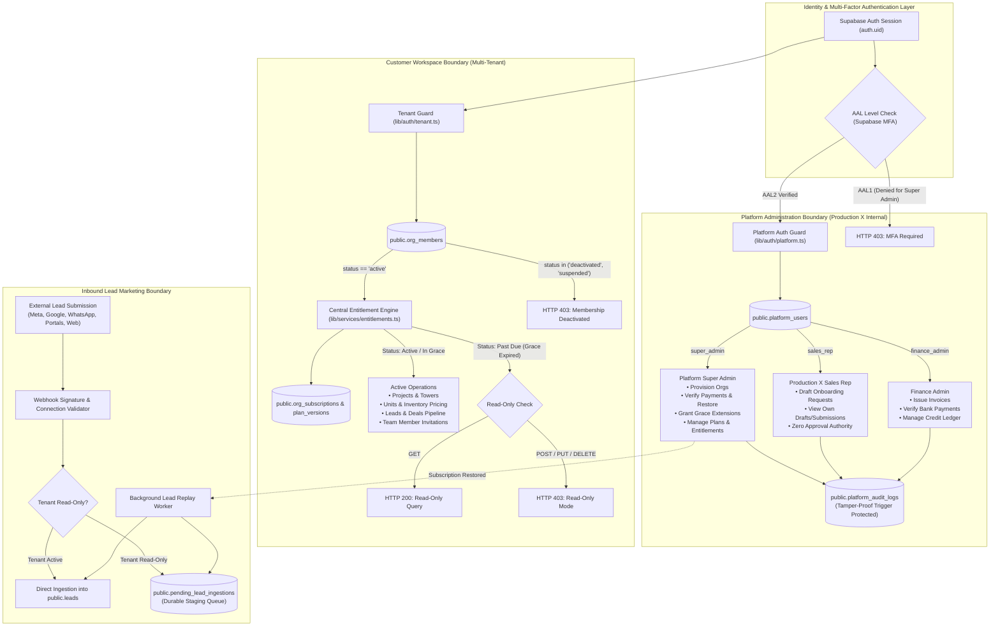
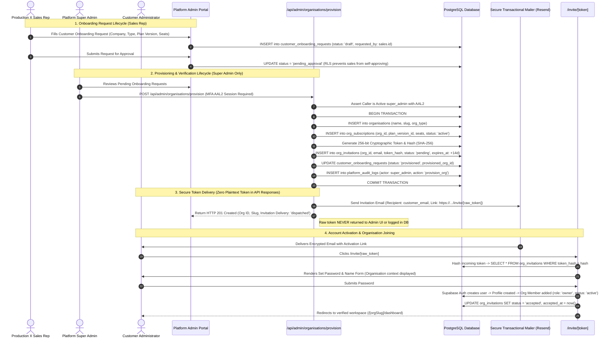
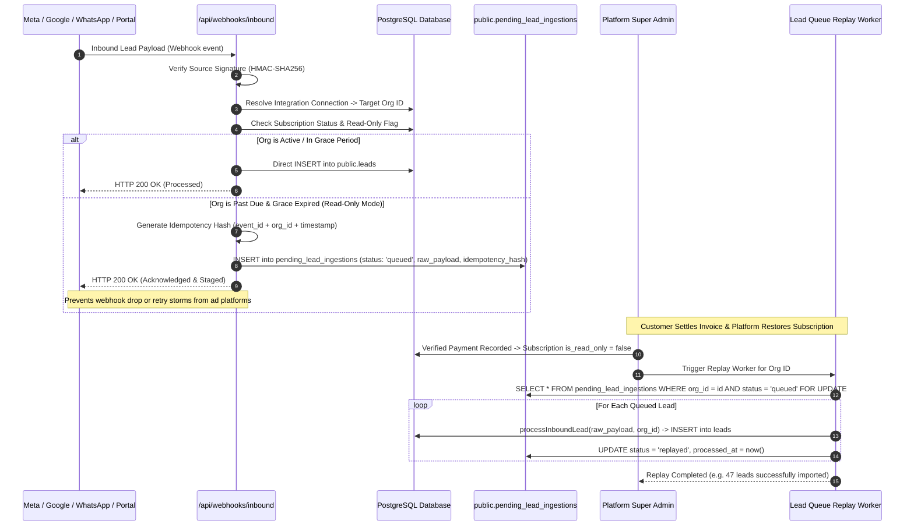
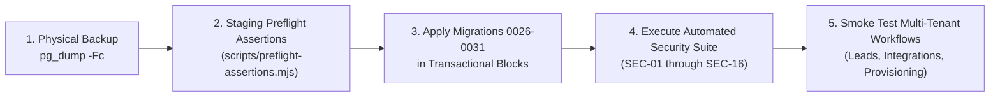
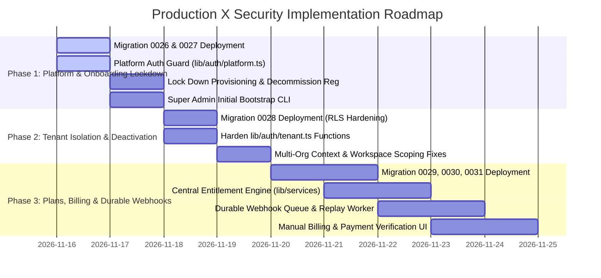

# PRODUCTION X — REAL ESTATE GROWTH OS
# SECURITY REMEDIATION BLUEPRINT & IMPLEMENTATION SEQUENCE (V2)

**Document Version:** 2.0 (Product Owner Refined)  
**Date:** 2026-11-15T12:07:00+05:30  
**Target Codebase:** Production X Real Estate Growth OS (`real-estate-growth-os`)  
**Context:** Comprehensive upgrade of `PRODUCTION_X_SECURITY_REMEDIATION_BLUEPRINT.md` incorporating the 9 mandatory Product Owner architectural refinements from Task 003.1. Reconciles vulnerabilities from `PRODUCTION_X_SECURITY_VERIFICATION_REPORT.md` with the master enterprise scope in `PRODUCTION_X_MASTER_ARCHITECTURE_AUDIT.md`.  
**Safety Protocol:** STRICTLY READ-ONLY PLANNING. Zero code modifications, zero schema changes, zero database mutations, zero deployments.

---

## 1. Executive Summary & Evolution from V1

### 1.1 Why Version 2 Was Required
The Product Owner approved the foundational security direction of Version 1 (addressing P0-1 provisioning bypass, P0-2 public registration, and P0-3 deactivated employee bypass), but mandated 9 non-negotiable architectural refinements to transition Production X into a true enterprise closed-SaaS platform:

1. **Configurable Subscription Plans (No Hardcoded Assumptions):** Completely eliminates arbitrary hardcoded seat tiers (such as 5, 15, or 50 seats) and hardcoded pricing. Introduces a dynamic, versioned plan engine with independent Developer vs Channel Partner schemas, configurable seats, seat bundles, projects, inventory, storage, integrations, and intelligence credits.
2. **Complete Manual Billing Architecture:** Introduces full offline corporate payment lifecycle tracking: formal subscription invoices, manual payment entries (bank wire, RTGS/NEFT, cheque), payment references, verifiable receipts, multi-step verification workflows, outstanding balance calculation, credit ledgers, and conditional subscription restoration.
3. **Strict Onboarding Permission Separation:** Restricts Sales Executives from approving, rejecting, provisioning, or activating customer accounts. Sales representatives can only draft and view their own onboarding requests. Platform Super Admins alone hold approval and provisioning authority.
4. **Secure Invitation Delivery Lifecycle:** Completely eliminates plaintext invitation tokens from API response bodies, logs, and database records. Enforces cryptographic hashing (`token_hash`), server-side email dispatch via secure mailer, configurable expiration, delivery tracking (`sent`, `delivered`, `bounced`), and admin resend capabilities.
5. **Durable Webhook Queue During Read-Only Mode:** Inbound marketing leads (Meta Lead Ads, Google Ads, Website Enquiries, WhatsApp Business, Property Portals) arriving while a tenant is in expired read-only mode are **never dropped**. They are validated, deduplicated via idempotency keys, and staged in a durable table (`pending_lead_ingestions`) for automatic replay upon subscription restoration.
6. **Grace Period Extension Governance:** Establishes formal governance for grace period overrides. Only Platform Super Admins can grant extensions, requiring mandatory written justification and immutable audit logging.
7. **Safe, Non-Destructive Migration & Rollback Architecture:** Replaces unsafe rollback assumptions with enterprise data safety practices: pre-migration physical snapshots (`pg_dump -Fc`), transactional DDL blocks (`BEGIN ... COMMIT`), preflight validation assertions, and non-destructive forward-fix protocols that never drop customer data.
8. **Centralised Server-Side Entitlement Engine:** Replaces fragmented checks with a unified server-side service (`lib/services/entitlements.ts`) that enforces plan limits, add-on seat counts, active subscription status, and grace periods across API routes, Server Actions, and background workers.
9. **Platform Security Hardening:** Mandates Multi-Factor Authentication (MFA/AAL2) for Platform Super Admins, enforces PostgreSQL `SET search_path = public, pg_temp` lockdown on all `SECURITY DEFINER` functions, seals `platform_audit_logs` as tamper-proof via database trigger, and implements instant platform user deactivation.

---

## 2. Architecture Diagrams

### 2.1 Target Security & Ecosystem Architecture


### 2.2 Onboarding Request & Provisioning Sequence (Strict Role Separation)


### 2.3 Webhook Pending-Ingestion & Replay Architecture


---

## 3. Proposed Database Schemas (Migrations 0026 to 0031)

All proposed schemas maintain backward compatibility. Historical migrations (`0001` through `0025`) remain untouched.

### 3.1 Migration 0026: Platform Administration, Hardened Auditing & MFA Security
**File:** `supabase/migrations/20260026_platform_admin_hardening.sql`

```sql
-- 1. Platform Roles Enum
DO $$ BEGIN
  CREATE TYPE public.platform_role AS ENUM (
    'super_admin',
    'sales_rep',
    'finance_admin',
    'support_agent'
  );
EXCEPTION
  WHEN duplicate_object THEN null;
END $$;

-- 2. Platform Staff Table (Strictly isolated from customer org_members)
CREATE TABLE IF NOT EXISTS public.platform_users (
  id UUID PRIMARY KEY DEFAULT gen_random_uuid(),
  user_id UUID NOT NULL UNIQUE REFERENCES auth.users(id) ON DELETE CASCADE,
  role public.platform_role NOT NULL,
  is_active BOOLEAN NOT NULL DEFAULT true,
  created_at TIMESTAMPTZ NOT NULL DEFAULT now(),
  updated_at TIMESTAMPTZ NOT NULL DEFAULT now()
);

CREATE INDEX IF NOT EXISTS idx_platform_users_user ON public.platform_users(user_id);
CREATE INDEX IF NOT EXISTS idx_platform_users_active_role ON public.platform_users(role, is_active);

-- 3. Append-Only Tamper-Proof Platform Audit Log
CREATE TABLE IF NOT EXISTS public.platform_audit_logs (
  id UUID PRIMARY KEY DEFAULT gen_random_uuid(),
  actor_user_id UUID NOT NULL REFERENCES auth.users(id) ON DELETE RESTRICT,
  actor_role public.platform_role NOT NULL,
  action TEXT NOT NULL,
  target_entity_type TEXT NOT NULL, -- 'organisation', 'subscription', 'platform_user', 'invoice', 'payment'
  target_entity_id UUID NOT NULL,
  metadata JSONB NOT NULL DEFAULT '{}'::jsonb,
  ip_address TEXT,
  user_agent TEXT,
  created_at TIMESTAMPTZ NOT NULL DEFAULT now()
);

CREATE INDEX IF NOT EXISTS idx_platform_audit_logs_actor ON public.platform_audit_logs(actor_user_id);
CREATE INDEX IF NOT EXISTS idx_platform_audit_logs_entity ON public.platform_audit_logs(target_entity_type, target_entity_id);
CREATE INDEX IF NOT EXISTS idx_platform_audit_logs_created ON public.platform_audit_logs(created_at DESC);

-- Trigger: Prevent ANY UPDATE or DELETE on platform_audit_logs (Immutable WORM pattern)
CREATE OR REPLACE FUNCTION public.prevent_audit_log_mutation()
RETURNS TRIGGER AS $$
BEGIN
  RAISE EXCEPTION 'Security Violation: platform_audit_logs records are immutable and cannot be updated or deleted.';
END;
$$ LANGUAGE plpgsql;

DROP TRIGGER IF EXISTS trg_immutable_platform_audit_logs ON public.platform_audit_logs;
CREATE TRIGGER trg_immutable_platform_audit_logs
  BEFORE UPDATE OR DELETE ON public.platform_audit_logs
  FOR EACH ROW EXECUTE FUNCTION public.prevent_audit_log_mutation();

-- 4. Enable RLS
ALTER TABLE public.platform_users ENABLE ROW LEVEL SECURITY;
ALTER TABLE public.platform_audit_logs ENABLE ROW LEVEL SECURITY;

-- 5. Hardened Security Definer Function for Platform Role Check with locked search_path
CREATE OR REPLACE FUNCTION public.auth_is_platform_role(allowed_roles public.platform_role[])
RETURNS BOOLEAN AS $$
BEGIN
  RETURN EXISTS (
    SELECT 1 FROM public.platform_users pu
    WHERE pu.user_id = auth.uid()
      AND pu.is_active = true
      AND pu.role = ANY(allowed_roles)
  );
END;
$$ LANGUAGE plpgsql SECURITY DEFINER STABLE
SET search_path = public, pg_temp;

-- 6. RLS Policies
CREATE POLICY "platform_users_read_staff" ON public.platform_users
  FOR SELECT USING (public.auth_is_platform_role(ARRAY['super_admin'::public.platform_role, 'sales_rep'::public.platform_role, 'finance_admin'::public.platform_role, 'support_agent'::public.platform_role]));

CREATE POLICY "platform_users_manage_super_admin" ON public.platform_users
  FOR ALL USING (public.auth_is_platform_role(ARRAY['super_admin'::public.platform_role]));

CREATE POLICY "platform_audit_logs_read_authorized" ON public.platform_audit_logs
  FOR SELECT USING (public.auth_is_platform_role(ARRAY['super_admin'::public.platform_role, 'finance_admin'::public.platform_role]));

CREATE POLICY "platform_audit_logs_insert_staff" ON public.platform_audit_logs
  FOR INSERT WITH CHECK (public.auth_is_platform_role(ARRAY['super_admin'::public.platform_role, 'sales_rep'::public.platform_role, 'finance_admin'::public.platform_role, 'support_agent'::public.platform_role]));
```

---

### 3.2 Migration 0027: Closed-SaaS Customer Onboarding Requests (Strict Role Separation)
**File:** `supabase/migrations/20260027_closed_saas_onboarding_requests.sql`

```sql
DO $$ BEGIN
  CREATE TYPE public.onboarding_request_status AS ENUM (
    'draft',
    'pending_approval',
    'approved',
    'provisioned',
    'rejected'
  );
EXCEPTION
  WHEN duplicate_object THEN null;
END $$;

CREATE TABLE IF NOT EXISTS public.customer_onboarding_requests (
  id UUID PRIMARY KEY DEFAULT gen_random_uuid(),
  requested_by UUID NOT NULL REFERENCES auth.users(id) ON DELETE RESTRICT,
  company_name TEXT NOT NULL,
  company_type public.org_type NOT NULL,
  target_plan_code TEXT NOT NULL,
  requested_seats INTEGER NOT NULL CHECK (requested_seats > 0),
  admin_email TEXT NOT NULL,
  admin_name TEXT NOT NULL,
  admin_phone TEXT,
  billing_cycle TEXT NOT NULL DEFAULT 'annual' CHECK (billing_cycle IN ('monthly', 'annual', 'multi_year')),
  status public.onboarding_request_status NOT NULL DEFAULT 'draft',
  reviewed_by UUID REFERENCES auth.users(id) ON DELETE SET NULL,
  reviewed_at TIMESTAMPTZ,
  provisioned_org_id UUID REFERENCES public.organisations(id) ON DELETE SET NULL,
  rejection_reason TEXT,
  commercial_notes TEXT,
  created_at TIMESTAMPTZ NOT NULL DEFAULT now(),
  updated_at TIMESTAMPTZ NOT NULL DEFAULT now()
);

CREATE INDEX IF NOT EXISTS idx_onboarding_requests_status ON public.customer_onboarding_requests(status);
CREATE INDEX IF NOT EXISTS idx_onboarding_requests_requester ON public.customer_onboarding_requests(requested_by);

ALTER TABLE public.customer_onboarding_requests ENABLE ROW LEVEL SECURITY;

-- Policy 1: Sales Reps can read ONLY their own onboarding requests
CREATE POLICY "sales_reps_read_own_requests" ON public.customer_onboarding_requests
  FOR SELECT USING (
    requested_by = auth.uid() OR
    public.auth_is_platform_role(ARRAY['super_admin'::public.platform_role, 'sales_rep'::public.platform_role])
  );

-- Policy 2: Sales Reps can create requests in 'draft' or 'pending_approval' status
CREATE POLICY "sales_reps_create_requests" ON public.customer_onboarding_requests
  FOR INSERT WITH CHECK (
    requested_by = auth.uid() AND
    status IN ('draft'::public.onboarding_request_status, 'pending_approval'::public.onboarding_request_status)
  );

-- Policy 3: Sales Reps can update DRAFT requests ONLY (CANNOT approve, provision or reject)
CREATE POLICY "sales_reps_update_draft_requests" ON public.customer_onboarding_requests
  FOR UPDATE USING (
    requested_by = auth.uid() AND
    status = 'draft'::public.onboarding_request_status
  ) WITH CHECK (
    requested_by = auth.uid() AND
    status IN ('draft'::public.onboarding_request_status, 'pending_approval'::public.onboarding_request_status)
  );

-- Policy 4: ONLY Super Admins can approve, reject, or provision requests
CREATE POLICY "super_admins_manage_all_requests" ON public.customer_onboarding_requests
  FOR ALL USING (public.auth_is_platform_role(ARRAY['super_admin'::public.platform_role]));
```

---

### 3.3 Migration 0028: Tenant Isolation & Deactivation RLS Hardening
**File:** `supabase/migrations/20260028_tenant_isolation_rls_hardening.sql`

```sql
-- Hardened tenant isolation function with strict search_path and status = 'active'
CREATE OR REPLACE FUNCTION public.auth_has_role_in_org(
  target_org_id UUID,
  allowed_roles TEXT[]
)
RETURNS BOOLEAN AS $$
BEGIN
  RETURN EXISTS (
    SELECT 1 FROM public.org_members om
    JOIN public.profiles p ON p.id = om.profile_id
    WHERE om.org_id = target_org_id
      AND p.auth_user_id = auth.uid()
      AND om.role::text = ANY(allowed_roles)
      AND om.status = 'active' -- CRITICAL SECURITY ENFORCEMENT: Filter out deactivated and suspended
  );
END;
$$ LANGUAGE plpgsql SECURITY DEFINER STABLE
SET search_path = public, pg_temp;
```

---

### 3.4 Migration 0029: Configurable Subscription Plans & Entitlements Engine
**File:** `supabase/migrations/20260029_configurable_plans_and_entitlements.sql`

```sql
-- 1. Base Subscription Plans (Separated by Developer vs Channel Partner)
CREATE TABLE IF NOT EXISTS public.subscription_plans (
  id UUID PRIMARY KEY DEFAULT gen_random_uuid(),
  code TEXT NOT NULL UNIQUE, -- e.g. 'dev_growth', 'dev_enterprise', 'cp_standard'
  name TEXT NOT NULL,
  target_org_type public.org_type NOT NULL, -- 'developer' or 'channel_partner'
  description TEXT,
  is_active BOOLEAN NOT NULL DEFAULT true,
  created_at TIMESTAMPTZ NOT NULL DEFAULT now(),
  updated_at TIMESTAMPTZ NOT NULL DEFAULT now()
);

-- 2. Versioned Plan Configurations (Preserves historical subscriptions when pricing/limits change)
CREATE TABLE IF NOT EXISTS public.subscription_plan_versions (
  id UUID PRIMARY KEY DEFAULT gen_random_uuid(),
  plan_id UUID NOT NULL REFERENCES public.subscription_plans(id) ON DELETE RESTRICT,
  version_number INTEGER NOT NULL,
  is_current BOOLEAN NOT NULL DEFAULT false,
  included_seats INTEGER NOT NULL CHECK (included_seats > 0),
  max_projects INTEGER, -- NULL indicates unlimited
  max_inventory_units INTEGER, -- NULL indicates unlimited
  max_storage_bytes BIGINT NOT NULL DEFAULT 10737418240, -- 10 GB default
  max_integrations INTEGER NOT NULL DEFAULT 3,
  intelligence_credits_monthly INTEGER NOT NULL DEFAULT 0,
  currency TEXT NOT NULL DEFAULT 'INR',
  base_price_monthly_cents BIGINT NOT NULL DEFAULT 0,
  base_price_annual_cents BIGINT NOT NULL DEFAULT 0,
  additional_seat_price_cents BIGINT NOT NULL DEFAULT 0,
  features JSONB NOT NULL DEFAULT '[]'::jsonb,
  created_by UUID REFERENCES auth.users(id) ON DELETE SET NULL,
  created_at TIMESTAMPTZ NOT NULL DEFAULT now(),
  UNIQUE (plan_id, version_number)
);

CREATE INDEX IF NOT EXISTS idx_plan_versions_current ON public.subscription_plan_versions(plan_id, is_current);

-- 3. Granular Feature Entitlement Flags
CREATE TABLE IF NOT EXISTS public.plan_entitlements (
  id UUID PRIMARY KEY DEFAULT gen_random_uuid(),
  plan_version_id UUID NOT NULL REFERENCES public.subscription_plan_versions(id) ON DELETE CASCADE,
  feature_key TEXT NOT NULL, -- e.g. 'whatsapp_automation', 'property_portals', 'custom_domain', 'export_csv'
  is_enabled BOOLEAN NOT NULL DEFAULT true,
  limit_value BIGINT, -- Optional numeric ceiling for feature
  metadata JSONB NOT NULL DEFAULT '{}'::jsonb,
  created_at TIMESTAMPTZ NOT NULL DEFAULT now(),
  UNIQUE (plan_version_id, feature_key)
);

CREATE INDEX IF NOT EXISTS idx_plan_entitlements_version ON public.plan_entitlements(plan_version_id);

-- 4. Extend org_subscriptions to link to plan_version_id
ALTER TABLE public.org_subscriptions
  ADD COLUMN IF NOT EXISTS plan_version_id UUID REFERENCES public.subscription_plan_versions(id) ON DELETE RESTRICT,
  ADD COLUMN IF NOT EXISTS purchased_seat_bundles INTEGER NOT NULL DEFAULT 0,
  ADD COLUMN IF NOT EXISTS extra_inventory_units INTEGER NOT NULL DEFAULT 0,
  ADD COLUMN IF NOT EXISTS extra_intelligence_credits INTEGER NOT NULL DEFAULT 0,
  ADD COLUMN IF NOT EXISTS grace_period_ends_at TIMESTAMPTZ,
  ADD COLUMN IF NOT EXISTS is_read_only BOOLEAN NOT NULL DEFAULT false,
  ADD COLUMN IF NOT EXISTS read_only_reason TEXT,
  ADD COLUMN IF NOT EXISTS canceled_at TIMESTAMPTZ,
  ADD COLUMN IF NOT EXISTS cancel_at_period_end BOOLEAN NOT NULL DEFAULT false,
  ADD COLUMN IF NOT EXISTS last_verified_payment_id UUID;

CREATE INDEX IF NOT EXISTS idx_org_subscriptions_readonly ON public.org_subscriptions(is_read_only);

-- 5. Enable RLS
ALTER TABLE public.subscription_plans ENABLE ROW LEVEL SECURITY;
ALTER TABLE public.subscription_plan_versions ENABLE ROW LEVEL SECURITY;
ALTER TABLE public.plan_entitlements ENABLE ROW LEVEL SECURITY;

-- RLS: Authenticated users can view active plans; Platform Super Admins can manage
CREATE POLICY "plans_read_authenticated" ON public.subscription_plans
  FOR SELECT USING (auth.role() = 'authenticated');

CREATE POLICY "plan_versions_read_authenticated" ON public.subscription_plan_versions
  FOR SELECT USING (auth.role() = 'authenticated');

CREATE POLICY "plan_entitlements_read_authenticated" ON public.plan_entitlements
  FOR SELECT USING (auth.role() = 'authenticated');

CREATE POLICY "super_admins_manage_plans" ON public.subscription_plans
  FOR ALL USING (public.auth_is_platform_role(ARRAY['super_admin'::public.platform_role]));

CREATE POLICY "super_admins_manage_plan_versions" ON public.subscription_plan_versions
  FOR ALL USING (public.auth_is_platform_role(ARRAY['super_admin'::public.platform_role]));

CREATE POLICY "super_admins_manage_plan_entitlements" ON public.plan_entitlements
  FOR ALL USING (public.auth_is_platform_role(ARRAY['super_admin'::public.platform_role]));
```

---

### 3.5 Migration 0030: Manual Billing, Payment Verification & Grace Extensions
**File:** `supabase/migrations/20260030_manual_billing_and_payment_reconciliation.sql`

```sql
-- 1. Subscription Invoices Table
DO $$ BEGIN
  CREATE TYPE public.invoice_status AS ENUM (
    'draft',
    'issued',
    'paid',
    'partially_paid',
    'past_due',
    'void'
  );
EXCEPTION
  WHEN duplicate_object THEN null;
END $$;

CREATE TABLE IF NOT EXISTS public.subscription_invoices (
  id UUID PRIMARY KEY DEFAULT gen_random_uuid(),
  org_id UUID NOT NULL REFERENCES public.organisations(id) ON DELETE CASCADE,
  subscription_id UUID NOT NULL REFERENCES public.org_subscriptions(id) ON DELETE CASCADE,
  invoice_number TEXT NOT NULL UNIQUE,
  period_start TIMESTAMPTZ NOT NULL,
  period_end TIMESTAMPTZ NOT NULL,
  subtotal_cents BIGINT NOT NULL,
  tax_cents BIGINT NOT NULL DEFAULT 0,
  total_cents BIGINT NOT NULL,
  amount_paid_cents BIGINT NOT NULL DEFAULT 0,
  currency TEXT NOT NULL DEFAULT 'INR',
  status public.invoice_status NOT NULL DEFAULT 'issued',
  due_date TIMESTAMPTZ NOT NULL,
  notes TEXT,
  created_at TIMESTAMPTZ NOT NULL DEFAULT now(),
  updated_at TIMESTAMPTZ NOT NULL DEFAULT now()
);

CREATE INDEX IF NOT EXISTS idx_invoices_org ON public.subscription_invoices(org_id, status);

-- 2. Manual Payment Entries
DO $$ BEGIN
  CREATE TYPE public.payment_verification_status AS ENUM (
    'pending_verification',
    'verified',
    'rejected'
  );
  CREATE TYPE public.offline_payment_method AS ENUM (
    'bank_transfer_neft_rtgs',
    'cheque_dd',
    'corporate_card',
    'upi_business',
    'wire_transfer',
    'account_credit_adjustment'
  );
EXCEPTION
  WHEN duplicate_object THEN null;
END $$;

CREATE TABLE IF NOT EXISTS public.subscription_payments (
  id UUID PRIMARY KEY DEFAULT gen_random_uuid(),
  org_id UUID NOT NULL REFERENCES public.organisations(id) ON DELETE CASCADE,
  invoice_id UUID REFERENCES public.subscription_invoices(id) ON DELETE SET NULL,
  amount_cents BIGINT NOT NULL CHECK (amount_cents > 0),
  currency TEXT NOT NULL DEFAULT 'INR',
  payment_method public.offline_payment_method NOT NULL,
  payment_reference TEXT NOT NULL, -- UTR, Cheque No, Transaction Ref
  payment_date DATE NOT NULL DEFAULT CURRENT_DATE,
  receipt_attachment_url TEXT, -- Path in Supabase storage for deposit slips / bank confirmations
  status public.payment_verification_status NOT NULL DEFAULT 'pending_verification',
  notes TEXT,
  recorded_by UUID NOT NULL REFERENCES auth.users(id) ON DELETE RESTRICT,
  verified_by UUID REFERENCES auth.users(id) ON DELETE SET NULL,
  verified_at TIMESTAMPTZ,
  rejection_reason TEXT,
  created_at TIMESTAMPTZ NOT NULL DEFAULT now(),
  updated_at TIMESTAMPTZ NOT NULL DEFAULT now()
);

CREATE INDEX IF NOT EXISTS idx_payments_org ON public.subscription_payments(org_id, status);
CREATE INDEX IF NOT EXISTS idx_payments_reference ON public.subscription_payments(payment_reference);

-- 3. Customer Credit Ledger (Credit balance, refunds, billing reconciliations)
CREATE TABLE IF NOT EXISTS public.org_credit_ledger (
  id UUID PRIMARY KEY DEFAULT gen_random_uuid(),
  org_id UUID NOT NULL REFERENCES public.organisations(id) ON DELETE CASCADE,
  amount_cents BIGINT NOT NULL, -- Positive for credit, negative for debit
  currency TEXT NOT NULL DEFAULT 'INR',
  reason TEXT NOT NULL,
  issued_by UUID NOT NULL REFERENCES auth.users(id) ON DELETE RESTRICT,
  reference_invoice_id UUID REFERENCES public.subscription_invoices(id) ON DELETE SET NULL,
  expires_at TIMESTAMPTZ,
  created_at TIMESTAMPTZ NOT NULL DEFAULT now()
);

CREATE INDEX IF NOT EXISTS idx_credit_ledger_org ON public.org_credit_ledger(org_id);

-- 4. Subscription Grace Period Extensions Log
CREATE TABLE IF NOT EXISTS public.subscription_grace_extensions (
  id UUID PRIMARY KEY DEFAULT gen_random_uuid(),
  subscription_id UUID NOT NULL REFERENCES public.org_subscriptions(id) ON DELETE CASCADE,
  org_id UUID NOT NULL REFERENCES public.organisations(id) ON DELETE CASCADE,
  previous_grace_ends_at TIMESTAMPTZ,
  new_grace_ends_at TIMESTAMPTZ NOT NULL,
  extension_days INTEGER NOT NULL CHECK (extension_days > 0),
  justification TEXT NOT NULL, -- Formal reason for extension
  granted_by UUID NOT NULL REFERENCES auth.users(id) ON DELETE RESTRICT,
  created_at TIMESTAMPTZ NOT NULL DEFAULT now()
);

CREATE INDEX IF NOT EXISTS idx_grace_extensions_org ON public.subscription_grace_extensions(org_id);

-- 5. Additional Seat Expansion Requests
DO $$ BEGIN
  CREATE TYPE public.seat_request_status AS ENUM ('pending', 'approved', 'rejected', 'fulfilled');
EXCEPTION
  WHEN duplicate_object THEN null;
END $$;

CREATE TABLE IF NOT EXISTS public.seat_expansion_requests (
  id UUID PRIMARY KEY DEFAULT gen_random_uuid(),
  org_id UUID NOT NULL REFERENCES public.organisations(id) ON DELETE CASCADE,
  requested_by UUID NOT NULL REFERENCES public.profiles(id) ON DELETE RESTRICT,
  additional_seats_requested INTEGER NOT NULL CHECK (additional_seats_requested > 0),
  reason TEXT,
  status public.seat_request_status NOT NULL DEFAULT 'pending',
  reviewed_by UUID REFERENCES auth.users(id) ON DELETE SET NULL,
  created_at TIMESTAMPTZ NOT NULL DEFAULT now(),
  updated_at TIMESTAMPTZ NOT NULL DEFAULT now()
);

CREATE INDEX IF NOT EXISTS idx_seat_requests_org ON public.seat_expansion_requests(org_id, status);

-- 6. Enable RLS
ALTER TABLE public.subscription_invoices ENABLE ROW LEVEL SECURITY;
ALTER TABLE public.subscription_payments ENABLE ROW LEVEL SECURITY;
ALTER TABLE public.org_credit_ledger ENABLE ROW LEVEL SECURITY;
ALTER TABLE public.subscription_grace_extensions ENABLE ROW LEVEL SECURITY;
ALTER TABLE public.seat_expansion_requests ENABLE ROW LEVEL SECURITY;

-- Invoices RLS: Org Owners/Admins can read; Finance/Super Admin can manage
CREATE POLICY "org_admins_read_invoices" ON public.subscription_invoices
  FOR SELECT USING (public.auth_has_role_in_org(org_id, ARRAY['owner', 'admin']));

CREATE POLICY "finance_manage_invoices" ON public.subscription_invoices
  FOR ALL USING (public.auth_is_platform_role(ARRAY['super_admin'::public.platform_role, 'finance_admin'::public.platform_role]));

-- Payments RLS: Org Owners/Admins can read verified payments; Finance/Super Admin manage
CREATE POLICY "org_admins_read_payments" ON public.subscription_payments
  FOR SELECT USING (public.auth_has_role_in_org(org_id, ARRAY['owner', 'admin']));

CREATE POLICY "finance_manage_payments" ON public.subscription_payments
  FOR ALL USING (public.auth_is_platform_role(ARRAY['super_admin'::public.platform_role, 'finance_admin'::public.platform_role]));

-- Credit Ledger RLS: Org Owners/Admins can read; Finance/Super Admin manage
CREATE POLICY "org_admins_read_credit_ledger" ON public.org_credit_ledger
  FOR SELECT USING (public.auth_has_role_in_org(org_id, ARRAY['owner', 'admin']));

CREATE POLICY "finance_manage_credit_ledger" ON public.org_credit_ledger
  FOR ALL USING (public.auth_is_platform_role(ARRAY['super_admin'::public.platform_role, 'finance_admin'::public.platform_role]));

-- Grace Extensions: Only Super Admin can read and grant
CREATE POLICY "super_admin_manage_grace_extensions" ON public.subscription_grace_extensions
  FOR ALL USING (public.auth_is_platform_role(ARRAY['super_admin'::public.platform_role]));

-- Seat Requests: Org Admins can create and read; Super Admin reviews
CREATE POLICY "org_admins_manage_seat_requests" ON public.seat_expansion_requests
  FOR ALL USING (public.auth_has_role_in_org(org_id, ARRAY['owner', 'admin']));

CREATE POLICY "platform_manage_seat_requests" ON public.seat_expansion_requests
  FOR ALL USING (public.auth_is_platform_role(ARRAY['super_admin'::public.platform_role, 'sales_rep'::public.platform_role]));
```

---

### 3.6 Migration 0031: Durable Webhook Ingestion & Dead-Letter Replay Queue
**File:** `supabase/migrations/20260031_read_only_pending_webhook_queue.sql`

```sql
DO $$ BEGIN
  CREATE TYPE public.pending_lead_status AS ENUM (
    'queued',
    'replayed',
    'failed',
    'purged'
  );
EXCEPTION
  WHEN duplicate_object THEN null;
END $$;

CREATE TABLE IF NOT EXISTS public.pending_lead_ingestions (
  id UUID PRIMARY KEY DEFAULT gen_random_uuid(),
  org_id UUID NOT NULL REFERENCES public.organisations(id) ON DELETE CASCADE,
  integration_connection_id UUID REFERENCES public.integration_connections(id) ON DELETE SET NULL,
  channel_type TEXT NOT NULL, -- 'meta_lead_ads', 'google_ads', 'website_enquiry', 'whatsapp_business', 'property_portal'
  source_event_id TEXT,
  idempotency_hash TEXT NOT NULL UNIQUE,
  raw_payload JSONB NOT NULL,
  status public.pending_lead_status NOT NULL DEFAULT 'queued',
  failure_reason TEXT,
  received_at TIMESTAMPTZ NOT NULL DEFAULT now(),
  processed_at TIMESTAMPTZ,
  expires_at TIMESTAMPTZ NOT NULL DEFAULT (now() + INTERVAL '60 days')
);

CREATE INDEX IF NOT EXISTS idx_pending_leads_org_status ON public.pending_lead_ingestions(org_id, status);
CREATE INDEX IF NOT EXISTS idx_pending_leads_hash ON public.pending_lead_ingestions(idempotency_hash);
CREATE INDEX IF NOT EXISTS idx_pending_leads_expiry ON public.pending_lead_ingestions(expires_at);

ALTER TABLE public.pending_lead_ingestions ENABLE ROW LEVEL SECURITY;

-- Public cannot view pending leads; Platform Super Admin and authorized Org Admins can view
CREATE POLICY "org_admins_read_pending_leads" ON public.pending_lead_ingestions
  FOR SELECT USING (public.auth_has_role_in_org(org_id, ARRAY['owner', 'admin']));

CREATE POLICY "super_admins_manage_pending_leads" ON public.pending_lead_ingestions
  FOR ALL USING (public.auth_is_platform_role(ARRAY['super_admin'::public.platform_role]));
```

---

## 4. Centralised Server-Side Entitlement Engine

To eliminate scattered checks and guarantee consistent enforcement across API routes, Server Actions, and background workers, a centralized service module is specified: `lib/services/entitlements.ts`.

### 4.1 Interface Specification
```typescript
// lib/services/entitlements.ts
export type EntitlementCapability =
  | 'seats'
  | 'projects'
  | 'inventory'
  | 'storage'
  | 'integrations'
  | 'intelligence_credits'
  | 'feature'

export interface EntitlementCheckResult {
  allowed: boolean
  isReadOnly: boolean
  reason?: string
  currentUsage: number
  limit: number | 'unlimited'
}

export interface OrgEntitlementSummary {
  orgId: string
  planCode: string
  planName: string
  status: 'active' | 'in_grace_period' | 'read_only' | 'expired'
  gracePeriodEndsAt: string | null
  seats: { allowed: number; used: number; remaining: number }
  projects: { allowed: number | 'unlimited'; used: number }
  inventory: { allowed: number | 'unlimited'; used: number }
  storageBytes: { allowed: number; used: number }
  integrations: { allowed: number; used: number }
  intelligenceCredits: { allowed: number; used: number }
  features: Record<string, boolean>
}
```

### 4.2 Core Logic & Evaluation Flow
```typescript
/**
 * Evaluates whether an organisation is permitted to execute a capability or consume capacity.
 */
export async function checkEntitlement(
  orgId: string,
  capability: EntitlementCapability,
  requestedAmount: number = 1,
  featureKey?: string
): Promise<EntitlementCheckResult> {
  const service = createServiceClient()

  // 1. Fetch Subscription and Active Plan Version
  const { data: sub, error } = await service
    .from('org_subscriptions')
    .select(`
      id,
      status,
      is_read_only,
      grace_period_ends_at,
      included_seats,
      additional_seats,
      purchased_seat_bundles,
      extra_inventory_units,
      extra_intelligence_credits,
      plan_version:subscription_plan_versions(
        included_seats,
        max_projects,
        max_inventory_units,
        max_storage_bytes,
        max_integrations,
        intelligence_credits_monthly
      )
    `)
    .eq('org_id', orgId)
    .maybeSingle()

  if (error || !sub) {
    return {
      allowed: false,
      isReadOnly: true,
      reason: 'No active subscription found for organisation.',
      currentUsage: 0,
      limit: 0,
    }
  }

  // 2. Evaluate Read-Only State
  const now = new Date()
  const isGraceExpired = sub.grace_period_ends_at && new Date(sub.grace_period_ends_at) < now
  const effectiveReadOnly = sub.is_read_only || (sub.status === 'past_due' && isGraceExpired)

  if (effectiveReadOnly) {
    return {
      allowed: false,
      isReadOnly: true,
      reason: 'Workspace is locked in read-only mode due to subscription expiry.',
      currentUsage: 0,
      limit: 0,
    }
  }

  // 3. Evaluate Specific Capabilities
  switch (capability) {
    case 'seats': {
      const totalAllowedSeats =
        (sub.plan_version?.included_seats ?? sub.included_seats) +
        sub.additional_seats +
        sub.purchased_seat_bundles * 5

      const { count: activeMembersCount } = await service
        .from('org_members')
        .select('*', { count: 'exact', head: true })
        .eq('org_id', orgId)
        .eq('status', 'active')

      const { count: pendingInvitesCount } = await service
        .from('org_invitations')
        .select('*', { count: 'exact', head: true })
        .eq('org_id', orgId)
        .eq('status', 'pending')

      const currentUsage = (activeMembersCount || 0) + (pendingInvitesCount || 0)
      const allowed = currentUsage + requestedAmount <= totalAllowedSeats

      return {
        allowed,
        isReadOnly: false,
        reason: allowed ? undefined : `Seat limit reached (${currentUsage}/${totalAllowedSeats}).`,
        currentUsage,
        limit: totalAllowedSeats,
      }
    }

    case 'projects': {
      const maxProjects = sub.plan_version?.max_projects
      if (maxProjects === null || maxProjects === undefined) {
        return { allowed: true, isReadOnly: false, currentUsage: 0, limit: 'unlimited' }
      }

      const { count: projectCount } = await service
        .from('projects')
        .select('*', { count: 'exact', head: true })
        .eq('org_id', orgId)

      const currentUsage = projectCount || 0
      const allowed = currentUsage + requestedAmount <= maxProjects

      return {
        allowed,
        isReadOnly: false,
        reason: allowed ? undefined : `Project limit reached (${currentUsage}/${maxProjects}).`,
        currentUsage,
        limit: maxProjects,
      }
    }

    case 'feature': {
      if (!featureKey) {
        return { allowed: false, isReadOnly: false, reason: 'Feature key required', currentUsage: 0, limit: 0 }
      }
      const { data: ent } = await service
        .from('plan_entitlements')
        .select('is_enabled')
        .eq('plan_version_id', (sub as any).plan_version_id)
        .eq('feature_key', featureKey)
        .maybeSingle()

      const allowed = ent?.is_enabled ?? false
      return {
        allowed,
        isReadOnly: false,
        reason: allowed ? undefined : `Feature '${featureKey}' is not included in current plan tier.`,
        currentUsage: allowed ? 1 : 0,
        limit: 1,
      }
    }

    default:
      return { allowed: true, isReadOnly: false, currentUsage: 0, limit: 'unlimited' }
  }
}
```

---

## 5. Secure Email Invitation Delivery & Token Lifecycle

### 5.1 Eliminating Plaintext Tokens
1. **Cryptographic Generation:** Raw tokens are 256-bit cryptographically random strings (`crypto.randomBytes(32).toString('hex')`).
2. **One-Way Hashing:** The database stores `token_hash = sha256(raw_token)`. The raw token is **never written to disk or database tables**.
3. **Zero API Response Body Exposure:** API endpoints returning invitation status (`/api/admin/organisations/provision`, `/api/team/invite`) only return:
   ```json
   {
     "success": true,
     "invitation": {
       "id": "uuid",
       "email": "executive@example.com",
       "role": "sales_exec",
       "status": "pending",
       "delivery": "dispatched",
       "expires_at": "2026-11-29T12:00:00Z"
     }
   }
   ```
4. **Secure Dispatch:** The raw token exists solely in memory during the execution turn and is dispatched immediately via the transactional mailer (`lib/email/mailer.ts` -> Resend / Postmark).

### 5.2 Invitation Token Lifecycle Management
- **Configurable Expiry Window:** Invitations default to 14 days for initial organization owners and 7 days for staff invites.
- **Delivery Status Tracking:** Extended columns on `org_invitations`:
  - `delivery_status`: `'dispatched' | 'delivered' | 'bounced' | 'failed'`
  - `last_sent_at`: `TIMESTAMPTZ`
  - `send_attempts`: `INTEGER DEFAULT 1`
- **Revocation & Resend API:**
  - `POST /api/team/invitations/[id]/resend`: Generates a fresh raw token and hash, invalidates the previous hash, and dispatches a new email.
  - `POST /api/team/invitations/[id]/cancel`: Sets `status = 'revoked'`. Reclaims the allocated seat reservation immediately.

---

## 6. Closed-SaaS Decommissioning Plan

### 6.1 Transitioning Public Routes
| Target Route | Current State | Target Remediation |
|:---|:---|:---|
| `/register` | Live registration form creating user + org. | **HTTP 307 Redirect** to `/login?notice=closed_saas`. Informational banner: *"Production X is an enterprise platform. Account access is managed by your organisation administrator."* |
| `POST /api/orgs` | Public API creating arbitrary orgs. | **HTTP 403 Forbidden**. Return `{ error: 'Organisation creation is restricted to Production X onboarding.' }`. |
| `/create-org` | Authenticated org creation page. | Decommission route. Remove navigation links from `Header.tsx`, `Sidebar.tsx`, and `/select-org`. |
| `/invite/[token]` | Invitation onboarding flow. | **Retained as the sole sanctioned onboarding route**. Validates cryptographic token hash, sets password, and adds member to existing tenant. |
| `/login` | Standard sign-in page. | **Retained**. Authenticates existing users with zero dependency on registration logic. |

---

## 7. Tenant Isolation & Deactivation Enforcement

### 7.1 Remediation of `lib/auth/tenant.ts`
All 4 authorization functions (`authorizeOrgAccess`, `authorizeProjectAccess`, `authorizeInventoryAccess`, `authorizeLeadAccess`) must assert `membership.status === 'active'`:

```typescript
// Proposed update across lib/auth/tenant.ts
const { data: membership } = await service
  .from('org_members')
  .select('role, status')
  .eq('org_id', targetOrgId)
  .eq('profile_id', auth.profile.id)
  .maybeSingle()

if (!membership) {
  return {
    success: false,
    response: NextResponse.json({ error: 'Forbidden. You do not belong to this organisation.' }, { status: 403 }),
  }
}

if (membership.status !== 'active') {
  return {
    success: false,
    response: NextResponse.json(
      { error: 'Forbidden. Your membership in this organisation has been deactivated or suspended.' },
      { status: 403 }
    ),
  }
}
```

### 7.2 Multi-Organisation Context & Workspace Resolution
As observed during testing and user flows (e.g. `/otho/leads/new` returning *"User belongs to multiple organisations. Please specify orgId in the request"*):
1. **URL-Slug Workspace Scoping:** When a user navigates under `/[orgSlug]/*`, the layout resolves the active organisation ID from the URL slug (`otho` -> `orgId`).
2. **Form Payload Context:** Forms and API client wrappers must always pass the resolved `orgId` in headers (`x-org-id`) or payload bodies.
3. **Multi-Org Independence:** A user who is deactivated in Org A can still seamlessly operate in Org B. Deactivation in Org A will never invalidate the global Supabase session or restrict access to Org B.

---

## 8. Service-Role Usage Taxonomy & Client Migration

To maintain tenant isolation while supporting necessary system automations:

| Category | Typical Files / Operations | Client Pattern | Justification & Security Guardrails |
|:---|:---|:---:|:---|
| **Public Inbound Integrations** | `/api/webhooks/inbound`<br>`lib/integrations/inbound.ts`<br>`/api/forms/submit` | `createServiceClient()` | External webhooks arrive without Supabase user sessions. Must validate payload signatures (HMAC-SHA256) and resolve tenant from connection mappings. |
| **Public Invitation Acceptance** | `lib/dal/invitations.ts:validateInvitationToken`<br>`/api/invite/accept` | `createServiceClient()` | Invitee is not yet authenticated. Queries invitation by SHA-256 token hash; binds to existing organization without org creation. |
| **System Automations & Schedulers** | `lib/automation/workflow-engine.ts`<br>Lead queue replay worker | `createServiceClient()` | Asynchronous background workers. Must explicitly filter queries by `org_id` and respect read-only flags. |
| **Platform Administration** | `/api/admin/organisations/provision`<br>`/api/admin/subscriptions/*` | `createServiceClient()` (Guarded) | Elevated operations. **Must strictly verify caller is an active Platform Super Admin with MFA (AAL2)** via `authenticatePlatformAdmin(['super_admin'])`. |
| **Tenant User Operations** | `lib/dal/projects.ts`<br>`lib/dal/inventory.ts`<br>`lib/dal/sales.ts`<br>`/api/leads/*` | `createClient()` (Authenticated) | Operates under caller's JWT with active PostgreSQL RLS. Strictly forbids bypassing RLS using service-role clients. |

---

## 9. Data-Safe Migration, Staging Verification & Non-Destructive Rollback Blueprint

### 9.1 Data-Safety Commitments
1. **Zero Destructive Drops:** Migrations will **never** execute `DROP TABLE organisations`, `DROP TABLE leads`, `DROP TABLE profiles`, or drop existing customer columns.
2. **Transactional DDL:** Every migration is wrapped in `BEGIN ... COMMIT` blocks. If any statement encounters an error, the entire migration aborts with zero partial state.
3. **Forward-Fix Preference:** Schema defects encountered in staging will be resolved by rolling forward with an explicit patch migration rather than rolling back production databases.

### 9.2 Staging Verification Sequence


### 9.3 Emergency Reversal Protocol (If Rollback Is Unavoidable)
If a critical staging defect requires reversing a migration before customer data is written:
1. **Drop Triggers & Views First:** Safely drop dependent triggers (`trg_immutable_platform_audit_logs`) and functions.
2. **Preserve Data Columns:** If columns were added (`grace_period_ends_at`, `is_read_only`), they remain in place or are renamed to `_deprecated_*` rather than dropped, preventing table lock cascades.
3. **Full Physical Restore:** For complete staging failure, restore the pre-migration physical snapshot (`pg_restore -d`).

---

## 10. Platform Security Hardening

### 10.1 Multi-Factor Authentication (MFA / AAL2) Enforcement
Platform administration routes and APIs verify that Super Admins have completed MFA:
```typescript
// lib/auth/platform.ts: Enforce MFA Assurance Level
const { data: aalData, error: aalError } = await supabase.auth.mfa.getAuthenticatorAssuranceLevel()
if (aalError || aalData.currentLevel !== 'aal2') {
  return {
    success: false,
    response: NextResponse.json(
      { error: 'Forbidden. Multi-Factor Authentication (AAL2) is required for platform administration.' },
      { status: 403 }
    ),
  }
}
```

### 10.2 PostgreSQL Function Search Path Lockdown
All `SECURITY DEFINER` functions in migrations 0026 to 0031 explicitly define:
```sql
SET search_path = public, pg_temp;
```
This eliminates search-path hijacking attacks where malicious schemas shadow core database entities.

### 10.3 Instant Platform Staff Deactivation
Setting `platform_users.is_active = false` immediately terminates all platform administration access. `authenticatePlatformAdmin` queries `is_active = true` on every request with zero stale session caching.

---

## 11. Automated Security Test Matrix (V2 Expanded)

| Test ID | Scope | Request / Trigger | Expected Result |
|:---|:---|:---|:---|
| **SEC-01** | Platform Auth | Unauthenticated caller sends `POST /api/admin/organisations/provision`. | `401 Unauthorized`. |
| **SEC-02** | Platform Auth | Authenticated Customer Admin or Sales Rep sends `POST /api/admin/organisations/provision`. | `403 Forbidden`. Provisioning rejected. |
| **SEC-03** | Platform Auth | Platform Super Admin with AAL1 (No MFA) calls provisioning API. | `403 Forbidden` (`MFA Required`). |
| **SEC-04** | Platform Auth | Platform Super Admin with AAL2 calls provisioning API with valid payload. | `201 Created`. Org, subscription, and hashed invite created. Plaintext token sent only to mailer. |
| **SEC-05** | Onboarding RLS | Sales Rep inserts customer onboarding request with status `draft`. | `201 Created`. Saved with `requested_by = sales.id`. |
| **SEC-06** | Onboarding RLS | Sales Rep attempts to update onboarding request status to `approved` or `provisioned`. | `403 Forbidden` / RLS violation. Status unchanged. |
| **SEC-07** | Closed-SaaS | Anonymous user visits `GET /register`. | `307 Temporary Redirect` to `/login?notice=closed_saas`. |
| **SEC-08** | Closed-SaaS | Anonymous user sends `POST /api/orgs`. | `403 Forbidden`. Zero org created. |
| **SEC-09** | Tenant Deactivation | Member with `status = 'deactivated'` calls `GET /api/leads?orgId=...`. | `403 Forbidden` (`Membership deactivated`). |
| **SEC-10** | Tenant Deactivation | Member with `status = 'deactivated'` attempts database mutation via PostgREST. | PostgREST returns 0 rows (PostgreSQL RLS blocks query). |
| **SEC-11** | Multi-Org Isolation | User deactivated in Org A but active in Org B queries Org B. | Org A returns `403`; Org B returns `200 OK`. |
| **SEC-12** | Entitlements | Customer attempts to invite employee exceeding total seat allowance. | `400 Bad Request` (`Seat limit reached`). Zero invite created. |
| **SEC-13** | Grace Period | Tenant in grace period (`status: 'past_due'`, day 4) performs lead creation. | `200 OK`. Mutation permitted; UI banner displays warning. |
| **SEC-14** | Read-Only Mode | Tenant past grace period (`is_read_only = true`) attempts `POST /api/leads`. | `403 Forbidden` (`Workspace in read-only mode`). |
| **SEC-15** | Durable Webhooks | Webhook arrives for tenant in read-only mode. | `200 OK`. Payload staged in `pending_lead_ingestions`. Zero data lost. |
| **SEC-16** | Manual Billing | Super Admin records verified payment and restores subscription. | Subscription `is_read_only` set to `false`. Queued webhook leads replayed to `leads`. |

---

## 12. Prioritised Implementation Sequence (Phased Roadmap)



---

## 13. Remaining Unresolved Decisions for Product Owner

Before implementation begins, please confirm the following operational parameters:

1. **Initial Super Admin Bootstrap Identity:** What email address and mobile number should be seeded as the initial Platform Super Admin?
2. **Lead Queue Retention Horizon:** Is the proposed 60-day retention for `pending_lead_ingestions` before archiving acceptable?
3. **Grace Period Length:** Is the 7-day default grace period before switching to read-only mode approved across all customer tiers?
4. **Primary Transactional Email Provider:** Should the invitation mailer integrate directly with Resend, Postmark, or SendGrid?

---

*Production X Security Remediation Blueprint V2 complete. Awaiting Product Owner formal sign-off before proceeding with Phase 1 execution.*
