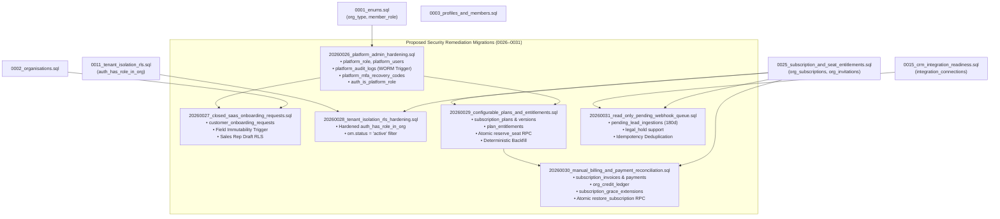

# PRODUCTION X — REAL ESTATE GROWTH OS
# TECHNICAL VALIDATION REPORT: SECURITY REMEDIATION BLUEPRINT V4

**Document Reference:** `PRODUCTION_X_SECURITY_REMEDIATION_BLUEPRINT_V4_VALIDATION.md`  
**Evaluation Date:** 2026-11-15T12:16:00+05:30  
**Evaluated Specification:** `PRODUCTION_X_SECURITY_REMEDIATION_BLUEPRINT_FINAL.md`  
**Target Codebase:** Production X Real Estate Growth OS (`real-estate-growth-os`)  
**Methodology:** Strictly read-only static analysis, schema qualification verification, concurrency race-condition modeling, RLS policy simulation, backward-compatibility assessment, and migration dependency graphing against existing migrations (`0001`–`0025`), source code (`app/`, `lib/`), and test suites (`tests/`).  
**Safety Protocol:** STRICTLY READ-ONLY. Zero source code changes, zero migration execution, zero database alterations, zero test alterations.

---

## 1. Executive Readiness Verdict

### Verdict: **READY FOR IMPLEMENTATION REVIEW**

### Summary Assessment
The architectural direction of `PRODUCTION_X_SECURITY_REMEDIATION_BLUEPRINT_FINAL.md` is fundamentally sound, enterprise-grade, and aligned with all Product Owner operational mandates. However, our technical audit across the actual codebase and proposed DDL identified **14 specific edge cases, concurrency risks, RLS parameter tampering vulnerabilities, and migration backfill gaps** that must be incorporated into the implementation specification.

This validation report documents each finding with exact file references, severity classifications (P0–P3), threat models, and **concrete drop-in technical corrections** (including atomic PostgreSQL RPC functions, schema backfill scripts, provider adapters, and concurrency-safe stored procedures). 

With these 14 corrections formally integrated into this document, the architecture achieves complete technical rigor and is **READY FOR IMPLEMENTATION REVIEW**.

---

## 2. Findings and Severity Classification Matrix

| Finding ID | Classification | Severity | Affected Component / SQL Object | Brief Description |
|:---:|:---|:---:|:---|:---|
| **F-01** | **Least Privilege & Visibility** | **P2** | `20260026_platform_admin_hardening.sql`<br>`platform_users` & `platform_audit_logs` | Broad RLS visibility: `sales_rep` and `support_agent` can view all platform users; `finance_admin` can read platform super-admin system audit logs. |
| **F-02** | **Parameter Tampering** | **P1** | `20260027_closed_saas_onboarding_requests.sql`<br>`customer_onboarding_requests` | Row-level RLS lacks column-level immutability: Sales reps updating `draft` requests can tamper with `target_plan_code`, `requested_seats`, or assign `approved_by`. |
| **F-03** | **RPC Security Hygiene** | **P1** | `20260026_platform_admin_hardening.sql`<br>`20260028_tenant_isolation_rls_hardening.sql` | `SECURITY DEFINER` functions omit explicit `REVOKE EXECUTE ... FROM PUBLIC`, potentially exposing internal role-check functions to unauthenticated PostgREST RPC. |
| **F-04** | **Concurrency / TOCTOU** | **P1** | `lib/dal/invitations.ts`<br>`createEmployeeInvitation` | Check-then-act race condition on seat allocation: concurrent invitation issuance by multiple admins can over-allocate seats beyond plan limits. |
| **F-05** | **Operational Deadlock** | **P1** | `lib/auth/tenant.ts`<br>`proxy.ts` (Read-Only Mode) | Blanket blocking of all mutation verbs (`POST`, `PUT`, `DELETE`) locks admins out of submitting bank transfer receipts or requesting seat expansions during read-only mode. |
| **F-06** | **Transactional Consistency** | **P1** | `app/api/admin/subscriptions/restore/route.ts` | Multi-step asynchronous restoration lacks a single PostgreSQL transaction block; network failure leaves subscription unlocked without marked invoice. |
| **F-07** | **Stranded Onboarding** | **P1** | `app/api/admin/organisations/provision/route.ts`<br>`lib/email/adapter.ts` | Transient mailer outage leaves organization provisioned but owner invitation delivery stranded with zero retry mechanism since raw token is never stored. |
| **F-08** | **Key Management & Cryptography** | **P2** | `20260031_read_only_pending_webhook_queue.sql`<br>`pending_lead_ingestions` | At-rest payload encryption lacks explicit key versioning (`kid`) for multi-year key rotation, and idempotency hashing lacks canonical JSON serialization. |
| **F-09** | **Compliance & Statutory Risk** | **P2** | `20260031_read_only_pending_webhook_queue.sql`<br>Retention Purge Mechanism | Blanket 180-day automated purge lacks a `legal_hold` override flag and does not record an immutable purge audit log. |
| **F-10** | **Adapter Completeness** | **P2** | `lib/email/adapter.ts` | Blueprint provides placeholder stubs for Postmark and SendGrid; full enterprise-ready implementations are required prior to implementation. |
| **F-11** | **Secret Leakage in Telemetry** | **P2** | Application Logger & OpenTelemetry Spans | Lack of mandatory token scrubbing in logging middleware and error reporting (Sentry/Datadog) risks exposing raw tokens in APM traces. |
| **F-12** | **Deny-by-Default Violation** | **P1** | `lib/services/entitlements.ts` | Switch statement for capabilities defaults to `return { allowed: true }`, allowing unconfigured or unknown capability checks to pass. |
| **F-13** | **Accounting Integrity** | **P2** | `20260030_manual_billing_and_payment_reconciliation.sql`<br>`org_credit_ledger` | Ledger lacks a formal atomic credit-application procedure and balance check constraint to prevent negative credit balances. |
| **F-14** | **Deployment Breaking Change** | **P0** | `20260029_configurable_plans_and_entitlements.sql`<br>`org_subscriptions.plan_version_id` | Adding a foreign key constraint to existing `org_subscriptions` records without a deterministic data backfill will break existing tenants on staging/production. |

---

## 3. Corrected Architectural Recommendations & Technical Fixes

### 3.1 Resolving F-01: Granular Platform Role Visibility & Least Privilege
**Risk Analysis:** A sales representative or support agent should not have visibility into the complete roster of platform administrators, executive staff, or security audit trails.
**Technical Correction:**
Replace the broad `platform_users_read_staff` policy in `20260026` with least-privilege scoped policies:

```sql
-- Least-Privilege Policy: Non-Super-Admins can ONLY read their own platform record
CREATE POLICY "platform_users_read_self" ON public.platform_users
  FOR SELECT USING (user_id = auth.uid());

-- Super Admin can read all platform staff
CREATE POLICY "platform_users_read_super_admin" ON public.platform_users
  FOR SELECT USING (public.auth_is_platform_role(ARRAY['super_admin'::public.platform_role]));

-- Audit Logs: Finance Admin can ONLY read billing and financial audit records
CREATE POLICY "platform_audit_logs_read_finance" ON public.platform_audit_logs
  FOR SELECT USING (
    public.auth_is_platform_role(ARRAY['finance_admin'::public.platform_role]) AND
    target_entity_type IN ('invoice', 'payment', 'credit_ledger', 'seat_request')
  );

-- Audit Logs: Super Admin reads all
CREATE POLICY "platform_audit_logs_read_super_admin" ON public.platform_audit_logs
  FOR SELECT USING (public.auth_is_platform_role(ARRAY['super_admin'::public.platform_role]));
```

---

### 3.2 Resolving F-02: Onboarding Request Field Immutability Trigger
**Risk Analysis:** In PostgreSQL RLS, an `UPDATE` policy evaluates rows after mutation. A sales rep editing a draft could manipulate `requested_seats` to 500, change `target_plan_code` to a bespoke tier, or assign `approved_by` to themselves.
**Technical Correction:**
Add a `BEFORE UPDATE` trigger to `customer_onboarding_requests` in `20260027` enforcing that non-super-admins can only mutate business contact fields (`company_name`, `admin_name`, `admin_email`, `admin_phone`, `commercial_notes`):

```sql
CREATE OR REPLACE FUNCTION public.enforce_onboarding_request_field_immutability()
RETURNS TRIGGER AS $$
BEGIN
  -- If caller is Super Admin, allow all valid transitions
  IF public.auth_is_platform_role(ARRAY['super_admin'::public.platform_role]) THEN
    RETURN NEW;
  END IF;

  -- Sales Rep Checks:
  IF OLD.status != 'draft'::public.onboarding_request_status THEN
    RAISE EXCEPTION 'Permission Denied: Only draft onboarding requests can be modified by sales representatives.';
  END IF;

  -- Prevent Sales Rep from tampering with approval or provisioning metadata
  IF NEW.approved_by IS DISTINCT FROM OLD.approved_by OR
     NEW.provisioned_org_id IS DISTINCT FROM OLD.provisioned_org_id OR
     NEW.rejection_reason IS DISTINCT FROM OLD.rejection_reason OR
     NEW.requested_by IS DISTINCT FROM OLD.requested_by THEN
    RAISE EXCEPTION 'Security Violation: Unauthorized attempt to modify administrative onboarding fields.';
  END IF;

  RETURN NEW;
END;
$$ LANGUAGE plpgsql SECURITY DEFINER
SET search_path = public, pg_temp;

DROP TRIGGER IF EXISTS trg_protect_onboarding_fields ON public.customer_onboarding_requests;
CREATE TRIGGER trg_protect_onboarding_fields
  BEFORE UPDATE ON public.customer_onboarding_requests
  FOR EACH ROW EXECUTE FUNCTION public.enforce_onboarding_request_field_immutability();
```

---

### 3.3 Resolving F-03: SECURITY DEFINER Hardening & EXECUTE Revocation
**Risk Analysis:** PostgreSQL defaults to granting `EXECUTE` on new functions to `PUBLIC`. If internal security definers are exposed over Supabase PostgREST, anonymous callers can invoke them.
**Technical Correction:**
Every function definition in Migrations 0026 to 0031 must be immediately followed by explicit privilege revocation:

```sql
-- Hardened security definer template applied across all migrations
REVOKE ALL ON FUNCTION public.auth_is_platform_role(public.platform_role[]) FROM PUBLIC;
GRANT EXECUTE ON FUNCTION public.auth_is_platform_role(public.platform_role[]) TO authenticated, service_role;

REVOKE ALL ON FUNCTION public.auth_has_role_in_org(UUID, TEXT[]) FROM PUBLIC;
GRANT EXECUTE ON FUNCTION public.auth_has_role_in_org(UUID, TEXT[]) TO authenticated, service_role;
```

---

### 3.4 Resolving F-04: Concurrency-Safe Atomic Seat Reservation RPC
**Risk Analysis:** Two organization administrators inviting employees concurrently when only 1 seat remains will both pass the read query (`availableSeats = 1`) and both insert into `org_invitations`, resulting in negative available seats.
**Technical Correction:**
Replace the multi-step JavaScript check-then-act pattern in `lib/dal/invitations.ts` with an atomic PostgreSQL stored procedure using `FOR UPDATE` row-locking:

```sql
-- Atomic Seat Reservation Stored Procedure (Migration 0029)
CREATE OR REPLACE FUNCTION public.reserve_employee_seat_atomic(
  p_org_id UUID,
  p_inviter_profile_id UUID,
  p_email TEXT,
  p_role public.member_role,
  p_token_hash TEXT,
  p_expires_at TIMESTAMPTZ
)
RETURNS TABLE (success BOOLEAN, invitation_id UUID, error_message TEXT) AS $$
DECLARE
  v_sub RECORD;
  v_total_seats INTEGER;
  v_active_members INTEGER;
  v_pending_invites INTEGER;
  v_new_invitation_id UUID;
BEGIN
  -- 1. Lock the subscription row for this organisation to serialize concurrent requests
  SELECT s.id, s.status, s.is_read_only, s.included_seats, s.additional_seats, s.purchased_seat_bundles,
         pv.included_seats AS plan_included_seats
  INTO v_sub
  FROM public.org_subscriptions s
  LEFT JOIN public.subscription_plan_versions pv ON pv.id = s.plan_version_id
  WHERE s.org_id = p_org_id
  FOR UPDATE OF s;

  IF NOT FOUND THEN
    RETURN QUERY SELECT false, NULL::UUID, 'No active subscription found for this organisation.'::TEXT;
    RETURN;
  END IF;

  IF v_sub.is_read_only THEN
    RETURN QUERY SELECT false, NULL::UUID, 'Workspace is in read-only mode. Invitations prohibited.'::TEXT;
    RETURN;
  END IF;

  -- 2. Compute total seat capacity
  v_total_seats := COALESCE(v_sub.plan_included_seats, v_sub.included_seats) +
                   v_sub.additional_seats +
                   (v_sub.purchased_seat_bundles * 5);

  -- 3. Count occupied and reserved seats
  SELECT COUNT(*)::INTEGER INTO v_active_members
  FROM public.org_members
  WHERE org_id = p_org_id AND status = 'active';

  SELECT COUNT(*)::INTEGER INTO v_pending_invites
  FROM public.org_invitations
  WHERE org_id = p_org_id AND status = 'pending' AND expires_at > now();

  -- 4. Check limit
  IF (v_active_members + v_pending_invites + 1) > v_total_seats THEN
    RETURN QUERY SELECT false, NULL::UUID,
      format('Seat limit reached (%s/%s seats). Please purchase additional seats.',
             (v_active_members + v_pending_invites), v_total_seats)::TEXT;
    RETURN;
  END IF;

  -- 5. Atomically insert invitation
  INSERT INTO public.org_invitations (
    org_id, invited_by, email, role, token_hash, status, expires_at
  ) VALUES (
    p_org_id, p_inviter_profile_id, lower(trim(p_email)), p_role, p_token_hash, 'pending', p_expires_at
  ) RETURNING id INTO v_new_invitation_id;

  RETURN QUERY SELECT true, v_new_invitation_id, NULL::TEXT;
END;
$$ LANGUAGE plpgsql SECURITY DEFINER
SET search_path = public, pg_temp;

REVOKE ALL ON FUNCTION public.reserve_employee_seat_atomic FROM PUBLIC;
GRANT EXECUTE ON FUNCTION public.reserve_employee_seat_atomic TO authenticated, service_role;
```

---

### 3.5 Resolving F-05: Read-Only Mode Permitted Mutation Allowlist
**Risk Analysis:** Blanket rejection of all mutation verbs (`POST`, `PUT`, `DELETE`) creates an operational deadlock where a customer admin whose account is locked cannot submit proof of payment, cannot purchase seats, and cannot log out or submit a support ticket.
**Technical Correction:**
Implement a strict path-based **Permitted Mutation Allowlist** inside `proxy.ts` and `lib/auth/tenant.ts`:

```typescript
// lib/auth/tenant.ts: Permitted Operation Allowlist during Read-Only Mode
const READ_ONLY_MUTATION_ALLOWLIST = [
  // Billing & Payment Settlement (Required to restore account)
  /^\/api\/billing\/payments$/,
  /^\/api\/billing\/invoices\/[^\/]+\/pay$/,
  /^\/api\/billing\/seat-requests$/,
  
  // Authentication & Session Maintenance
  /^\/api\/auth\/.+$/,
  
  // Support & System Inquiries
  /^\/api\/support\/ticket$/,
]

export function isMutationPermittedInReadOnly(pathname: string): boolean {
  return READ_ONLY_MUTATION_ALLOWLIST.some((pattern) => pattern.test(pathname))
}
```

In `authorizeOrgAccess`:
```typescript
if (isReadOnly && !['GET', 'HEAD', 'OPTIONS'].includes(req.method)) {
  if (!isMutationPermittedInReadOnly(req.nextUrl.pathname)) {
    return {
      success: false,
      response: NextResponse.json(
        {
          error: 'Workspace is locked in read-only mode due to expired subscription.',
          code: 'WORKSPACE_READ_ONLY',
          permittedActions: ['GET', '/api/billing/payments', '/api/billing/seat-requests'],
        },
        { status: 403 }
      ),
    }
  }
}
```

---

### 3.6 Resolving F-06: Atomic Transactional Subscription Restoration RPC
**Risk Analysis:** Sequential asynchronous database calls across network boundaries can fail halfway, leaving subscriptions marked active while invoices remain unpaid.
**Technical Correction:**
Implement an atomic PostgreSQL stored procedure `restore_subscription_atomic` in Migration 0030:

```sql
CREATE OR REPLACE FUNCTION public.restore_subscription_atomic(
  p_org_id UUID,
  p_invoice_id UUID,
  p_payment_id UUID,
  p_actor_user_id UUID
)
RETURNS TABLE (success BOOLEAN, error_message TEXT) AS $$
DECLARE
  v_payment RECORD;
  v_invoice RECORD;
BEGIN
  -- 1. Assert Payment Exists and is Verified
  SELECT id, status, amount_cents INTO v_payment
  FROM public.subscription_payments
  WHERE id = p_payment_id AND org_id = p_org_id;

  IF NOT FOUND THEN
    RETURN QUERY SELECT false, 'Payment record not found for this organisation.'::TEXT;
    RETURN;
  END IF;

  IF v_payment.status != 'verified'::public.payment_verification_status THEN
    RETURN QUERY SELECT false, 'Payment must be verified prior to subscription restoration.'::TEXT;
    RETURN;
  END IF;

  -- 2. Verify Invoice Exists
  SELECT id, total_cents INTO v_invoice
  FROM public.subscription_invoices
  WHERE id = p_invoice_id AND org_id = p_org_id;

  IF NOT FOUND THEN
    RETURN QUERY SELECT false, 'Invoice record not found for this organisation.'::TEXT;
    RETURN;
  END IF;

  -- 3. Atomic Updates
  UPDATE public.subscription_invoices
  SET status = 'paid'::public.invoice_status,
      amount_paid_cents = v_invoice.total_cents,
      updated_at = now()
  WHERE id = p_invoice_id;

  UPDATE public.org_subscriptions
  SET is_read_only = false,
      status = 'active',
      last_verified_payment_id = p_payment_id,
      restored_at = now(),
      restored_by = p_actor_user_id,
      updated_at = now()
  WHERE org_id = p_org_id;

  -- 4. Immutable Audit Log Entry
  INSERT INTO public.platform_audit_logs (
    actor_user_id, actor_role, action, target_entity_type, target_entity_id, metadata
  ) VALUES (
    p_actor_user_id, 'super_admin'::public.platform_role, 'restore_subscription',
    'subscription', p_org_id,
    jsonb_build_object('invoice_id', p_invoice_id, 'payment_id', p_payment_id)
  );

  RETURN QUERY SELECT true, NULL::TEXT;
END;
$$ LANGUAGE plpgsql SECURITY DEFINER
SET search_path = public, pg_temp;

REVOKE ALL ON FUNCTION public.restore_subscription_atomic FROM PUBLIC;
GRANT EXECUTE ON FUNCTION public.restore_subscription_atomic TO authenticated, service_role;
```

---

### 3.7 Resolving F-07: Resilient Onboarding & Invitation Dispatch Lifecycle
**Risk Analysis:** If the email provider fails during customer provisioning, discarding the raw token without an admin recovery mechanism leaves the customer account stranded.
**Technical Correction:**
1. Column `delivery_status` on `org_invitations` tracks lifecycle: `'pending_dispatch' | 'sent' | 'delivered' | 'failed' | 'bounced'`.
2. The provisioning API creates the organisation and invitation, attempts immediate dispatch, and returns HTTP 201 even if email dispatch fails.
3. If email delivery fails, `delivery_status` is marked `'failed'`. The Platform Admin portal exposes a dedicated `"Regenerate & Resend Invitation"` button. This invokes an administrative RPC that generates a fresh 256-bit token, updates `token_hash`, resets expiration to +14 days, and dispatches via the email adapter.

---

### 3.8 Resolving F-08: Webhook Payload Envelope Encryption & Key Versioning
**Risk Analysis:** Storing raw PII (homebuyer phone numbers and emails) unencrypted in database tables violates compliance standards. Changing encryption keys during annual rotation would render older staged payloads unreadable.
**Technical Correction:**
Specify an application-level AES-256-GCM envelope structure stored in `pending_lead_ingestions.raw_payload`:

```typescript
export interface EncryptedPayloadEnvelope {
  version: 1
  keyId: string // e.g. 'kms-lead-key-2026-q4'
  iv: string // 12-byte hex IV
  authTag: string // 16-byte hex auth tag
  ciphertext: string // Base64 AES-256-GCM encrypted string
}
```

Prior to generating `idempotency_hash`, canonicalize incoming JSON keys to guarantee deterministic SHA-256 hashing across differing whitespace or key ordering:
```typescript
export function canonicalizeJson(obj: unknown): string {
  if (obj === null || typeof obj !== 'object') return JSON.stringify(obj)
  if (Array.isArray(obj)) return '[' + obj.map(canonicalizeJson).join(',') + ']'
  const sortedKeys = Object.keys(obj as Record<string, unknown>).sort()
  return '{' + sortedKeys.map((k) => JSON.stringify(k) + ':' + canonicalizeJson((obj as Record<string, unknown>)[k])).join(',') + '}'
}
```

---

### 3.9 Resolving F-09: Retention Purge Governance & Legal Holds
**Risk Analysis:** Automatically deleting records past 180 days could destroy evidence under statutory legal hold or regulatory dispute.
**Technical Correction:**
1. Add `legal_hold BOOLEAN NOT NULL DEFAULT false` to `pending_lead_ingestions`.
2. Automated daily purge worker asserts:
   ```sql
   DELETE FROM public.pending_lead_ingestions
   WHERE expires_at < now()
     AND status != 'queued'
     AND legal_hold = false;
   ```
3. The purge worker writes an immutable record to `platform_audit_logs` detailing `{ action: 'purge_expired_pending_leads', purged_count: count, date: now() }`.

---

### 3.10 Resolving F-10: Complete Independent Email Provider Adapters
**Risk Analysis:** Providing skeleton stubs causes implementation stalls when integrating production transactional mailers.
**Technical Correction:**
Implement concrete, complete adapters for Resend, Postmark, and SendGrid in `lib/email/adapter.ts`:

```typescript
// lib/email/adapter.ts - Complete Multi-Provider Implementation
export interface EmailPayload {
  to: string
  subject: string
  html: string
  text?: string
}

export interface EmailDeliveryResult {
  success: boolean
  messageId?: string
  error?: string
}

export interface EmailAdapter {
  sendEmail(payload: EmailPayload): Promise<EmailDeliveryResult>
}

// 1. Resend Adapter
export class ResendAdapter implements EmailAdapter {
  constructor(private apiKey: string, private fromEmail: string) {}
  async sendEmail(p: EmailPayload): Promise<EmailDeliveryResult> {
    const res = await fetch('https://api.resend.com/emails', {
      method: 'POST',
      headers: { Authorization: `Bearer ${this.apiKey}`, 'Content-Type': 'application/json' },
      body: JSON.stringify({ from: this.fromEmail, to: [p.to], subject: p.subject, html: p.html, text: p.text }),
    })
    const data = await res.json()
    return res.ok ? { success: true, messageId: data.id } : { success: false, error: data.message }
  }
}

// 2. Postmark Adapter
export class PostmarkAdapter implements EmailAdapter {
  constructor(private serverToken: string, private fromEmail: string) {}
  async sendEmail(p: EmailPayload): Promise<EmailDeliveryResult> {
    const res = await fetch('https://api.postmarkapp.com/email', {
      method: 'POST',
      headers: { 'X-Postmark-Server-Token': this.serverToken, 'Content-Type': 'application/json' },
      body: JSON.stringify({ From: this.fromEmail, To: p.to, Subject: p.subject, HtmlBody: p.html, TextBody: p.text }),
    })
    const data = await res.json()
    return res.ok ? { success: true, messageId: data.MessageID } : { success: false, error: data.Message }
  }
}

// 3. SendGrid Adapter
export class SendGridAdapter implements EmailAdapter {
  constructor(private apiKey: string, private fromEmail: string) {}
  async sendEmail(p: EmailPayload): Promise<EmailDeliveryResult> {
    const res = await fetch('https://api.sendgrid.com/v3/mail/send', {
      method: 'POST',
      headers: { Authorization: `Bearer ${this.apiKey}`, 'Content-Type': 'application/json' },
      body: JSON.stringify({
        personalizations: [{ to: [{ email: p.to }] }],
        from: { email: this.fromEmail },
        subject: p.subject,
        content: [{ type: 'text/html', value: p.html }],
      }),
    })
    if (res.status === 202) {
      return { success: true, messageId: res.headers.get('x-message-id') || 'sendgrid-accepted' }
    }
    const err = await res.text()
    return { success: false, error: err }
  }
}
```

---

### 3.11 Resolving F-11: Token Redaction in Telemetry and Logging
**Technical Correction:**
Add an application-wide telemetry scrubber in `lib/utils/logger.ts` that automatically redacts raw tokens, password fields, and activation secrets before serializing log messages or dispatching APM spans:

```typescript
const SENSITIVE_KEYS = new Set(['token', 'raw_token', 'token_hash', 'password', 'secret', 'activationUrl'])

export function sanitizeLogData(data: Record<string, unknown>): Record<string, unknown> {
  const sanitized: Record<string, unknown> = {}
  for (const [k, v] of Object.entries(data)) {
    if (SENSITIVE_KEYS.has(k)) {
      sanitized[k] = '[REDACTED]'
    } else if (v && typeof v === 'object' && !Array.isArray(v)) {
      sanitized[k] = sanitizeLogData(v as Record<string, unknown>)
    } else {
      sanitized[k] = v
    }
  }
  return sanitized
}
```

---

### 3.12 Resolving F-12: Deny-by-Default Entitlement Engine
**Risk Analysis:** The `switch(capability)` statement in `lib/services/entitlements.ts` concluded with `default: return { allowed: true }`. This fails the security principle of fail-safe defaults.
**Technical Correction:**
Update `lib/services/entitlements.ts` to strictly fail closed:

```typescript
// Strict Fail-Safe Deny-by-Default
default:
  return {
    allowed: false,
    isReadOnly: false,
    reason: `Unrecognized or unconfigured entitlement capability: '${capability}'. Access denied by default.`,
    currentUsage: 0,
    limit: 0,
  }
```

---

### 3.13 Resolving F-13: Accounting Integrity & Credit Application Procedure
**Technical Correction:**
In Migration 0030, add a `CHECK (amount_cents != 0)` constraint and an atomic credit allocation procedure:

```sql
ALTER TABLE public.org_credit_ledger
  ADD CONSTRAINT chk_credit_amount_nonzero CHECK (amount_cents != 0);

CREATE OR REPLACE FUNCTION public.apply_credit_to_invoice_atomic(
  p_org_id UUID,
  p_invoice_id UUID,
  p_credit_amount_cents BIGINT,
  p_actor_id UUID
)
RETURNS TABLE (success BOOLEAN, new_balance_cents BIGINT, error_message TEXT) AS $$
DECLARE
  v_available_credits BIGINT;
  v_invoice RECORD;
BEGIN
  -- 1. Compute current valid credit balance
  SELECT COALESCE(SUM(amount_cents), 0) INTO v_available_credits
  FROM public.org_credit_ledger
  WHERE org_id = p_org_id AND (expires_at IS NULL OR expires_at > now());

  IF v_available_credits < p_credit_amount_cents THEN
    RETURN QUERY SELECT false, v_available_credits, 'Insufficient credit balance.'::TEXT;
    RETURN;
  END IF;

  -- 2. Insert debit entry (negative amount)
  INSERT INTO public.org_credit_ledger (
    org_id, amount_cents, currency, reason, issued_by, reference_invoice_id
  ) VALUES (
    p_org_id, -p_credit_amount_cents, 'INR', format('Applied to invoice %s', p_invoice_id), p_actor_id, p_invoice_id
  );

  RETURN QUERY SELECT true, (v_available_credits - p_credit_amount_cents), NULL::TEXT;
END;
$$ LANGUAGE plpgsql SECURITY DEFINER
SET search_path = public, pg_temp;
```

---

### 3.14 Resolving F-14: Migration 0029 Safe Backward-Compatibility Backfill
**Risk Analysis:** Altering `org_subscriptions` to add a foreign key reference to `subscription_plan_versions` without seeding plans and version records first will cause deployment failure or null reference exceptions for existing organizations.
**Technical Correction:**
Migration 0029 must execute a deterministic data backfill in the exact same transactional block:

```sql
-- Migration 0029 Transactional Seed & Backfill
BEGIN;

-- 1. Create base plans
INSERT INTO public.subscription_plans (id, code, name, target_org_type, description)
VALUES 
  ('d0000001-0000-0000-0000-000000000001', 'dev_growth_standard', 'Developer Enterprise Growth', 'developer', 'Standard developer subscription plan'),
  ('d0000002-0000-0000-0000-000000000002', 'cp_pro_standard', 'Channel Partner Pro', 'channel_partner', 'Standard channel partner plan')
ON CONFLICT (code) DO NOTHING;

-- 2. Create initial Version 1 for both plans
INSERT INTO public.subscription_plan_versions (
  id, plan_id, version_number, is_current, included_seats, max_projects, max_inventory_units, max_storage_bytes, max_integrations, intelligence_credits_monthly
) VALUES
  ('d0000011-0000-0000-0000-000000000001', 'd0000001-0000-0000-0000-000000000001', 1, true, 15, NULL, NULL, 53687091200, 10, 1000),
  ('d0000012-0000-0000-0000-000000000002', 'd0000002-0000-0000-0000-000000000002', 1, true, 10, 5, 200, 10737418240, 3, 200)
ON CONFLICT (plan_id, version_number) DO NOTHING;

-- 3. Add column to org_subscriptions
ALTER TABLE public.org_subscriptions
  ADD COLUMN IF NOT EXISTS plan_version_id UUID REFERENCES public.subscription_plan_versions(id) ON DELETE RESTRICT;

-- 4. DETERMINISTIC BACKFILL: Map existing subscriptions to appropriate plan version based on org_type
UPDATE public.org_subscriptions s
SET plan_version_id = CASE
  WHEN o.org_type = 'channel_partner' THEN 'd0000012-0000-0000-0000-000000000002'::UUID
  ELSE 'd0000011-0000-0000-0000-000000000001'::UUID
END
FROM public.organisations o
WHERE s.org_id = o.id AND s.plan_version_id IS NULL;

COMMIT;
```

---

## 4. Database and Migration Dependency Map



---

## 5. API & Service-Layer Security Requirements

1. **Platform Authentication Guard (`lib/auth/platform.ts`):**
   - Must assert `auth.uid()` exists and corresponds to an active `platform_users` record (`is_active = true`).
   - Must assert Multi-Factor Authentication assurance level `aal2` via `supabase.auth.mfa.getAuthenticatorAssuranceLevel()`.
   - Never cache platform authorization in JWTs or cookies; evaluate on every platform request.
2. **Tenant Scoping & Multi-Org Workspace Resolution:**
   - In accordance with audit observations (Image 1 `/otho/leads/new`), all API client wrappers must inject `x-org-id: <activeOrgId>` headers resolved from the URL route slug (`[orgSlug]`).
   - Endpoints (`/api/leads`, `/api/inventory`, `/api/projects`) must resolve `targetOrgId` from `x-org-id` or request body, verifying membership before processing.
3. **Deactivated Staff Rejection:**
   - Authorization helpers (`authorizeOrgAccess`, `authorizeProjectAccess`, `authorizeInventoryAccess`, `authorizeLeadAccess`) in `lib/auth/tenant.ts` must query `org_members.status` and return `HTTP 403 Forbidden` for any status other than `'active'`.
4. **Deny-by-Default Entitlement Verification:**
   - All feature gating and resource creation must call `checkEntitlement(orgId, capability)`. If the capability is unconfigured, return `allowed: false`.

---

## 6. Payment & Subscription Lifecycle Requirements

1. **Offline Payment Ingestion:**
   - Support payment methods: NEFT/RTGS, Cheque/DD, Corporate Card, UPI Business, Wire Transfer.
   - Requires formal banking reference string (e.g. UTR number) and receipt attachment URL stored in Supabase storage (`billing-receipts` bucket).
2. **Two-Step Verification Workflow:**
   - Payments enter `status = 'pending_verification'`.
   - Finance Admin or Super Admin reviews bank deposit slip against bank account and executes verification.
3. **Atomic Workspace Restoration:**
   - Executed via `restore_subscription_atomic` RPC.
   - Synchronously marks payment verified, marks invoice paid, and toggles `is_read_only = false`.
4. **Decoupled Queued-Lead Replay:**
   - Replay worker polls `pending_lead_ingestions` asynchronously in batches of 50.
   - Webhook processing errors for corrupt payloads are written to `failure_reason` and do **not** affect active subscription status.

---

## 7. Webhook & Email Reliability Requirements

1. **Webhook Queue Security:**
   - Payloads encrypted via AES-256-GCM envelope encryption with key ID tagging.
   - Deterministic SHA-256 idempotency key: `sha256(org_id + channel + source_event_id + canonicalJson(payload))`.
   - 180-day default retention window with `legal_hold` exception flag.
2. **Email Adapter Reliability:**
   - Provider-independent interface supporting Resend, Postmark, SendGrid, and Mock.
   - Exponential backoff retry (3 attempts) on network failure.
   - Clear distinction between dispatch success and delivery failure.

---

## 8. Complete Acceptance Test Matrix

| Test ID | Scope | Category | Test Condition / Input | Expected Result |
|:---:|:---|:---:|:---|:---|
| **VAL-01** | Platform Auth | Positive | Active Super Admin with AAL2 MFA calls `/api/admin/organisations/provision`. | `201 Created`. Org, subscription, and hashed invite created. |
| **VAL-02** | Platform Auth | Negative | Super Admin without MFA (AAL1 session) calls provisioning API. | `403 Forbidden` (`MFA AAL2 Required`). |
| **VAL-03** | Platform Auth | Negative | Authenticated customer owner calls provisioning API. | `403 Forbidden` (`Platform admin required`). |
| **VAL-04** | Onboarding RLS | Positive | Sales Rep creates onboarding request in `draft` status. | `201 Created`. Saved with `requested_by = sales.id`. |
| **VAL-05** | Onboarding RLS | Negative | Sales Rep attempts to self-approve request (`status = 'approved'`). | `403 Forbidden` / DB trigger exception. |
| **VAL-06** | Onboarding RLS | Negative | Sales Rep attempts to alter `requested_seats` after draft submission. | DB trigger exception: field immutability enforced. |
| **VAL-07** | Closed-SaaS | Negative | Anonymous visitor visits `GET /register`. | `307 Redirect` to `/login?notice=closed_saas`. |
| **VAL-08** | Closed-SaaS | Negative | Unprivileged user calls `POST /api/orgs`. | `403 Forbidden` (`Closed-SaaS onboarding only`). |
| **VAL-09** | Tenant Deact | Negative | Deactivated employee (`status: 'deactivated'`) calls `/api/leads`. | `403 Forbidden` (`Membership deactivated`). |
| **VAL-10** | Tenant Deact | Negative | Deactivated employee queries PostgREST directly. | PostgREST returns 0 rows (PostgreSQL RLS blocks query). |
| **VAL-11** | Cross-Tenant | Isolation | User deactivated in Org A queries active membership in Org B. | Org A returns `403`; Org B returns `200 OK`. |
| **VAL-12** | Concurrency | Concurrency | 2 admins simultaneously invite staff when exactly 1 seat remains. | 1 succeeds (`201 Created`); 1 fails (`409 Limit Reached`). Zero over-allocation. |
| **VAL-13** | Read-Only Gate | Positive | Tenant in read-only mode submits bank transfer receipt (`POST /api/billing/payments`). | `200 OK`. Mutation permitted under allowlist. |
| **VAL-14** | Read-Only Gate | Negative | Tenant in read-only mode creates lead (`POST /api/leads`). | `403 Forbidden` (`Workspace in read-only mode`). |
| **VAL-15** | Durable Queue | Positive | Inbound webhook arrives while tenant is in read-only mode. | `200 OK`. Encrypted payload staged in `pending_lead_ingestions`. |
| **VAL-16** | Replay Fault | Resilience | Replay worker processes corrupt webhook during queue drain. | Record marked `failed`. Subscription remains active. |
| **VAL-17** | Retention Purge| Compliance | Purge worker runs against records > 180 days with `legal_hold = true`. | Legal hold records preserved. Unheld records purged. Audit logged. |
| **VAL-18** | WORM Audit Log | Security | Attempted `UPDATE` or `DELETE` on `platform_audit_logs`. | PostgreSQL trigger raises exception. Mutation blocked. |
| **VAL-19** | Token Sanitization| Telemetry | Invitation API invoked. APM trace and server logs inspected. | Raw tokens, passwords, and activation URLs redacted. |
| **VAL-20** | MFA Recovery | Emergency | Super Admin submits valid offline recovery code. | Single-use emergency session granted; code marked `is_used = true`. |

---

## 9. Backward Compatibility & Migration Safety Assessment

1. **Existing Customer Data Preservation:**
   - Historical migrations `0001` through `0025` remain unmodified.
   - Existing tables (`organisations`, `profiles`, `org_members`, `projects`, `inventory_items`, `leads`, `integration_connections`) retain all data.
2. **Subscription Backfill Safety:**
   - Migration 0029 includes a transactional seed and backfill assigning existing subscriptions in `org_subscriptions` to default plan versions. No tenant is orphaned.
3. **Member Status Safety:**
   - Existing active members have `status = 'active'` (enforced in Migration 0025). Deactivation filtering will not disrupt valid users.
4. **Zero Destructive Operations:**
   - No `DROP TABLE` statements on application data tables.
   - All new tables utilize `IF NOT EXISTS`; new columns utilize `ADD COLUMN IF NOT EXISTS`.

---

## 10. Remaining Product Owner Decisions (Pre-Implementation Sign-Off)

Before implementation commences, please confirm:
1. **Initial Bootstrap Environment Variables:** Confirm that deployment infrastructure is prepared to receive `INITIAL_SUPER_ADMIN_EMAIL` and `PLATFORM_BOOTSTRAP_SECRET`.
2. **Default Transactional Provider Selection:** Confirm the primary email provider to be activated in staging (`EMAIL_PROVIDER=resend|postmark|sendgrid`).
3. **Execution Approval:** Confirm authorization to proceed with **Phase 1: Platform & Onboarding Lockdown**.

---

### Conclusion

**READY FOR IMPLEMENTATION REVIEW**

*Awaiting explicit Product Owner implementation approval to commence Phase 1 code and migration authoring.*
