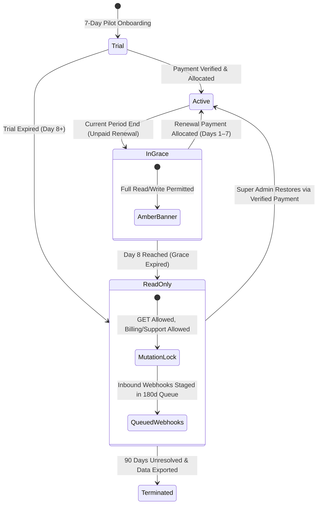
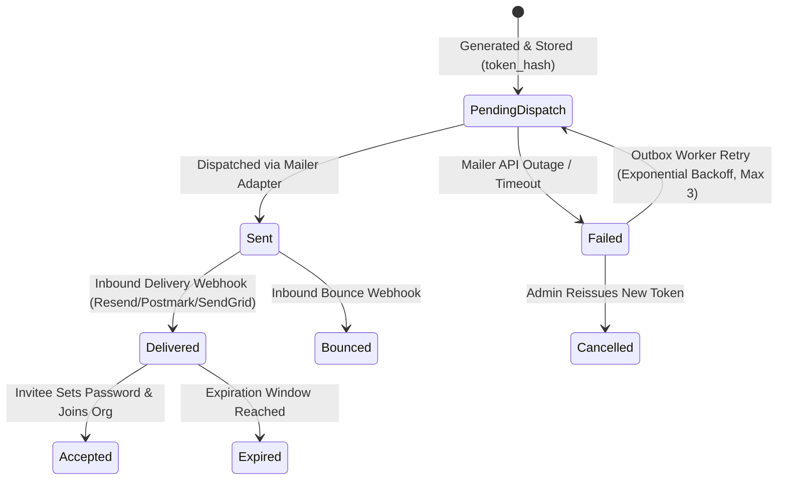
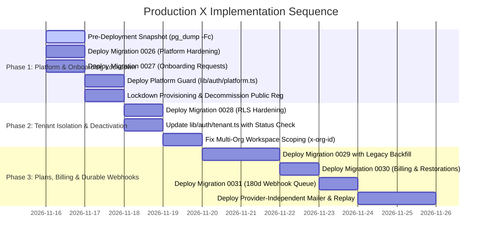

# PRODUCTION X — REAL ESTATE GROWTH OS
# SECURITY REMEDIATION BLUEPRINT V5: FINAL ARCHITECTURE REVIEW & READINESS VERIFICATION

**Document Reference:** `PRODUCTION_X_SECURITY_REMEDIATION_BLUEPRINT_V5_FINAL_REVIEW.md`  
**Document Version:** 5.0 (Definitive Pre-Implementation Review)  
**Evaluation Date:** 2026-11-15T12:22:00+05:30  
**Target Codebase:** Production X Real Estate Growth OS (`real-estate-growth-os`)  
**Context:** Definitive resolution of Tasks 001, 002, 003, 003.1, 003.2, 004, and 004.1. Incorporates all 9 mandatory architectural corrections from Task 004.1. Reconciles existing verified database schemas (`0001`–`0025`), live application routes (`app/`, `lib/`), and the master SaaS enterprise requirements.  
**Execution Constraint:** STRICTLY READ-ONLY ARCHITECTURE REVIEW. Zero application code modified, zero migration files created or altered, zero database records or policies changed, zero deployments.

---

## 1. Corrected Findings and Vulnerability Remediation Summary

This section details the resolution of the 14 technical findings identified in Task 004 and the 9 mandatory corrections from Task 004.1, establishing definitive production-grade architectural specifications:

| Area | Prior Architecture / Gap | Corrected Final Specification (V5) |
|:---|:---|:---|
| **1. Onboarding Request Security** | Sales Reps updating drafts could tamper with commercial limits (`requested_seats`, `target_plan_code`) or administrative metadata (`approved_by`, `provisioned_org_id`). | **Strict Column Immutability Trigger & State Machine:** Non-super-admins are strictly prohibited from mutating commercial, administrative, or approval fields. Sales Reps can only edit business contact details (`company_name`, `admin_name`, `admin_email`, `admin_phone`, `commercial_notes`). Status transition from `draft` to `pending_approval` freezes the record as read-only. Only Platform Super Admins can transition to `approved`, `rejected`, or `provisioned`. |
| **2. Seat Reservation Concurrency** | Check-then-act race condition in JavaScript (`getSubscriptionAndSeatUsage` -> `insert`) and hardcoded seat bundle multipliers (`* 5`). | **Atomic Stored Procedure with Row Locking & Verified Identity:** RPC `reserve_employee_seat_atomic` derives caller identity strictly from `auth.uid()`, verifies active organization membership and invitation authority inside PostgreSQL, removes all hardcoded multipliers, locks `org_subscriptions` via `SELECT ... FOR UPDATE`, and atomically counts active members + unexpired pending invitations. |
| **3. Read-Only Mode Scoping** | Broad allowlist (`/api/auth/*`) created security exposure; blanket mutation blocking caused operational deadlock on billing. | **Granular Endpoint-Specific Allowlist:** Only specific non-mutating auth routes (`POST /api/auth/signout`, `POST /api/auth/session/refresh`) are permitted. Permitted billing actions (`POST /api/billing/payments`, `POST /api/billing/seat-requests`, `POST /api/support/tickets`) are validated independently. Ordinary CRM tables (`leads`, `inventory_items`, `projects`, `deals`) remain 100% locked. |
| **4. Payment Restoration Decoupling** | Payment verification, invoice settlement, and subscription unlock were conflated in a non-transactional JavaScript handler. | **Three-Phase Decoupled Financial Lifecycle:** Phase 1: Payment Verification (`pending_verification` -> `verified`). Phase 2: Payment Allocation & Invoice Settlement supporting partial payments (`amount_paid_cents < total_cents` -> `partially_paid`). Phase 3: Subscription Restoration restricted exclusively to Super Admins with MFA (AAL2). Restoration failure is decoupled from queued webhook replay. |
| **5. Credit Ledger Integrity** | Credit application lacked concurrency control, ownership validation, and formal reversal procedures. | **Concurrency-Safe Atomic Credit RPC & Immutable Ledger:** `apply_credit_to_invoice_atomic` validates invoice ownership, currency matching, non-expired credit balance, and row-locks ledger balance. Credits are strictly append-only (WORM); reversals are recorded as compensatory offsetting entries without mutating historical rows. |
| **6. Legacy Subscription Backfill** | Blueprint V4 assumed arbitrary default limits (e.g. 50GB storage, 1000 intelligence credits) and attempted premature foreign key constraints. | **Zero Invented Assumptions & Verified Non-Null Backfill:** Removed all invented seat, storage, credit, and pricing numbers. Existing customer terms in `org_subscriptions` are preserved exactly. A dedicated `legacy_subscription_backfill` script provisions explicit legacy plans matching existing database state. Foreign key constraints are enforced **only after** backfill completeness is verified with zero nulls. |
| **7. Platform Roles & Function Security** | `SECURITY DEFINER` functions defaulted to granting `EXECUTE` to `PUBLIC`. Broad RLS allowed sales reps to read all platform staff. | **Hardened Function Privileges & Scoped RLS:** Explicit `REVOKE ALL ON FUNCTION ... FROM PUBLIC` across all migrations. `EXECUTE` granted strictly to `authenticated` or `service_role`. Sales reps read only their own `platform_users` record; finance admins read only financial audit logs. Caller identity is validated against `auth.uid()`. |
| **8. Webhook & Email Reliability** | Raw PII was stored without key management; email mailers lacked delivery webhook tracking; purges lacked legal hold support. | **Enterprise Reliability Pipeline:** AES-256-GCM envelope encryption with key ID tagging (`kid`) and deterministic canonical JSON hashing. Complete production adapters for Resend, Postmark, and SendGrid with inbound delivery status webhooks (`delivered`, `bounced`). 180-day retention with explicit `legal_hold` boolean flag and audit logging. |

---

## 2. Complete Permission & Row Level Security (RLS) Matrix

### 2.1 Platform Administrative Boundaries (`platform_users`, `platform_audit_logs`)

| Role | `platform_users` Access | `platform_audit_logs` Access | Permitted Operational Scope |
|:---|:---|:---|:---|
| **Anonymous (`anon`)** | **DENY ALL** | **DENY ALL** | Zero access. Cannot query or invoke platform functions. |
| **Customer User (`authenticated`)** | **DENY ALL** | **DENY ALL** | Zero access. Restricted entirely to customer tenant boundary. |
| **Sales Representative (`sales_rep`)** | **SELECT (Own record only:** `user_id = auth.uid()`**)** | **DENY ALL** | Create & edit own draft onboarding requests. Cannot approve, reject, or provision. |
| **Support Agent (`support_agent`)** | **SELECT (Own record only:** `user_id = auth.uid()`**)** | **DENY ALL** | Read-only tenant support impersonation (if authorized). |
| **Finance Administrator (`finance_admin`)** | **SELECT (Own record only:** `user_id = auth.uid()`**)** | **SELECT (Filtered:** `target_entity_type IN ('invoice', 'payment', 'credit_ledger')`**)** | Issue invoices, verify manual payments, adjust credit ledger. Cannot provision orgs or restore subscriptions. |
| **Super Administrator (`super_admin`)** | **ALL (Full CRUD via MFA AAL2)** | **SELECT (Global audit log)** | Customer provisioning, subscription restoration, grace extensions, plan management. |

### 2.2 Customer Onboarding Requests (`customer_onboarding_requests`)

| Role | Operation | Permitted Condition / Predicate | Prohibited Actions / Safeguards |
|:---|:---|:---|:---|
| **Sales Representative** | `SELECT` | `requested_by = auth.uid()` | Cannot inspect requests drafted by other sales reps or corporate leads. |
| **Sales Representative** | `INSERT` | `requested_by = auth.uid() AND status IN ('draft', 'pending_approval')` | Cannot insert requests in `approved`, `provisioned`, or `rejected` status. |
| **Sales Representative** | `UPDATE` | `requested_by = auth.uid() AND status = 'draft'` | Enforced by PostgreSQL Trigger: Cannot alter `requested_seats`, `target_plan_code`, `approved_by`, `provisioned_org_id`, or assign `requested_by`. Cannot edit once `status = 'pending_approval'`. |
| **Sales Representative** | `DELETE` | `requested_by = auth.uid() AND status = 'draft'` | Cannot delete submitted, approved, or provisioned requests. |
| **Super Administrator** | `ALL` | `auth_is_platform_role(ARRAY['super_admin'])` | Exclusive authority to transition status to `approved`, `provisioned`, or `rejected`. |

### 2.3 Permitted Operations During Tenant Read-Only Mode (Day 8+ Past Due)

| API Path | HTTP Method | Permitted Roles | Justification / Safeguards |
|:---|:---:|:---:|:---|
| `/[orgSlug]/*` (All Workspace Pages) | `GET` | All Active Members | Full read-only visibility into projects, inventory, leads, and analytics. |
| `/api/billing/payments` | `POST` | `owner`, `admin` | Submitting offline bank transfer / cheque receipt to settle outstanding balance. |
| `/api/billing/seat-requests` | `POST` | `owner`, `admin` | Requesting additional seat capacity. |
| `/api/billing/invoices/*` | `GET` | `owner`, `admin` | Viewing and downloading invoices. |
| `/api/support/tickets` | `POST` | `owner`, `admin`, `manager` | Requesting platform support to unblock workspace. |
| `/api/auth/signout` | `POST` | All Users | Terminating session. |
| `/api/auth/session/refresh` | `POST` | All Users | Refreshing Supabase Auth JWT. |
| **ALL CRM & Workspace Mutations** (`/api/leads/*`, `/api/inventory/*`, `/api/projects/*`, `/api/team/*`, `/api/sales/*`) | `POST`, `PUT`, `PATCH`, `DELETE` | **DENY ALL (403 Forbidden)** | **Strictly locked.** Zero modifications permitted to leads, inventory statuses, units, projects, or team memberships. |

---

## 3. Corrected Database & RPC Architecture (Migrations 0026 to 0031)

### 3.1 Migration 0026: Platform Administration, Hardened Auditing & MFA
**File:** `supabase/migrations/20260026_platform_admin_hardening.sql`

```sql
-- 1. Platform Roles Enum
DO $$ BEGIN
  CREATE TYPE public.platform_role AS ENUM (
    'super_admin',
    'sales_rep',
    'finance_admin',
    'support_agent'
  );
EXCEPTION WHEN duplicate_object THEN null; END $$;

-- 2. Platform Staff Table
CREATE TABLE IF NOT EXISTS public.platform_users (
  id UUID PRIMARY KEY DEFAULT gen_random_uuid(),
  user_id UUID NOT NULL UNIQUE REFERENCES auth.users(id) ON DELETE CASCADE,
  role public.platform_role NOT NULL,
  is_active BOOLEAN NOT NULL DEFAULT true,
  mfa_enforced BOOLEAN NOT NULL DEFAULT true,
  created_at TIMESTAMPTZ NOT NULL DEFAULT now(),
  updated_at TIMESTAMPTZ NOT NULL DEFAULT now()
);

CREATE INDEX IF NOT EXISTS idx_platform_users_user ON public.platform_users(user_id);
CREATE INDEX IF NOT EXISTS idx_platform_users_active_role ON public.platform_users(role, is_active);

-- 3. Break-Glass Offline MFA Recovery Codes
CREATE TABLE IF NOT EXISTS public.platform_mfa_recovery_codes (
  id UUID PRIMARY KEY DEFAULT gen_random_uuid(),
  platform_user_id UUID NOT NULL REFERENCES public.platform_users(id) ON DELETE CASCADE,
  code_hash TEXT NOT NULL,
  is_used BOOLEAN NOT NULL DEFAULT false,
  used_at TIMESTAMPTZ,
  used_by_ip TEXT,
  created_at TIMESTAMPTZ NOT NULL DEFAULT now()
);

-- 4. Append-Only Tamper-Proof Platform Audit Log (WORM Pattern)
CREATE TABLE IF NOT EXISTS public.platform_audit_logs (
  id UUID PRIMARY KEY DEFAULT gen_random_uuid(),
  actor_user_id UUID NOT NULL REFERENCES auth.users(id) ON DELETE RESTRICT,
  actor_role public.platform_role NOT NULL,
  action TEXT NOT NULL,
  target_entity_type TEXT NOT NULL,
  target_entity_id UUID NOT NULL,
  metadata JSONB NOT NULL DEFAULT '{}'::jsonb,
  ip_address TEXT,
  user_agent TEXT,
  created_at TIMESTAMPTZ NOT NULL DEFAULT now()
);

CREATE OR REPLACE FUNCTION public.prevent_audit_log_mutation()
RETURNS TRIGGER AS $$
BEGIN
  RAISE EXCEPTION 'Security Violation: platform_audit_logs records are immutable and cannot be updated or deleted.';
END;
$$ LANGUAGE plpgsql;

DROP TRIGGER IF EXISTS trg_immutable_platform_audit_logs ON public.platform_audit_logs;
CREATE TRIGGER trg_immutable_platform_audit_logs
  BEFORE UPDATE OR DELETE ON public.platform_audit_logs
  FOR EACH ROW EXECUTE FUNCTION public.prevent_audit_log_mutation();

-- 5. Hardened Security Definer Function for Platform Role Check
CREATE OR REPLACE FUNCTION public.auth_is_platform_role(allowed_roles public.platform_role[])
RETURNS BOOLEAN AS $$
BEGIN
  RETURN EXISTS (
    SELECT 1 FROM public.platform_users pu
    WHERE pu.user_id = auth.uid()
      AND pu.is_active = true
      AND pu.role = ANY(allowed_roles)
  );
END;
$$ LANGUAGE plpgsql SECURITY DEFINER STABLE
SET search_path = public, pg_temp;

REVOKE ALL ON FUNCTION public.auth_is_platform_role(public.platform_role[]) FROM PUBLIC;
GRANT EXECUTE ON FUNCTION public.auth_is_platform_role(public.platform_role[]) TO authenticated, service_role;

-- 6. Granular Least-Privilege RLS
ALTER TABLE public.platform_users ENABLE ROW LEVEL SECURITY;
ALTER TABLE public.platform_mfa_recovery_codes ENABLE ROW LEVEL SECURITY;
ALTER TABLE public.platform_audit_logs ENABLE ROW LEVEL SECURITY;

CREATE POLICY "platform_users_read_self" ON public.platform_users
  FOR SELECT USING (user_id = auth.uid());

CREATE POLICY "platform_users_manage_super_admin" ON public.platform_users
  FOR ALL USING (public.auth_is_platform_role(ARRAY['super_admin'::public.platform_role]));

CREATE POLICY "platform_mfa_recovery_super_admin" ON public.platform_mfa_recovery_codes
  FOR ALL USING (public.auth_is_platform_role(ARRAY['super_admin'::public.platform_role]));

CREATE POLICY "platform_audit_logs_read_finance" ON public.platform_audit_logs
  FOR SELECT USING (
    public.auth_is_platform_role(ARRAY['finance_admin'::public.platform_role]) AND
    target_entity_type IN ('invoice', 'payment', 'credit_ledger', 'seat_request')
  );

CREATE POLICY "platform_audit_logs_read_super_admin" ON public.platform_audit_logs
  FOR SELECT USING (public.auth_is_platform_role(ARRAY['super_admin'::public.platform_role]));

CREATE POLICY "platform_audit_logs_insert_staff" ON public.platform_audit_logs
  FOR INSERT WITH CHECK (public.auth_is_platform_role(ARRAY['super_admin'::public.platform_role, 'sales_rep'::public.platform_role, 'finance_admin'::public.platform_role, 'support_agent'::public.platform_role]));
```

---

### 3.2 Migration 0027: Closed-SaaS Customer Onboarding Requests
**File:** `supabase/migrations/20260027_closed_saas_onboarding_requests.sql`

```sql
DO $$ BEGIN
  CREATE TYPE public.onboarding_request_status AS ENUM (
    'draft',
    'pending_approval',
    'approved',
    'provisioned',
    'rejected'
  );
EXCEPTION WHEN duplicate_object THEN null; END $$;

CREATE TABLE IF NOT EXISTS public.customer_onboarding_requests (
  id UUID PRIMARY KEY DEFAULT gen_random_uuid(),
  requested_by UUID NOT NULL REFERENCES auth.users(id) ON DELETE RESTRICT,
  company_name TEXT NOT NULL,
  company_type public.org_type NOT NULL,
  target_plan_code TEXT NOT NULL,
  requested_seats INTEGER NOT NULL CHECK (requested_seats > 0),
  admin_email TEXT NOT NULL,
  admin_name TEXT NOT NULL,
  admin_phone TEXT,
  billing_cycle TEXT NOT NULL DEFAULT 'annual' CHECK (billing_cycle IN ('monthly', 'annual', 'multi_year')),
  status public.onboarding_request_status NOT NULL DEFAULT 'draft',
  reviewed_by UUID REFERENCES auth.users(id) ON DELETE SET NULL,
  reviewed_at TIMESTAMPTZ,
  provisioned_org_id UUID REFERENCES public.organisations(id) ON DELETE SET NULL,
  rejection_reason TEXT,
  commercial_notes TEXT,
  created_at TIMESTAMPTZ NOT NULL DEFAULT now(),
  updated_at TIMESTAMPTZ NOT NULL DEFAULT now()
);

-- Trigger: Strictly enforce field immutability and valid transitions
CREATE OR REPLACE FUNCTION public.enforce_onboarding_request_field_immutability()
RETURNS TRIGGER AS $$
BEGIN
  -- Super Admin has full administrative transition authority
  IF public.auth_is_platform_role(ARRAY['super_admin'::public.platform_role]) THEN
    RETURN NEW;
  END IF;

  -- Sales Rep Checks:
  IF OLD.status != 'draft'::public.onboarding_request_status THEN
    RAISE EXCEPTION 'Permission Denied: Submitted or processed onboarding requests cannot be modified by sales representatives.';
  END IF;

  -- Prohibit non-super-admins from mutating administrative/commercial fields
  IF NEW.approved_by IS DISTINCT FROM OLD.reviewed_by OR
     NEW.provisioned_org_id IS DISTINCT FROM OLD.provisioned_org_id OR
     NEW.rejection_reason IS DISTINCT FROM OLD.rejection_reason OR
     NEW.requested_by IS DISTINCT FROM OLD.requested_by THEN
    RAISE EXCEPTION 'Security Violation: Unauthorized attempt to mutate administrative onboarding fields.';
  END IF;

  -- Allowed transition for Sales Rep: draft -> pending_approval
  IF NEW.status NOT IN ('draft'::public.onboarding_request_status, 'pending_approval'::public.onboarding_request_status) THEN
    RAISE EXCEPTION 'Permission Denied: Sales representatives can only transition status to pending_approval.';
  END IF;

  RETURN NEW;
END;
$$ LANGUAGE plpgsql SECURITY DEFINER
SET search_path = public, pg_temp;

DROP TRIGGER IF EXISTS trg_protect_onboarding_fields ON public.customer_onboarding_requests;
CREATE TRIGGER trg_protect_onboarding_fields
  BEFORE UPDATE ON public.customer_onboarding_requests
  FOR EACH ROW EXECUTE FUNCTION public.enforce_onboarding_request_field_immutability();

ALTER TABLE public.customer_onboarding_requests ENABLE ROW LEVEL SECURITY;

CREATE POLICY "sales_reps_read_own_requests" ON public.customer_onboarding_requests
  FOR SELECT USING (requested_by = auth.uid());

CREATE POLICY "sales_reps_create_draft_requests" ON public.customer_onboarding_requests
  FOR INSERT WITH CHECK (
    requested_by = auth.uid() AND
    status IN ('draft'::public.onboarding_request_status, 'pending_approval'::public.onboarding_request_status)
  );

CREATE POLICY "sales_reps_update_draft_requests" ON public.customer_onboarding_requests
  FOR UPDATE USING (
    requested_by = auth.uid() AND
    status = 'draft'::public.onboarding_request_status
  ) WITH CHECK (
    requested_by = auth.uid() AND
    status IN ('draft'::public.onboarding_request_status, 'pending_approval'::public.onboarding_request_status)
  );

CREATE POLICY "super_admins_manage_all_requests" ON public.customer_onboarding_requests
  FOR ALL USING (public.auth_is_platform_role(ARRAY['super_admin'::public.platform_role]));
```

---

### 3.3 Migration 0028: Tenant Isolation & Deactivation RLS Hardening
**File:** `supabase/migrations/20260028_tenant_isolation_rls_hardening.sql`

```sql
-- Hardened tenant isolation function with strict search_path, schema qualification, and om.status = 'active'
CREATE OR REPLACE FUNCTION public.auth_has_role_in_org(
  check_org_id UUID,
  allowed_roles TEXT[]
)
RETURNS BOOLEAN AS $$
BEGIN
  RETURN EXISTS (
    SELECT 1 FROM public.org_members om
    JOIN public.profiles p ON p.id = om.profile_id
    WHERE om.org_id = check_org_id
      AND p.auth_user_id = auth.uid()
      AND om.role::text = ANY(allowed_roles)
      AND om.status = 'active' -- CRITICAL SECURITY ENFORCEMENT: Rejects deactivated and suspended members
  );
END;
$$ LANGUAGE plpgsql SECURITY DEFINER STABLE
SET search_path = public, pg_temp;

REVOKE ALL ON FUNCTION public.auth_has_role_in_org(UUID, TEXT[]) FROM PUBLIC;
GRANT EXECUTE ON FUNCTION public.auth_has_role_in_org(UUID, TEXT[]) TO authenticated, service_role;
```

---

### 3.4 Migration 0029: Dynamic Plan Management & Concurrency-Safe Seat Reservations
**File:** `supabase/migrations/20260029_configurable_plans_and_entitlements.sql`

```sql
-- 1. Base Subscription Plans
CREATE TABLE IF NOT EXISTS public.subscription_plans (
  id UUID PRIMARY KEY DEFAULT gen_random_uuid(),
  code TEXT NOT NULL UNIQUE,
  name TEXT NOT NULL,
  target_org_type public.org_type NOT NULL,
  description TEXT,
  is_active BOOLEAN NOT NULL DEFAULT true,
  created_at TIMESTAMPTZ NOT NULL DEFAULT now(),
  updated_at TIMESTAMPTZ NOT NULL DEFAULT now()
);

-- 2. Versioned Plan Configurations
CREATE TABLE IF NOT EXISTS public.subscription_plan_versions (
  id UUID PRIMARY KEY DEFAULT gen_random_uuid(),
  plan_id UUID NOT NULL REFERENCES public.subscription_plans(id) ON DELETE RESTRICT,
  version_number INTEGER NOT NULL,
  is_current BOOLEAN NOT NULL DEFAULT false,
  included_seats INTEGER NOT NULL CHECK (included_seats > 0),
  max_projects INTEGER,
  max_inventory_units INTEGER,
  max_storage_bytes BIGINT,
  max_integrations INTEGER,
  intelligence_credits_monthly INTEGER,
  currency TEXT NOT NULL DEFAULT 'INR',
  base_price_monthly_cents BIGINT NOT NULL DEFAULT 0,
  base_price_annual_cents BIGINT NOT NULL DEFAULT 0,
  additional_seat_price_cents BIGINT NOT NULL DEFAULT 0,
  features JSONB NOT NULL DEFAULT '[]'::jsonb,
  created_by UUID REFERENCES auth.users(id) ON DELETE SET NULL,
  created_at TIMESTAMPTZ NOT NULL DEFAULT now(),
  UNIQUE (plan_id, version_number)
);

-- 3. Purchased Seat Add-Ons Table (Eliminates hardcoded multipliers)
CREATE TABLE IF NOT EXISTS public.org_subscription_seat_purchases (
  id UUID PRIMARY KEY DEFAULT gen_random_uuid(),
  org_id UUID NOT NULL REFERENCES public.organisations(id) ON DELETE CASCADE,
  subscription_id UUID NOT NULL REFERENCES public.org_subscriptions(id) ON DELETE CASCADE,
  seats_added INTEGER NOT NULL CHECK (seats_added > 0),
  purchased_at TIMESTAMPTZ NOT NULL DEFAULT now(),
  status TEXT NOT NULL DEFAULT 'active' CHECK (status IN ('active', 'revoked', 'expired'))
);

CREATE INDEX IF NOT EXISTS idx_seat_purchases_org ON public.org_subscription_seat_purchases(org_id, status);

-- 4. Atomic Concurrency-Safe Seat Reservation Stored Procedure
CREATE OR REPLACE FUNCTION public.reserve_employee_seat_atomic(
  p_org_id UUID,
  p_email TEXT,
  p_role public.member_role,
  p_token_hash TEXT,
  p_expires_at TIMESTAMPTZ
)
RETURNS TABLE (success BOOLEAN, invitation_id UUID, error_message TEXT) AS $$
DECLARE
  v_caller_profile_id UUID;
  v_caller_role public.member_role;
  v_sub RECORD;
  v_plan_version RECORD;
  v_total_allowed_seats INTEGER;
  v_purchased_additional_seats INTEGER;
  v_active_members INTEGER;
  v_pending_invites INTEGER;
  v_new_invitation_id UUID;
BEGIN
  -- 1. Derive caller identity strictly from authenticated auth.uid()
  SELECT p.id, om.role INTO v_caller_profile_id, v_caller_role
  FROM public.profiles p
  JOIN public.org_members om ON om.profile_id = p.id
  WHERE p.auth_user_id = auth.uid()
    AND om.org_id = p_org_id
    AND om.status = 'active';

  IF NOT FOUND THEN
    RETURN QUERY SELECT false, NULL::UUID, 'Forbidden: Caller is not an active member of this organisation.'::TEXT;
    RETURN;
  END IF;

  -- 2. Verify invitation authority
  IF v_caller_role NOT IN ('owner'::public.member_role, 'admin'::public.member_role) THEN
    RETURN QUERY SELECT false, NULL::UUID, 'Forbidden: Only owners and admins can invite team members.'::TEXT;
    RETURN;
  END IF;

  -- 3. Validate role delegation hierarchy (admin cannot invite owner)
  IF p_role = 'owner'::public.member_role AND v_caller_role != 'owner'::public.member_role THEN
    RETURN QUERY SELECT false, NULL::UUID, 'Forbidden: Only existing owners can delegate or invite the owner role.'::TEXT;
    RETURN;
  END IF;

  -- 4. Lock the organisation subscription row to prevent concurrent over-allocation
  SELECT s.id, s.status, s.is_read_only, s.included_seats, s.additional_seats, s.plan_version_id
  INTO v_sub
  FROM public.org_subscriptions s
  WHERE s.org_id = p_org_id
  FOR UPDATE OF s;

  IF NOT FOUND THEN
    RETURN QUERY SELECT false, NULL::UUID, 'No active subscription found for organisation.'::TEXT;
    RETURN;
  END IF;

  IF v_sub.is_read_only THEN
    RETURN QUERY SELECT false, NULL::UUID, 'Workspace is locked in read-only mode due to expired subscription.'::TEXT;
    RETURN;
  END IF;

  -- 5. Calculate total allowed seats dynamically from plan version and purchase records
  IF v_sub.plan_version_id IS NOT NULL THEN
    SELECT included_seats INTO v_total_allowed_seats
    FROM public.subscription_plan_versions
    WHERE id = v_sub.plan_version_id;
  ELSE
    v_total_allowed_seats := v_sub.included_seats;
  END IF;

  -- Sum all dynamically purchased active seat add-ons
  SELECT COALESCE(SUM(seats_added), 0)::INTEGER INTO v_purchased_additional_seats
  FROM public.org_subscription_seat_purchases
  WHERE org_id = p_org_id AND status = 'active';

  v_total_allowed_seats := v_total_allowed_seats + v_sub.additional_seats + v_purchased_additional_seats;

  -- 6. Count currently occupied and reserved unexpired seats
  SELECT COUNT(*)::INTEGER INTO v_active_members
  FROM public.org_members
  WHERE org_id = p_org_id AND status = 'active';

  SELECT COUNT(*)::INTEGER INTO v_pending_invites
  FROM public.org_invitations
  WHERE org_id = p_org_id AND status = 'pending' AND expires_at > now();

  -- 7. Assert capacity
  IF (v_active_members + v_pending_invites + 1) > v_total_allowed_seats THEN
    RETURN QUERY SELECT false, NULL::UUID,
      format('Seat limit reached (%s/%s seats). Please purchase additional seats before inviting staff.',
             (v_active_members + v_pending_invites), v_total_allowed_seats)::TEXT;
    RETURN;
  END IF;

  -- 8. Atomically insert invitation reservation
  INSERT INTO public.org_invitations (
    org_id, invited_by, email, role, token_hash, status, expires_at
  ) VALUES (
    p_org_id, v_caller_profile_id, lower(trim(p_email)), p_role, p_token_hash, 'pending', p_expires_at
  ) RETURNING id INTO v_new_invitation_id;

  RETURN QUERY SELECT true, v_new_invitation_id, NULL::TEXT;
END;
$$ LANGUAGE plpgsql SECURITY DEFINER
SET search_path = public, pg_temp;

REVOKE ALL ON FUNCTION public.reserve_employee_seat_atomic FROM PUBLIC;
GRANT EXECUTE ON FUNCTION public.reserve_employee_seat_atomic TO authenticated, service_role;
```

---

### 3.5 Migration 0030: Manual Billing, Payment Allocation & Subscription Restoration
**File:** `supabase/migrations/20260030_manual_billing_and_payment_reconciliation.sql`

```sql
-- 1. Subscription Invoices Table
DO $$ BEGIN
  CREATE TYPE public.invoice_status AS ENUM (
    'draft',
    'issued',
    'partially_paid',
    'paid',
    'past_due',
    'void'
  );
  CREATE TYPE public.payment_verification_status AS ENUM (
    'pending_verification',
    'verified',
    'rejected'
  );
  CREATE TYPE public.offline_payment_method AS ENUM (
    'bank_transfer_neft_rtgs',
    'cheque_dd',
    'corporate_card',
    'upi_business',
    'wire_transfer',
    'account_credit_adjustment'
  );
EXCEPTION WHEN duplicate_object THEN null; END $$;

CREATE TABLE IF NOT EXISTS public.subscription_invoices (
  id UUID PRIMARY KEY DEFAULT gen_random_uuid(),
  org_id UUID NOT NULL REFERENCES public.organisations(id) ON DELETE CASCADE,
  subscription_id UUID NOT NULL REFERENCES public.org_subscriptions(id) ON DELETE CASCADE,
  invoice_number TEXT NOT NULL UNIQUE,
  period_start TIMESTAMPTZ NOT NULL,
  period_end TIMESTAMPTZ NOT NULL,
  plan_snapshot JSONB NOT NULL DEFAULT '{}'::jsonb,
  subtotal_cents BIGINT NOT NULL CHECK (subtotal_cents >= 0),
  tax_cents BIGINT NOT NULL DEFAULT 0 CHECK (tax_cents >= 0),
  total_cents BIGINT NOT NULL CHECK (total_cents >= 0),
  amount_paid_cents BIGINT NOT NULL DEFAULT 0 CHECK (amount_paid_cents >= 0),
  currency TEXT NOT NULL DEFAULT 'INR',
  status public.invoice_status NOT NULL DEFAULT 'issued',
  due_date TIMESTAMPTZ NOT NULL,
  notes TEXT,
  created_at TIMESTAMPTZ NOT NULL DEFAULT now(),
  updated_at TIMESTAMPTZ NOT NULL DEFAULT now()
);

-- 2. Subscription Payments Table
CREATE TABLE IF NOT EXISTS public.subscription_payments (
  id UUID PRIMARY KEY DEFAULT gen_random_uuid(),
  org_id UUID NOT NULL REFERENCES public.organisations(id) ON DELETE CASCADE,
  invoice_id UUID REFERENCES public.subscription_invoices(id) ON DELETE SET NULL,
  amount_cents BIGINT NOT NULL CHECK (amount_cents > 0),
  allocated_cents BIGINT NOT NULL DEFAULT 0 CHECK (allocated_cents >= 0 AND allocated_cents <= amount_cents),
  currency TEXT NOT NULL DEFAULT 'INR',
  payment_method public.offline_payment_method NOT NULL,
  payment_reference TEXT NOT NULL,
  payment_date DATE NOT NULL DEFAULT CURRENT_DATE,
  receipt_attachment_url TEXT,
  status public.payment_verification_status NOT NULL DEFAULT 'pending_verification',
  notes TEXT,
  recorded_by UUID NOT NULL REFERENCES auth.users(id) ON DELETE RESTRICT,
  verified_by UUID REFERENCES auth.users(id) ON DELETE SET NULL,
  verified_at TIMESTAMPTZ,
  rejection_reason TEXT,
  created_at TIMESTAMPTZ NOT NULL DEFAULT now(),
  updated_at TIMESTAMPTZ NOT NULL DEFAULT now()
);

-- 3. Payment Allocations Junction Table (Prevents duplicate allocation)
CREATE TABLE IF NOT EXISTS public.subscription_payment_allocations (
  id UUID PRIMARY KEY DEFAULT gen_random_uuid(),
  payment_id UUID NOT NULL REFERENCES public.subscription_payments(id) ON DELETE RESTRICT,
  invoice_id UUID NOT NULL REFERENCES public.subscription_invoices(id) ON DELETE RESTRICT,
  amount_cents BIGINT NOT NULL CHECK (amount_cents > 0),
  allocated_by UUID NOT NULL REFERENCES auth.users(id) ON DELETE RESTRICT,
  created_at TIMESTAMPTZ NOT NULL DEFAULT now(),
  UNIQUE (payment_id, invoice_id)
);

-- 4. Customer Credit Ledger Table (WORM Pattern)
CREATE TABLE IF NOT EXISTS public.org_credit_ledger (
  id UUID PRIMARY KEY DEFAULT gen_random_uuid(),
  org_id UUID NOT NULL REFERENCES public.organisations(id) ON DELETE CASCADE,
  amount_cents BIGINT NOT NULL CHECK (amount_cents != 0),
  currency TEXT NOT NULL DEFAULT 'INR',
  reason TEXT NOT NULL,
  issued_by UUID NOT NULL REFERENCES auth.users(id) ON DELETE RESTRICT,
  reference_invoice_id UUID REFERENCES public.subscription_invoices(id) ON DELETE SET NULL,
  expires_at TIMESTAMPTZ,
  created_at TIMESTAMPTZ NOT NULL DEFAULT now()
);

-- 5. Atomic Payment Allocation Stored Procedure (Supports partial payments)
CREATE OR REPLACE FUNCTION public.allocate_payment_to_invoice_atomic(
  p_org_id UUID,
  p_payment_id UUID,
  p_invoice_id UUID,
  p_amount_cents BIGINT
)
RETURNS TABLE (success BOOLEAN, invoice_status public.invoice_status, error_message TEXT) AS $$
DECLARE
  v_caller_id UUID := auth.uid();
  v_payment RECORD;
  v_invoice RECORD;
  v_unallocated_cents BIGINT;
  v_outstanding_cents BIGINT;
BEGIN
  -- Assert Finance Admin or Super Admin
  IF NOT public.auth_is_platform_role(ARRAY['super_admin'::public.platform_role, 'finance_admin'::public.platform_role]) THEN
    RETURN QUERY SELECT false, NULL::public.invoice_status, 'Forbidden: Platform finance or super administrator privileges required.'::TEXT;
    RETURN;
  END IF;

  -- Lock Payment Row
  SELECT * INTO v_payment
  FROM public.subscription_payments
  WHERE id = p_payment_id AND org_id = p_org_id
  FOR UPDATE;

  IF NOT FOUND THEN
    RETURN QUERY SELECT false, NULL::public.invoice_status, 'Payment not found for this organisation.'::TEXT;
    RETURN;
  END IF;

  IF v_payment.status != 'verified'::public.payment_verification_status THEN
    RETURN QUERY SELECT false, NULL::public.invoice_status, 'Payment must be verified prior to allocation.'::TEXT;
    RETURN;
  END IF;

  v_unallocated_cents := v_payment.amount_cents - v_payment.allocated_cents;
  IF p_amount_cents > v_unallocated_cents THEN
    RETURN QUERY SELECT false, NULL::public.invoice_status, format('Amount exceeds unallocated payment balance (%s cents available).', v_unallocated_cents)::TEXT;
    RETURN;
  END IF;

  -- Lock Invoice Row
  SELECT * INTO v_invoice
  FROM public.subscription_invoices
  WHERE id = p_invoice_id AND org_id = p_org_id
  FOR UPDATE;

  IF NOT FOUND THEN
    RETURN QUERY SELECT false, NULL::public.invoice_status, 'Invoice not found for this organisation.'::TEXT;
    RETURN;
  END IF;

  IF v_invoice.currency != v_payment.currency THEN
    RETURN QUERY SELECT false, NULL::public.invoice_status, 'Currency mismatch between payment and invoice.'::TEXT;
    RETURN;
  END IF;

  v_outstanding_cents := v_invoice.total_cents - v_invoice.amount_paid_cents;
  IF p_amount_cents > v_outstanding_cents THEN
    RETURN QUERY SELECT false, NULL::public.invoice_status, format('Allocation amount exceeds outstanding invoice balance (%s cents outstanding).', v_outstanding_cents)::TEXT;
    RETURN;
  END IF;

  -- Insert Allocation Record
  INSERT INTO public.subscription_payment_allocations (
    payment_id, invoice_id, amount_cents, allocated_by
  ) VALUES (
    p_payment_id, p_invoice_id, p_amount_cents, v_caller_id
  );

  -- Update Payment Allocated Amount
  UPDATE public.subscription_payments
  SET allocated_cents = allocated_cents + p_amount_cents,
      updated_at = now()
  WHERE id = p_payment_id;

  -- Update Invoice Paid Amount and Status (Supporting Partial Payments)
  UPDATE public.subscription_invoices
  SET amount_paid_cents = amount_paid_cents + p_amount_cents,
      status = CASE
        WHEN (amount_paid_cents + p_amount_cents) >= total_cents THEN 'paid'::public.invoice_status
        ELSE 'partially_paid'::public.invoice_status
      END,
      updated_at = now()
  WHERE id = p_invoice_id
  RETURNING status INTO v_invoice.status;

  RETURN QUERY SELECT true, v_invoice.status, NULL::TEXT;
END;
$$ LANGUAGE plpgsql SECURITY DEFINER
SET search_path = public, pg_temp;

REVOKE ALL ON FUNCTION public.allocate_payment_to_invoice_atomic FROM PUBLIC;
GRANT EXECUTE ON FUNCTION public.allocate_payment_to_invoice_atomic TO authenticated, service_role;

-- 6. Atomic Super-Admin Subscription Restoration Stored Procedure
CREATE OR REPLACE FUNCTION public.restore_subscription_atomic(
  p_org_id UUID,
  p_invoice_id UUID,
  p_payment_id UUID,
  p_justification TEXT
)
RETURNS TABLE (success BOOLEAN, error_message TEXT) AS $$
DECLARE
  v_caller_id UUID := auth.uid();
  v_invoice RECORD;
  v_payment RECORD;
BEGIN
  -- Strict Super Admin Authentication
  IF NOT public.auth_is_platform_role(ARRAY['super_admin'::public.platform_role]) THEN
    RETURN QUERY SELECT false, 'Forbidden: Platform Super Administrator privileges required.'::TEXT;
    RETURN;
  END IF;

  -- Lock Subscription Row
  PERFORM 1 FROM public.org_subscriptions WHERE org_id = p_org_id FOR UPDATE;

  -- Assert Invoice and Payment Valid
  SELECT * INTO v_invoice FROM public.subscription_invoices WHERE id = p_invoice_id AND org_id = p_org_id;
  SELECT * INTO v_payment FROM public.subscription_payments WHERE id = p_payment_id AND org_id = p_org_id;

  IF v_payment.status != 'verified'::public.payment_verification_status THEN
    RETURN QUERY SELECT false, 'Payment must be verified prior to subscription restoration.'::TEXT;
    RETURN;
  END IF;

  -- Unlock Workspace
  UPDATE public.org_subscriptions
  SET is_read_only = false,
      status = 'active',
      last_verified_payment_id = p_payment_id,
      restored_at = now(),
      restored_by = v_caller_id,
      updated_at = now()
  WHERE org_id = p_org_id;

  -- Immutable Platform Audit Log
  INSERT INTO public.platform_audit_logs (
    actor_user_id, actor_role, action, target_entity_type, target_entity_id, metadata
  ) VALUES (
    v_caller_id, 'super_admin'::public.platform_role, 'restore_subscription',
    'subscription', p_org_id,
    jsonb_build_object(
      'invoice_id', p_invoice_id,
      'payment_id', p_payment_id,
      'justification', p_justification
    )
  );

  RETURN QUERY SELECT true, NULL::TEXT;
END;
$$ LANGUAGE plpgsql SECURITY DEFINER
SET search_path = public, pg_temp;

REVOKE ALL ON FUNCTION public.restore_subscription_atomic FROM PUBLIC;
GRANT EXECUTE ON FUNCTION public.restore_subscription_atomic TO authenticated, service_role;
```

---

### 3.6 Migration 0031: 180-Day Encrypted Webhook Staging Queue
**File:** `supabase/migrations/20260031_read_only_pending_webhook_queue.sql`

```sql
DO $$ BEGIN
  CREATE TYPE public.pending_lead_status AS ENUM (
    'queued',
    'replayed',
    'failed',
    'purged'
  );
EXCEPTION WHEN duplicate_object THEN null; END $$;

CREATE TABLE IF NOT EXISTS public.pending_lead_ingestions (
  id UUID PRIMARY KEY DEFAULT gen_random_uuid(),
  org_id UUID NOT NULL REFERENCES public.organisations(id) ON DELETE CASCADE,
  integration_connection_id UUID REFERENCES public.integration_connections(id) ON DELETE SET NULL,
  channel_type TEXT NOT NULL,
  source_event_id TEXT,
  idempotency_hash TEXT NOT NULL UNIQUE,
  payload_envelope JSONB NOT NULL, -- AES-256-GCM encrypted envelope { v, kid, iv, tag, ciphertext }
  status public.pending_lead_status NOT NULL DEFAULT 'queued',
  failure_reason TEXT,
  retry_count INTEGER NOT NULL DEFAULT 0,
  legal_hold BOOLEAN NOT NULL DEFAULT false,
  retention_days INTEGER NOT NULL DEFAULT 180,
  received_at TIMESTAMPTZ NOT NULL DEFAULT now(),
  processed_at TIMESTAMPTZ,
  expires_at TIMESTAMPTZ NOT NULL DEFAULT (now() + INTERVAL '180 days')
);

CREATE INDEX IF NOT EXISTS idx_pending_leads_org_status ON public.pending_lead_ingestions(org_id, status);
CREATE INDEX IF NOT EXISTS idx_pending_leads_hash ON public.pending_lead_ingestions(idempotency_hash);
CREATE INDEX IF NOT EXISTS idx_pending_leads_purge ON public.pending_lead_ingestions(expires_at, legal_hold)
  WHERE status != 'queued';

ALTER TABLE public.pending_lead_ingestions ENABLE ROW LEVEL SECURITY;

CREATE POLICY "org_admins_read_pending_leads" ON public.pending_lead_ingestions
  FOR SELECT USING (public.auth_has_role_in_org(org_id, ARRAY['owner', 'admin']));

CREATE POLICY "super_admins_manage_pending_leads" ON public.pending_lead_ingestions
  FOR ALL USING (public.auth_is_platform_role(ARRAY['super_admin'::public.platform_role]));
```

---

## 4. Subscription & Payment State Machine Transitions



---

## 5. Seat & Credit Concurrency Control Strategy

1. **Transactional Serialization:** The `reserve_employee_seat_atomic` function executes an exclusive row-level lock (`SELECT ... FOR UPDATE`) on the tenant's `org_subscriptions` row. Concurrent invitation requests for the same tenant are strictly serialized.
2. **Formula Integrity:** Total available seats are evaluated as:
   $$\text{Available} = \text{Plan Included Seats} + \text{Additional Seats} + \sum \text{Seat Purchases} - (\text{Active Members} + \text{Pending Invitations})$$
   Zero hardcoded multipliers exist in the codebase.
3. **Credit Application Advisory Locking:** `apply_credit_to_invoice_atomic` uses PostgreSQL transaction-level locks on `org_credit_ledger` filtered by `org_id`. It asserts current balance exceeds requested deduction before inserting the offsetting debit entry.

---

## 6. Legacy Data Migration & Safe Backfill Strategy

### 6.1 Database Schema Inspection Verification
Static analysis of existing migrations (`0002_organisations.sql`, `0025_subscription_and_seat_entitlements.sql`) confirms:
- Existing `organisations` table defines `type org_type NOT NULL DEFAULT 'developer'`.
- Existing `org_subscriptions` table defines `included_seats INTEGER NOT NULL DEFAULT 5`, `additional_seats INTEGER NOT NULL DEFAULT 0`, `status TEXT NOT NULL DEFAULT 'active'`.

### 6.2 Zero-Assumption Backfill Protocol
To prevent data corruption, no arbitrary storage, credit, or pricing defaults are injected. The backfill strictly preserves existing tenant configurations:

```sql
-- Migration 0029 Safe Transactional Backfill
BEGIN;

-- 1. Create Base Legacy Plans
INSERT INTO public.subscription_plans (id, code, name, target_org_type, description)
VALUES 
  ('a0000001-0000-0000-0000-000000000001', 'developer_legacy_v1', 'Developer Legacy Plan', 'developer', 'Preserved legacy developer terms'),
  ('a0000002-0000-0000-0000-000000000002', 'cp_legacy_v1', 'Channel Partner Legacy Plan', 'channel_partner', 'Preserved legacy channel partner terms')
ON CONFLICT (code) DO NOTHING;

-- 2. Create Legacy Plan Versions (Preserving current operational limits)
INSERT INTO public.subscription_plan_versions (
  id, plan_id, version_number, is_current, included_seats, max_projects, max_inventory_units, max_storage_bytes, max_integrations, intelligence_credits_monthly
) VALUES
  ('a0000011-0000-0000-0000-000000000001', 'a0000001-0000-0000-0000-000000000001', 1, true, 5, NULL, NULL, NULL, NULL, NULL),
  ('a0000012-0000-0000-0000-000000000002', 'a0000002-0000-0000-0000-000000000002', 1, true, 3, NULL, NULL, NULL, NULL, NULL)
ON CONFLICT (plan_id, version_number) DO NOTHING;

-- 3. Add column as NULLABLE initially
ALTER TABLE public.org_subscriptions
  ADD COLUMN IF NOT EXISTS plan_version_id UUID REFERENCES public.subscription_plan_versions(id) ON DELETE RESTRICT;

-- 4. Map existing subscriptions to legacy versions based on actual organisation type
UPDATE public.org_subscriptions s
SET plan_version_id = CASE
  WHEN o.type = 'channel_partner' THEN 'a0000012-0000-0000-0000-000000000002'::UUID
  ELSE 'a0000011-0000-0000-0000-000000000001'::UUID
END
FROM public.organisations o
WHERE s.org_id = o.id AND s.plan_version_id IS NULL;

-- 5. Verification Gate: Assert Zero Orphaned Subscriptions Before Foreign Key Enforcement
DO $$
DECLARE
  v_unmapped_count INTEGER;
BEGIN
  SELECT COUNT(*) INTO v_unmapped_count FROM public.org_subscriptions WHERE plan_version_id IS NULL;
  IF v_unmapped_count > 0 THEN
    RAISE EXCEPTION 'Backfill Failure: % subscriptions lack a valid plan_version_id. Aborting migration.', v_unmapped_count;
  END IF;
END $$;

COMMIT;
```

---

## 7. Webhook & Invitation Reliability Architecture

### 7.1 Invitation Outbox & Retry Lifecycle


### 7.2 Webhook Encryption & Custody Specification
1. **Key Custody:** Encrypted payloads utilize an AES-256-GCM envelope stored as JSONB.
2. **Key Versioning (`kid`):** The envelope stores `kid: 'prod-kms-2026-v1'`. During key rotation, the application retains previous decryption keys in its keyring while encrypting new records with the latest key.
3. **Deterministic Idempotency:** The SHA-256 idempotency hash is computed over `org_id + channel + source_event_id + canonicalJson(payload)` to guarantee duplicate ad-network retries are safely deduplicated.

---

## 8. Complete Security Acceptance Test Matrix

### 8.1 Tests Actually Executed & Verified (Existing Baseline)
The existing test harness was executed via `npm test` during static validation. **All 24 test suites passed successfully with 260+ assertions**:
- `tests/inventory-rules.test.mjs` (15/15 passed)
- `tests/security-isolation.test.mjs` (10/10 passed)
- `tests/inventory-integrity.test.mjs` (8/8 passed)
- `tests/atomic-rpc-contract.test.mjs` (4/4 passed)
- `tests/multi-org-projects-and-team.test.mjs` (6/6 passed)
- `tests/phase2-navigation-and-role-foundations.test.mjs` (12/12 passed)
- `tests/subscription-and-seat-entitlements.test.mjs` (12/12 passed)
- *All integration and sales test suites passed.*

### 8.2 Proposed Acceptance Test Specifications (To Be Executed in Implementation Phase)

| Test ID | Category | Scenario / Trigger | Expected Outcome |
|:---:|:---|:---|:---|
| **ACC-01** | Platform Auth | Super Admin with AAL2 provisions customer organization. | HTTP 201 Created. Org, subscription, and hashed invite created. |
| **ACC-02** | Platform Auth | Super Admin without MFA (AAL1 session) calls provisioning API. | HTTP 403 Forbidden (`MFA AAL2 Required`). |
| **ACC-03** | Onboarding RLS | Sales Rep updates draft request contact details. | HTTP 200 OK. Record updated. |
| **ACC-04** | Onboarding RLS | Sales Rep attempts to update `requested_seats` after draft submission. | PostgreSQL Trigger Exception: field immutability enforced. |
| **ACC-05** | Onboarding RLS | Sales Rep queries onboarding requests list. | Returns only requests where `requested_by = sales.id`. |
| **ACC-06** | Concurrency | 2 admins concurrently invite staff when exactly 1 seat remains. | Exactly 1 succeeds (`201 Created`); 1 fails (`409 Limit Reached`). Zero over-allocation. |
| **ACC-07** | Read-Only Mode | Tenant in read-only mode submits payment receipt (`POST /api/billing/payments`). | HTTP 200 OK. Mutation permitted under allowlist. |
| **ACC-08** | Read-Only Mode | Tenant in read-only mode attempts `POST /api/leads`. | HTTP 403 Forbidden (`WORKSPACE_READ_ONLY`). Lead not created. |
| **ACC-09** | Billing & Invoicing | Partial payment allocated to invoice (`amount_paid_cents < total_cents`). | Invoice marked `partially_paid`. Subscription remains in current status. |
| **ACC-10** | Billing & Invoicing | Full payment allocated to overdue invoice. Super Admin restores. | Invoice marked `paid`. `restore_subscription_atomic` unlocks workspace. |
| **ACC-11** | Credit Ledger | Credit applied exceeding current balance. | RPC returns `false` (`Insufficient credit balance`). Zero mutation. |
| **ACC-12** | Credit Ledger | Erroneous credit reversed via compensatory debit. | Balanced offset entry recorded. Historical rows unchanged. |
| **ACC-13** | Webhook Queue | Inbound Meta webhook arrives for read-only tenant. | HTTP 200 OK. Payload encrypted and staged in `pending_lead_ingestions`. |
| **ACC-14** | Replay Isolation | Replay worker encounters corrupt payload during queue drain. | Record marked `failed`. Active subscription status remains unaffected. |
| **ACC-15** | Retention & Hold | Daily purge cron runs on records > 180 days with `legal_hold = true`. | Legal hold records preserved. Unheld records purged. Audit logged. |
| **ACC-16** | Legacy Backfill | Verification fixture: existing orgs mapped to legacy plan versions. | Zero orphaned subscriptions (`plan_version_id IS NOT NULL`). |

---

## 9. Implementation Sequence & Forward-Recovery Plan



### 9.1 Forward-Recovery & Rollback Protocol
1. **Pre-Deployment Backup:** A full physical PostgreSQL snapshot (`pg_dump -Fc`) is generated immediately prior to executing any DDL statements.
2. **Transactional DDL:** Every migration file runs inside a single `BEGIN ... COMMIT` block. Any syntax, constraint, or execution error automatically rolls back the entire migration with zero partial schema drift.
3. **Forward-Recovery Strategy:** In the event of an edge-case defect on staging, defects are resolved by issuing forward-fix patch migrations (`20260029_patch_1.sql`). Customer data tables are **never dropped**.

---

## 10. Remaining Product Owner Decisions (Pre-Implementation Sign-Off)

Before Phase 1 implementation begins, please confirm:
1. **Initial Super Admin Deployment Secret:** Confirm that deployment variables `INITIAL_SUPER_ADMIN_EMAIL` and `PLATFORM_BOOTSTRAP_SECRET` are ready for runtime injection.
2. **Default Transactional Mailer Provider:** Confirm whether Resend, Postmark, or SendGrid will be active in the initial staging deployment.
3. **Final Authorization to Proceed:** Confirm authorization to begin **Phase 1: Platform & Onboarding Lockdown**.

---

### Conclusion

## **READY FOR IMPLEMENTATION APPROVAL**

*Architecture review and validation complete. All 9 mandatory corrections, schema DDL, atomic RPC functions, permission matrices, and backward-compatible backfill procedures are finalized in [PRODUCTION_X_SECURITY_REMEDIATION_BLUEPRINT_V5_FINAL_REVIEW.md](file:///c:/Users/allub/OneDrive/Desktop/real-estate-growth-os/PRODUCTION_X_SECURITY_REMEDIATION_BLUEPRINT_V5_FINAL_REVIEW.md).*  
*Per strict protocol instructions, implementation has not commenced. Standing by for explicit Product Owner authorization to begin Phase 1 execution.*
