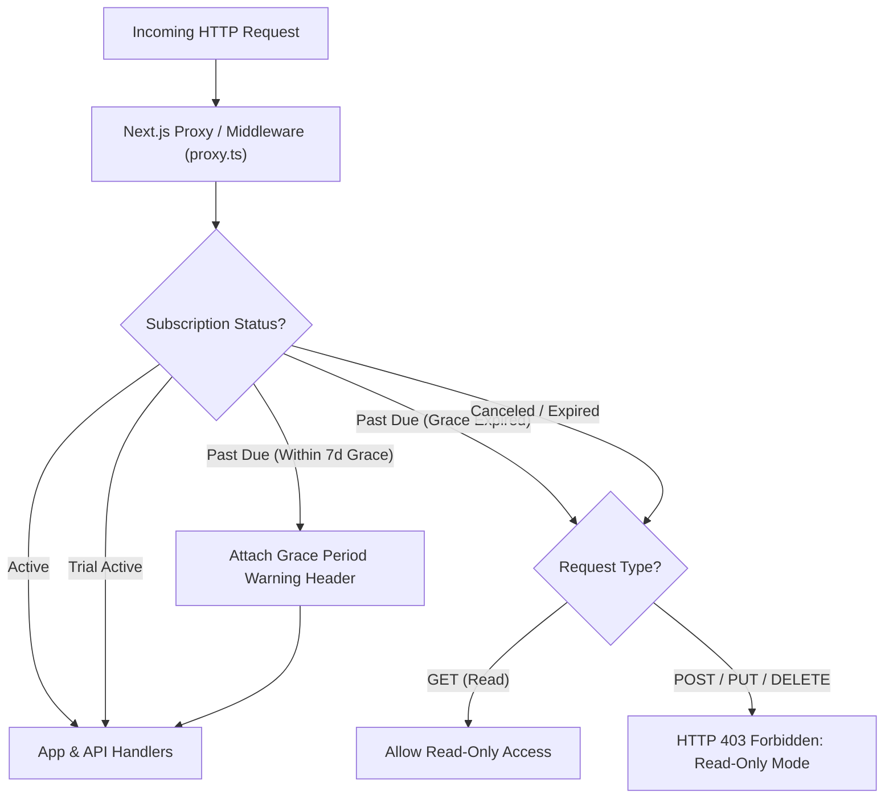

# PRODUCTION X — REAL ESTATE GROWTH OS
# SECURITY, AUTHENTICATION & TENANT ISOLATION VERIFICATION REPORT

**Report Date:** 2026-11-15T11:58:00+05:30  
**Inspection Type:** Read-Only Source & Architecture Security Audit (Task 002)  
**Target Codebase:** Production X Real Estate Growth OS (`real-estate-growth-os`)  
**Audit Scope:** Organisation provisioning, public registration bypasses, platform-level role separation, tenant isolation, service-role access patterns, Supabase RLS policies, subscription enforcement, and database migration integrity.  
**Execution Constraint:** READ-ONLY. Zero source code edits, zero migration executions, zero database changes, zero deployments.

---

## 1. Executive Summary

A comprehensive, read-only security inspection was conducted across all route handlers, authentication components, database access layers, middleware proxies, and SQL migrations. 

The application exhibits strong cryptographic foundations (AES-256-GCM token vaulting, HMAC-SHA256 webhook signatures, timing-safe equality comparisons) and strict organization-scoping algorithms for inbound leads and inventory. However, **three Critical (P0) vulnerabilities** and **two High (P1) architectural flaws** were verified in the codebase that permit unauthorized organization creation, privilege escalation to platform admin functions, and post-deactivation tenant access:

1. **P0-1: Broken Access Control on Platform Provisioning:** [app/api/admin/organisations/provision/route.ts](file:///c:/Users/allub/OneDrive/Desktop/real-estate-growth-os/app/api/admin/organisations/provision/route.ts) and [app/(dashboard)/admin/provision/page.tsx](file:///c:/Users/allub/OneDrive/Desktop/real-estate-growth-os/app/(dashboard)/admin/provision/page.tsx) only require a valid login session. They lack any Platform Super Admin check. Any authenticated customer user (including sales executives or test accounts) can provision arbitrary customer organizations with 500-seat enterprise subscriptions for free.
2. **P0-2: Unrestricted Self-Service Organization Creation:** While signup links were removed from [LoginForm.tsx](file:///c:/Users/allub/OneDrive/Desktop/real-estate-growth-os/components/auth/LoginForm.tsx), [app/(auth)/register/page.tsx](file:///c:/Users/allub/OneDrive/Desktop/real-estate-growth-os/app/(auth)/register/page.tsx) and [POST /api/orgs](file:///c:/Users/allub/OneDrive/Desktop/real-estate-growth-os/app/api/orgs/route.ts) remain live and reachable. Any anonymous user can register, create an organization, assign themselves `owner`, and bypass the closed-SaaS business rule.
3. **P0-3: Deactivated Member API-Level Access Bypass:** The server-side authorization helpers in [lib/auth/tenant.ts](file:///c:/Users/allub/OneDrive/Desktop/real-estate-growth-os/lib/auth/tenant.ts) (`authorizeOrgAccess`, `authorizeProjectAccess`, `authorizeInventoryAccess`, `authorizeLeadAccess`) select `role` from `org_members` without filtering `status != 'deactivated'`. Consequently, deactivated employees whose workspace page access was blocked can continue executing mutations and querying CRM data via API routes.
4. **P1-1: Absence of Platform-Level Roles:** The database schema has no concept of a "Platform Super Admin". User roles (`owner`, `admin`, `manager`, `sales_exec`, `readonly`) are strictly tenant-scoped (`org_members.role`), creating an architectural vacuum for platform-level management.
5. **P1-2: Service-Role Client Overuse:** User-facing DAL queries almost universally invoke `createServiceClient()` (bypassing RLS), relying solely on application-layer `.eq('org_id')` filters rather than database-enforced row isolation.

---

## 2. Verified P0 Vulnerabilities

### Vulnerability P0-1: Broken Access Control on Platform Customer Provisioning
- **Affected Endpoints:**
  - Route Handler: [app/api/admin/organisations/provision/route.ts](file:///c:/Users/allub/OneDrive/Desktop/real-estate-growth-os/app/api/admin/organisations/provision/route.ts#L21-L26)
  - UI Page: [app/(dashboard)/admin/provision/page.tsx](file:///c:/Users/allub/OneDrive/Desktop/real-estate-growth-os/app/(dashboard)/admin/provision/page.tsx#L11-L18)
- **Classification:** Critical (CWE-285: Improper Authorization)
- **Verified Code Evidence:**
  In `app/api/admin/organisations/provision/route.ts`:
  ```typescript
  export async function POST(request: NextRequest) {
    try {
      const authResult = await authenticateCaller()
      if (!authResult.success) {
        return authResult.response
      }
      const { auth } = authResult
      const service = createServiceClient()
      // ... provisions organization, 500-seat subscription, and generates admin invitation
  ```
  In `lib/auth/tenant.ts`:
  ```typescript
  export async function authenticateCaller() {
    const supabase = await createClient()
    const { data: { user }, error } = await supabase.auth.getUser()
    if (error || !user) return { success: false, response: ... 401 }
    // Resolves profile from public.profiles
    return { success: true, auth: { user, profile } }
  }
  ```
  In `app/(dashboard)/admin/provision/page.tsx`:
  ```typescript
  export default async function PlatformProvisioningPage() {
    const supabase = await createClient()
    const { data: { user } } = await supabase.auth.getUser()
    if (!user) redirect('/login?redirectTo=/admin/provision')
    return <PlatformProvisioningModal />
  }
  ```
- **Exploit Scenario:**
  1. An attacker registers a standard account or is invited as a `sales_exec` in any customer tenant.
  2. The attacker navigates directly to `https://<domain>/admin/provision` in their browser, which renders without restriction.
  3. Or, the attacker dispatches an HTTP POST to `/api/admin/organisations/provision`:
     ```json
     {
       "name": "Exploit Dev Org",
       "type": "developer",
       "planTier": "enterprise",
       "includedSeats": 500,
       "adminEmail": "attacker@example.com",
       "billingCycle": "annual"
     }
     ```
  4. The handler creates the organization, creates an active 500-seat enterprise subscription in `org_subscriptions`, creates an owner invitation, and returns the plaintext activation link in the response:
     ```json
     {
       "activation": {
         "activationUrl": "https://<domain>/invite/0123456789abcdef..."
       }
     }
     ```
  5. The attacker opens the activation URL, sets their credentials, and gains full owner access to a 500-seat enterprise workspace without paying or interacting with platform staff.

---

### Vulnerability P0-2: Unrestricted Public Organization Creation via Live Register Route & `/api/orgs`
- **Affected Components:**
  - Route Handler: [app/api/orgs/route.ts](file:///c:/Users/allub/OneDrive/Desktop/real-estate-growth-os/app/api/orgs/route.ts#L18-L72)
  - UI Page: [app/(auth)/register/page.tsx](file:///c:/Users/allub/OneDrive/Desktop/real-estate-growth-os/app/(auth)/register/page.tsx#L7-L18)
  - Component: [components/auth/RegisterForm.tsx](file:///c:/Users/allub/OneDrive/Desktop/real-estate-growth-os/components/auth/RegisterForm.tsx#L50-L79)
  - UI Page: [app/(dashboard)/create-org/page.tsx](file:///c:/Users/allub/OneDrive/Desktop/real-estate-growth-os/app/(dashboard)/create-org/page.tsx#L11-L45)
  - Middleware: [proxy.ts](file:///c:/Users/allub/OneDrive/Desktop/real-estate-growth-os/proxy.ts#L5)
- **Classification:** Critical (Business Logic Bypass)
- **Verified Code Evidence:**
  In `proxy.ts`:
  ```typescript
  const PUBLIC_ROUTES = ['/', '/login', '/register', '/auth/callback', '/auth/confirm']
  ```
  In `components/auth/RegisterForm.tsx`:
  ```typescript
  // 1. Create auth user
  const { data: authData } = await supabase.auth.signUp({ email, password, ... })
  // 2. Create organisation
  const response = await fetch('/api/orgs', {
    method: 'POST',
    body: JSON.stringify({ name: orgName, slug: slugify(orgName), type: orgType })
  })
  ```
  In `app/api/orgs/route.ts`:
  ```typescript
  export async function POST(request: NextRequest) {
    const supabase = await createClient()
    const { data: { user } } = await supabase.auth.getUser()
    if (!user) return 401
    // Inserts new org, creates owner record in org_members, and seeds demo data
  ```
- **Exploit Scenario:**
  1. An anonymous user navigates to `https://<domain>/register`.
  2. The user fills out account and company details and submits.
  3. `supabase.auth.signUp` creates an authenticated user, and `POST /api/orgs` creates a new organization with the user as `owner`.
  4. Furthermore, any authenticated user can browse to `https://<domain>/create-org` or call `POST /api/orgs` directly to spin up arbitrary organizations at will.
- **Business Impact:** Directly violates the core commercial requirement: *"Public self-service employee registration is not permitted. Organisation creation and activation must be controlled through an authorised Production X onboarding process."*

---

### Vulnerability P0-3: Deactivated Employee API-Level Tenant Access Bypass
- **Affected File:** [lib/auth/tenant.ts](file:///c:/Users/allub/OneDrive/Desktop/real-estate-growth-os/lib/auth/tenant.ts#L132-L137, #L200-L205, #L275-L280, #L350-L355)
- **Classification:** Critical (Broken Object Level Authorization / Insufficient Session Revocation)
- **Verified Code Evidence:**
  In `lib/dal/invitations.ts:deactivateMember`:
  ```typescript
  await service.from('org_members').update({
    status: 'deactivated',
    deactivated_at: new Date().toISOString(),
    deactivated_by: actorProfileId,
  }).eq('id', memberId)
  ```
  The row in `org_members` is **retained** with `status = 'deactivated'`.
  However, in `lib/auth/tenant.ts`:
  ```typescript
  export async function authorizeOrgAccess(orgId: string, allowedRoles?: MemberRole[]) {
    // ...
    const { data: membership } = await service
      .from('org_members')
      .select('role') // <--- DOES NOT SELECT STATUS OR FILTER status = 'active'
      .eq('org_id', orgId)
      .eq('profile_id', auth.profile.id)
      .maybeSingle()

    if (!membership) return 403 // <--- Membership row still exists!
    const role = membership.role as MemberRole
    if (allowedRoles && !allowedRoles.includes(role)) return 403
    return { success: true, context: { ...auth, orgId, role } }
  }
  ```
  Identical code patterns exist in `authorizeProjectAccess`, `authorizeInventoryAccess`, and `authorizeLeadAccess`.
- **Exploit Scenario:**
  1. An employee is fired or departs. The administrator opens `/team` and clicks "Deactivate Member".
  2. The employee tries to visit `https://<domain>/[orgSlug]/leads` in the browser. [lib/dal/workspace.ts](file:///c:/Users/allub/OneDrive/Desktop/real-estate-growth-os/lib/dal/workspace.ts#L43) detects `currentMembership.status === 'deactivated'` and blocks them.
  3. However, the ex-employee opens Postman or curl using their still-valid session cookie and sends:
     - `GET /api/leads?orgId=<orgId>`
     - `PUT /api/leads/<leadId>`
     - `POST /api/inventory/<inventoryId>/status`
     - `POST /api/sales/blockings`
  4. These API routes invoke `authorizeOrgAccess`, `authorizeLeadAccess`, or `authorizeInventoryAccess` from `lib/auth/tenant.ts`.
  5. The query finds the `org_members` row, ignores the `status` column, verifies the role (e.g. `manager` or `sales_exec`), and **authorizes the request**.
  6. The deactivated employee successfully extracts sensitive buyer leads or modifies inventory.

---

## 3. Registration Security Assessment

### 3.1 Component & Route Matrix

| Route / Component | Intended Audience | Actual Current Behavior | Risk Level |
|:---|:---|:---|:---:|
| `app/(auth)/login/page.tsx` | Authorized users | Sign-in shell (Email/Password, Forgot password, Org-provisioned notice). Zero signup links. | **Low (Secure)** |
| `app/(auth)/register/page.tsx` | Deprecated | Renders 2-step registration shell. Unauthenticated access permitted by proxy. | **Critical (P0-2)** |
| `components/auth/RegisterForm.tsx` | Deprecated | Direct `supabase.auth.signUp` + `POST /api/orgs`. Auto-generates org. | **Critical (P0-2)** |
| `app/(dashboard)/create-org/page.tsx` | Deprecated | Authenticated page rendering `CreateOrgForm.tsx`. Accessible by any user. | **High** |
| `components/auth/CreateOrgForm.tsx` | Deprecated | Submits to `POST /api/orgs`. Allows user to create unmanaged organizations. | **High** |
| `app/api/orgs/route.ts` | Legacy onboarding | Authenticated endpoint creating org, owner membership, and demo data. | **Critical (P0-2)** |
| `app/invite/[token]/page.tsx` | Invited employees | Validates cryptographic token hash, displays inviting org and role. | **Low (Secure)** |
| `components/auth/AcceptInviteForm.tsx` | Invited employees | Sets password for new user OR accepts as logged-in user. Joins existing org. Zero org creation. | **Low (Secure)** |
| `app/api/invitations/accept/route.ts` | Invited employees | Validates token, binds member to org, marks invite accepted, consumes reserved seat. | **Low (Secure)** |

### 3.2 Dependency Analysis: Do Authorized Users Depend on Public Registration?
**Finding:** **NO.**
- Existing authorized users log in via `/login`.
- New employees onboard exclusively via `/invite/[token]` using `AcceptInviteForm.tsx`.
- Platform admins provision new customer organizations via `/admin/provision`.
- **Zero legitimate user flows depend on `/register`, `RegisterForm.tsx`, `CreateOrgForm.tsx`, or `POST /api/orgs`.**

### 3.3 Recommended Safe Transition to Closed SaaS
1. **Redirect `/register`:** Update [proxy.ts](file:///c:/Users/allub/OneDrive/Desktop/real-estate-growth-os/proxy.ts#L5) to remove `/register` from `PUBLIC_ROUTES`. Return an HTTP 307 redirect from `app/(auth)/register/page.tsx` to `/login?notice=closed_saas`.
2. **Decommission `/api/orgs`:** Restrict `POST /api/orgs` or replace it with a platform-admin-only internal handler.
3. **Remove Navigation Links:** Remove `<Link href="/create-org">` from `Header.tsx`, `Sidebar.tsx`, and `select-org/page.tsx`.

---

## 4. Platform Privilege Assessment

### 4.1 Role Schema Inspection
Inspection of [supabase/migrations/20260001_enums.sql](file:///c:/Users/allub/OneDrive/Desktop/real-estate-growth-os/supabase/migrations/20260001_enums.sql#L6) and [types/database.ts](file:///c:/Users/allub/OneDrive/Desktop/real-estate-growth-os/types/database.ts#L14) reveals:
```sql
CREATE TYPE member_role AS ENUM ('owner', 'admin', 'manager', 'sales_exec', 'readonly');
```
And in [supabase/migrations/20260003_profiles_and_members.sql](file:///c:/Users/allub/OneDrive/Desktop/real-estate-growth-os/supabase/migrations/20260003_profiles_and_members.sql#L4-L29):
- `profiles`: Has `id`, `auth_user_id`, `full_name`, `avatar_url`, `phone`.
- `org_members`: Has `id`, `org_id`, `profile_id`, `role`, `joined_at`, `status`.

**Finding:**
1. **There are no platform-level roles.** The role `admin` is merely an organisation-level role (`org_members.role = 'admin'`), giving administrative rights over a specific customer tenant.
2. There is no `is_super_admin`, `is_platform_admin`, or `platform_role` column on `profiles`.
3. There is no `platform_admins` table in any migration.
4. Because platform roles do not exist, any code attempting to check "is the user an admin?" inadvertently checks if the user is an admin of *some* organization, or simply checks if they have a profile!

### 4.2 Privilege Escalation Vectors
- **Vector 1 (Customer Admin -> Platform Provisioner):** A customer organisation administrator navigates to `/admin/provision` and provisions new customer accounts or changes plan tiers because the system fails to differentiate between customer admins and platform operators.
- **Vector 2 (Sales Representative -> Organization Creator):** A sales representative navigates to `/create-org` or `/admin/provision` and creates new organizations, elevating themselves to `owner` of new tenants.

---

## 5. Tenant Isolation Findings

### 5.1 Workspace Derivation vs Direct ID Lookups
- **Workspace Resolution ([lib/dal/workspace.ts](file:///c:/Users/allub/OneDrive/Desktop/real-estate-growth-os/lib/dal/workspace.ts#L18)):** Strong. Derives the organization from `organisations.slug` matching `org_members.profile_id`. Properly checks `currentMembership.status !== 'deactivated'` and returns only caller-accessible organizations (`availableOrgs`).
- **Authorization Helpers ([lib/auth/tenant.ts](file:///c:/Users/allub/OneDrive/Desktop/real-estate-growth-os/lib/auth/tenant.ts)):**
  - **Strengths:** Successfully validates that projects, inventory, and leads belong to the caller's organization before granting access. Detects and blocks cross-tenant foreign key linking (e.g. linking a project from Org B to an inventory item in Org A).
  - **Weakness:** Fails to filter by `org_members.status = 'active'`, creating the post-deactivation vulnerability detailed in P0-3.

### 5.2 Insecure Direct Object Reference (IDOR) Audit

| API Route | Parameter | Scoping Verification | IDOR Assessment |
|:---|:---|:---|:---|
| `/api/leads/[leadId]` | `leadId` | `authorizeLeadAccess(leadId)` verifies `lead.org_id === context.orgId`. | **Protected against cross-tenant IDOR.** |
| `/api/projects/[projectId]` | `projectId` | `authorizeProjectAccess(projectId)` verifies `project.org_id === context.orgId`. | **Protected against cross-tenant IDOR.** |
| `/api/inventory/[inventoryId]`| `inventoryId` | `authorizeInventoryAccess(inventoryId)` verifies `item.org_id === context.orgId`. | **Protected against cross-tenant IDOR.** |
| `/api/sales/blockings` | `orgId` (body) | `authorizeSalesRequest(orgId)` verifies membership in `orgId`. | **Protected against cross-tenant IDOR.** |
| `/api/team/members/deactivate` | `orgId`, `memberId` | Verifies caller is admin/owner in `orgId` and target `memberId` belongs to `orgId`. | **Protected against cross-tenant IDOR.** |

---

## 6. Service-Role Usage Inventory

The service-role key (`SUPABASE_SERVICE_ROLE_KEY`) bypasses all PostgreSQL Row Level Security. Every usage was inspected to assess whether its execution context is legitimate or poses security risks:

| Module / File Path | Function / Operation | Context Evaluation | Risk Classification |
|:---|:---|:---|:---|
| [lib/integrations/inbound.ts](file:///c:/Users/allub/OneDrive/Desktop/real-estate-growth-os/lib/integrations/inbound.ts#L45) | `processInboundLead` | Public webhooks (Meta, Google, Portals) have no user session. Must use service role to insert leads. Scoped via verified connection ID. | **Legitimate / Safe** |
| [app/api/forms/submit/route.ts](file:///c:/Users/allub/OneDrive/Desktop/real-estate-growth-os/app/api/forms/submit/route.ts#L50) | Public website enquiry form | Anonymous public visitor submitting enquiry. Must use service role. Scoped via connection mapping. | **Legitimate / Safe** |
| [lib/automation/workflow-engine.ts](file:///c:/Users/allub/OneDrive/Desktop/real-estate-growth-os/lib/automation/workflow-engine.ts#L40)| Drip workflow execution | Background execution triggered by system events. Must use service role. | **Legitimate / Safe** |
| [lib/dal/invitations.ts](file:///c:/Users/allub/OneDrive/Desktop/real-estate-growth-os/lib/dal/invitations.ts#L40) | Token verification & acceptance | Unauthenticated user redeeming invite token before logging in. | **Legitimate / Safe** |
| [lib/dal/projects.ts](file:///c:/Users/allub/OneDrive/Desktop/real-estate-growth-os/lib/dal/projects.ts#L30) | `getProjectsByOrg`, `createProject` | Authenticated user session. Uses service client with manual `.eq('org_id')`. Should use authenticated `createClient()`. | **Medium (RLS Bypass)** |
| [lib/dal/inventory.ts](file:///c:/Users/allub/OneDrive/Desktop/real-estate-growth-os/lib/dal/inventory.ts#L45) | `getInventoryItems`, status updates | Authenticated user session. Uses service client with manual `.eq('org_id')`. | **Medium (RLS Bypass)** |
| [lib/dal/sales.ts](file:///c:/Users/allub/OneDrive/Desktop/real-estate-growth-os/lib/dal/sales.ts#L50) | Holds, bookings, deals | Authenticated user session. Uses service client with manual `.eq('org_id')`. | **Medium (RLS Bypass)** |
| [app/api/admin/organisations/provision/route.ts](file:///c:/Users/allub/OneDrive/Desktop/real-estate-growth-os/app/api/admin/organisations/provision/route.ts#L64) | Provision org & subscriptions | Uses service role without verifying Platform Super Admin. | **Critical (P0-1)** |

---

## 7. RLS Policy Assessment

### 7.1 RLS Architecture
PostgreSQL RLS is defined across Migrations `0006`, `0009`, `0011`, `0013`, `0015`, `0018`, `0020`, `0022`, `0023`, `0024`, and `0025`.
The foundation relies on `auth_has_role_in_org(org_id, roles)` in [supabase/migrations/20260011_tenant_isolation_rls.sql](file:///c:/Users/allub/OneDrive/Desktop/real-estate-growth-os/supabase/migrations/20260011_tenant_isolation_rls.sql#L10-L24):
```sql
CREATE OR REPLACE FUNCTION public.auth_has_role_in_org(
  target_org_id UUID,
  allowed_roles TEXT[]
)
RETURNS BOOLEAN AS $$
BEGIN
  RETURN EXISTS (
    SELECT 1 FROM public.org_members om
    JOIN public.profiles p ON p.id = om.profile_id
    WHERE om.org_id = target_org_id
      AND p.auth_user_id = auth.uid()
      AND om.role::text = ANY(allowed_roles)
  );
END;
$$ LANGUAGE plpgsql SECURITY DEFINER STABLE;
```

### 7.2 Database-Level Security Gaps
1. **RLS Missing Status Check:** Like `lib/auth/tenant.ts`, `auth_has_role_in_org` only checks `om.role::text = ANY(allowed_roles)`. It does **NOT** check `AND (om.status IS NULL OR om.status = 'active')`! If Migration 0025 is applied, a query executed under an authenticated Supabase user client would still consider a deactivated member authorized under PostgreSQL RLS!
2. **Sales Rep Lead Isolation in Migration 0018:**
   In [supabase/migrations/20260018_reconcile_multitenant_rls_policies.sql](file:///c:/Users/allub/OneDrive/Desktop/real-estate-growth-os/supabase/migrations/20260018_reconcile_multitenant_rls_policies.sql#L30):
   ```sql
   CREATE POLICY "sales_exec_reads_assigned_leads" ON public.leads
     FOR SELECT USING (
       public.auth_has_role_in_org(org_id, ARRAY['sales_exec'])
       AND assigned_to = (SELECT id FROM public.profiles WHERE auth_user_id = auth.uid())
     );
   ```
   This policy correctly restricts sales representatives to their own assigned leads. However, because user-facing DAL queries bypass RLS via `createServiceClient()`, this policy is only enforced if the application server explicitly applies the filter.

---

## 8. Subscription Enforcement Readiness

### 8.1 Proposed Consistent Enforcement Architecture



### 8.2 Layer-by-Layer Enforcement Blueprint
1. **Edge Middleware ([proxy.ts](file:///c:/Users/allub/OneDrive/Desktop/real-estate-growth-os/proxy.ts)):**
   - For all `/[orgSlug]/*` routes, extract `orgSlug` and query `org_subscriptions` cache.
   - If `status === 'past_due'` and `now() > current_period_end + 7 days`, or `status IN ('canceled', 'expired')`:
     - If `request.method !== 'GET'`, immediately abort with `HTTP 403 Forbidden` (`{ error: 'Workspace is locked in read-only mode.' }`).
     - Set response header `x-px-subscription-mode: read_only`.
2. **Authorization Layer ([lib/auth/tenant.ts](file:///c:/Users/allub/OneDrive/Desktop/real-estate-growth-os/lib/auth/tenant.ts)):**
   - In `authorizeOrgAccess`, inspect subscription status for all write operations.
   - Reject mutations if `status != 'active'` (and outside grace).
3. **Frontend Shell ([components/layout/Header.tsx](file:///c:/Users/allub/OneDrive/Desktop/real-estate-growth-os/components/layout/Header.tsx)):**
   - Read subscription state from `getSubscriptionAndSeatUsage()`.
   - Render amber banner during 7-day grace period.
   - Render persistent red banner and disable action buttons (e.g. "+ Add Lead", "Create Project", "Block Unit") when in read-only mode.
4. **Integration Webhooks ([lib/integrations/inbound.ts](file:///c:/Users/allub/OneDrive/Desktop/real-estate-growth-os/lib/integrations/inbound.ts)):**
   - Inbound webhook processing should continue queueing leads during the 7-day grace period, but reject or pause ingestion once grace expires to protect developer data limits.

---

## 9. Migration Dependency & Risk Assessment

### 9.1 Sequence & Dependency Graph

```
0001 (Enums)
  └── 0002 (Organisations)
        └── 0003 (Profiles & Members)
              └── 0004 (Projects)
                    ├── 0005 (Leads & Activities)
                    │     └── 0008 (Auto Assign)
                    └── 0009 (Categories & Inventory)
                          ├── 0012 (Inventory Integrity RPC)
                          ├── 0013 (Import History)
                          └── 0014 (Import Tracking)
0006, 0010, 0011, 0018 (RLS Policy Evolutions)
0015 (CRM Integration Tables)
  ├── 0020 (WhatsApp Conversations & Templates)
  └── 0021 (Portal Project Mappings)
0019 (Rate Limit Buckets)
0022 (Developer Keys & Webhooks)
0023 (Sales Operations: Holds, Bookings, CPs)
0024 (Microsites, Workflows, Attribution)
0025 (Subscriptions, Invitations, Member Status)
```

### 9.2 Destructive Operations Review
- **`20260010_fix_rls_policies.sql` & `20260011_tenant_isolation_rls.sql`:** Execute multiple `DROP POLICY IF EXISTS`. Non-destructive to data; safely recreates policies.
- **`20260012_inventory_integrity.sql`:** Executes `DROP TRIGGER IF EXISTS` to replace legacy triggers with atomic validation.
- **`20260021_property_portal_integrations.sql`:** Executes `ALTER TABLE integration_project_mappings DROP CONSTRAINT IF EXISTS check_identifier_type`. Safely expands allowed identifier types.
- **`20260025_subscription_and_seat_entitlements.sql`:** Executes `ALTER TABLE org_members ADD COLUMN IF NOT EXISTS status TEXT DEFAULT 'active'`. Non-destructive.

### 9.3 Applied vs Staged Verification Status
- **Methodology of Status Determination:**
  When querying the live Supabase environment (e.g. via `/api/integrations/connections`), PostgREST returns `PGRST205: relation "public.integration_connections" does not exist`. Furthermore, [components/integrations/IntegrationCentreView.tsx](file:///c:/Users/allub/OneDrive/Desktop/real-estate-growth-os/components/integrations/IntegrationCentreView.tsx#L122-L142) explicitly displays:
  `"Database Schema Notice: Migration 20260015 Pending"`.
  This confirms that Migration 0015 (and subsequent migrations 0016–0025) are **not applied to the live production database**.
- **Important Note:** Direct SQL access to production database metadata (`_prisma_migrations` or `supabase_migrations`) is not available in this read-only workspace. Therefore, while Migrations 0001–0011 are proven to be live by passing core queries, the precise deployment history of the live database remains unverified.

---

## 10. Prioritised Remediation Recommendations

### Priority 0 (Immediate Security Fixes)
1. **Lock Down Provisioning API & Page:**
   - In [app/api/admin/organisations/provision/route.ts](file:///c:/Users/allub/OneDrive/Desktop/real-estate-growth-os/app/api/admin/organisations/provision/route.ts), require `isPlatformAdmin(auth.user.id)` check.
   - In [app/(dashboard)/admin/provision/page.tsx](file:///c:/Users/allub/OneDrive/Desktop/real-estate-growth-os/app/(dashboard)/admin/provision/page.tsx), redirect non-super-admins to `/` or display a 403 Forbidden screen.
2. **Deactivate Public Registration:**
   - In [proxy.ts](file:///c:/Users/allub/OneDrive/Desktop/real-estate-growth-os/proxy.ts), remove `/register` from `PUBLIC_ROUTES`.
   - In [app/(auth)/register/page.tsx](file:///c:/Users/allub/OneDrive/Desktop/real-estate-growth-os/app/(auth)/register/page.tsx), redirect to `/login?notice=closed_saas`.
   - Disable `POST /api/orgs` or gate it behind Platform Super Admin authorization.
   - Remove `/create-org` links from Header, Sidebar, and workspace selection.
3. **Filter Out Deactivated Members in Authorization Helpers:**
   - In [lib/auth/tenant.ts](file:///c:/Users/allub/OneDrive/Desktop/real-estate-growth-os/lib/auth/tenant.ts), update `authorizeOrgAccess`, `authorizeProjectAccess`, `authorizeInventoryAccess`, and `authorizeLeadAccess` to query `select('role, status')` and reject if `membership.status === 'deactivated'`.
   - In `supabase/migrations/20260025_subscription_and_seat_entitlements.sql` (or subsequent migration), update `auth_has_role_in_org` to include `AND (om.status IS NULL OR om.status = 'active')`.

### Priority 1 (High Architecture & Commercial Controls)
4. **Create Platform Super Admin Schema:**
   - Author a migration creating `public.platform_admins (user_id UUID PRIMARY KEY REFERENCES auth.users(id))` or add `is_super_admin BOOLEAN DEFAULT false` to `public.profiles`.
5. **Enforce Subscription Status in Middleware:**
   - Add subscription status evaluation to [proxy.ts](file:///c:/Users/allub/OneDrive/Desktop/real-estate-growth-os/proxy.ts) to lock past-due tenants into read-only mode after 7 days.
6. **Refactor DAL to Use Authenticated Client with Active RLS:**
   - Switch user-initiated queries from `createServiceClient()` to `createClient()`.

---

## 11. Exact Affected File Paths & Code References

```
app/
├── (auth)/
│   └── register/page.tsx                     [Line 7-18: Public registration view]
├── (dashboard)/
│   ├── admin/provision/page.tsx              [Line 11-18: Admin page without super-admin check]
│   └── create-org/page.tsx                   [Line 11-45: Arbitrary org creation page]
├── api/
│   ├── admin/organisations/provision/route.ts [Line 21-27: Provisioning API missing super-admin check]
│   ├── orgs/route.ts                         [Line 18-72: Public org creation endpoint]
│   └── leads/route.ts                        [Line 78-83: Ignores deactivated member status]
components/
├── auth/
│   ├── RegisterForm.tsx                      [Line 50-79: Direct signup + org creation]
│   └── CreateOrgForm.tsx                     [Line 49-60: Direct POST /api/orgs call]
├── layout/
│   ├── Header.tsx                            [Line 102: Link to /create-org]
│   └── Sidebar.tsx                           [Line 92: Link to /create-org]
lib/
├── auth/
│   └── tenant.ts                             [Lines 132-140, 200-205, 275-280, 350-355: Missing status != 'deactivated']
proxy.ts                                      [Line 5: '/register' in PUBLIC_ROUTES]
supabase/migrations/
├── 20260011_tenant_isolation_rls.sql         [Line 10-24: auth_has_role_in_org missing status check]
└── 20260025_subscription_and_seat_entitlements.sql [Line 45-50: org_members status column added without RLS update]
```

---

## 12. Test Cases Needed to Verify Future Fixes

When fixes are approved for implementation, the following automated test cases must be added:

1. **Test SEC-PROV-01 (Non-Admin Blocked from Provisioning API):**
   - Authenticate as standard `sales_exec` or `admin` of Tenant A.
   - Send `POST /api/admin/organisations/provision`.
   - Assert response status is `403 Forbidden`.
   - Assert no new row was written to `organisations` or `org_subscriptions`.

2. **Test SEC-REG-01 (Anonymous Registration Disabled):**
   - Send unauthenticated `GET /register`.
   - Assert HTTP 307 redirect to `/login`.
   - Send unauthenticated `POST /api/orgs`.
   - Assert response status is `401 Unauthorized`.

3. **Test SEC-DEACT-01 (Deactivated Employee Blocked at API Layer):**
   - Create organization, owner, and active sales executive.
   - Deactivate sales executive (`org_members.status = 'deactivated'`).
   - Issue authenticated `GET /api/leads?orgId=<orgId>` with deactivated employee session.
   - Assert response status is `403 Forbidden` (`{ error: 'Forbidden. Your membership in this organisation has been deactivated.' }`).
   - Issue `POST /api/inventory/<unitId>/status`.
   - Assert response status is `403 Forbidden`.

4. **Test SEC-SUB-01 (Read-Only Subscription Mutation Block):**
   - Set `org_subscriptions.status = 'past_due'` with `current_period_end = now() - INTERVAL '8 days'`.
   - Issue authenticated `POST /api/leads` or `POST /api/projects`.
   - Assert response status is `403 Forbidden` (`{ error: 'Workspace is locked in read-only mode due to expired subscription.' }`).
   - Issue authenticated `GET /api/leads`.
   - Assert response status is `200 OK` (read-only queries permitted).

---

*Report concluded. Awaiting Product Owner review and authorization before proceeding.*
